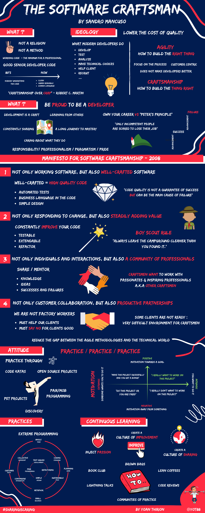

# Artisanat <mark>logiciel</mark>

Se comporter en professionnel, assumer la qualité, progresser en permanence.

---

Connexion · 1' seul, 2' en binôme

# 3 mots / idées

Notez **3 mots ou idées** que vous associez à *Artisanat logiciel* / *Software Craftsmanship*.

1. 1 minute en individuel
2. 2 minutes en binôme
3. Mise en commun visuelle

### Débrief guidé

Regroupons les mots sous 4 familles :

QualitéProfessionnalismeExcellence techniqueApprentissage continu

---
layout: center
---

---

Pratique concrète · en petits groupes · 15'

# Craft ou pas Craft ?

Pour chacune des 5 situations de l'atelier :

1. En quoi ce comportement est-il **désaligné** avec l'artisanat logiciel ?
2. Quel serait le comportement **Craft** ?
3. Quelles **pratiques concrètes** mettre en place ?

| # | Situation                          |
|---|------------------------------------|
| 1 | Le pipeline rouge "temporairement" |
| 2 | Les tests qui "ralentissent"       |
| 3 | La refacto qu'on repousse          |
| 4 | Code Review express                |
| 5 | "Ça marche en prod"                |

<Exercise path="01.craft/exercices/craft-ou-pas-craft" />

---

Craft ou pas Craft ? · débrief

# Faire émerger les pratiques

- TDD
- Refactoring continu
- Clean Code
- Pair Programming
- Code Review exigeante
- CI/CD robuste
- Ownership produit
- Documentation vivante

> "Si c'était un produit artisanal, à quoi verrait-on la différence ?"

- Lisibilité du code
- Tests explicites
- Architecture intentionnelle
- Dette technique maîtrisée
- Feedback rapide

---

Conclusions · synthèse collective · 10'

# Revenons à nos 3 mots

> "Après cette session, changeriez-vous un ou plusieurs de vos 3 mots ?"

### L'artisanat logiciel, ce n'est pas

- Faire du code parfait
- Être élitiste
- Être dogmatique

### C'est

- Se comporter en professionnel
- Assumer la qualité
- Progresser en permanence
- Construire avec fierté

---
layout: statement
---

# Le Craft à l'heure de l'<mark>IA</mark>

D'après l'article de Sandro Mancuso, [Software Craftsmanship in the AI Era](https://www.codurance.com/publications/software-craftsmanship-in-the-ai-era).

---

Le Craft à l'heure de l'IA

# Vitesse ≠ productivité

### L'IA change la façon de coder...

- Copilot, ChatGPT, Claude produisent du code très vite
- ... mais pas ce que "bien coder" veut dire
- Le vrai enjeu : le logiciel est-il **correct, maintenable et aligné avec le besoin** ?

### La productivité est une propriété du système

- Produire plus vite peut **augmenter les bugs, la dette et les régressions**
- Productivité = livrer des **changements sûrs, compréhensibles et faciles à faire évoluer**
- Sans bonnes pratiques, l'IA **accélère surtout le chaos**

---

Le Craft à l'heure de l'IA

# On passe notre temps à comprendre, pas à taper

Moins de **25 %** du temps sert à écrire du code. Le reste :

- lire du code
- comprendre le système
- analyser des bugs
- discuter du besoin

Si le code est mal structuré, **l'IA n'aide pas : elle empire le problème**.

### Ce qui rend un code difficile à comprendre

- Mauvaise modularisation
- Noms flous ou incohérents
- Complexité excessive
- Peu ou pas de tests utiles
- Tests mauvais ou verbeux
- Duplication de logique

L'IA génère plus de code, mais **ne corrige aucun de ces problèmes**.

---

Le Craft à l'heure de l'IA

# Un mauvais code engendre plus de mauvais code

### Du langage flou au code précis... souvent mal

- Les humains écrivent des **prompts vagues**
- L'IA s'appuie sur un **code existant souvent mal conçu**
- Elle **reproduit et amplifie les mauvais patterns** : grosses classes, duplications, abstractions manquantes

### La perte de compréhension s'accélère

- Le développeur **n'a pas fait l'effort mental** de conception
- Il ne comprend parfois pas ce qu'il a "écrit"
- La connaissance n'est plus dans les têtes, mais "dans l'outil"
- Le système devient une **boîte noire** pour l'équipe

---

Le Craft à l'heure de l'IA

# Revues, sémantique et tests

### Les revues de code cassent

- PR énormes, complexes, impossibles à revoir sérieusement
- Les reviewers survolent ou valident sans comprendre
- Le Craft recommande : **petits changements, bien délimités et compréhensibles**

### Le vrai danger : la perte de sémantique

Sans structure claire (DDD, modules, bons noms), l'IA introduit du **drift sémantique**. Le système fonctionne... mais **n'a plus de sens**.

### Les tests : danger ou opportunité

Générer le code puis les tests avec l'IA :

> Les tests deviennent une **validation de bugs**, pas une aide au design.

Bien utilisée, l'IA peut aider à faire du **TDD guidé par le sens**. Les tests redeviennent une **spécification** et un **outil de conception**.

---
layout: statement
---

# AI is the <mark>engine</mark>. Craftsmanship is the <mark>compass</mark>.

Sans craftsmanship, on va vite... mais dans la mauvaise direction. Avec, on va plus vite **et** on construit quelque chose de durable.

---

Ressources

# Pour aller plus loin

- [Software Craftsmanship in the AI Era](https://www.codurance.com/publications/software-craftsmanship-in-the-ai-era), Sandro Mancuso
- [Livre "Software Craft : TDD, Clean Code et autres pratiques essentielles"](https://www.dunod.com/sciences-techniques/software-craft-tdd-clean-code-et-autres-pratiques-essentielles-0)
- [Chaîne YouTube "Artisan Développeur"](https://www.youtube.com/@artisandeveloppeur)
- [Livre "The Pragmatic Programmer"](https://pragprog.com/titles/tpp20/the-pragmatic-programmer-20th-anniversary-edition/)

<Exercise path="01.craft/resources/The Software Craftsman.pdf" tag="Infographie" />
