# Et si on parlait <mark>qualité</mark> ?

Comment sait-on qu'un logiciel est de qualité ?

---

Connexion · 3' seul, 5' en groupe de 3, 5' en commun

# Le dashboard du CTO

> Imagine que tu es CTO. Tu dois prouver au CEO que ton logiciel est de qualité.
> **Quels indicateurs mets-tu dans ton dashboard ?**

1. **Individuel** : liste tes indicateurs
2. **En groupe de 3** : mise en commun, fusion des idées, choix de **5 indicateurs maximum**
3. **Mise en commun** : on regroupe au tableau par catégories

VitesseBugsTestsIncidentsSatisfaction utilisateur / impact business

> "Est-ce que toutes ces métriques mesurent vraiment la qualité ? Ou seulement une partie ?"

---

Concepts · les couches de la qualité

# Les dimensions de la qualité

### Qualité interne

- Lisibilité du code
- Maintenabilité
- Modularité
- Complexité
- Dette technique
- Testabilité

### Qualité externe

- Fiabilité
- Performance
- Sécurité
- UX / UI
- Compatibilité

### Qualité perçue

- Satisfaction utilisateur
- Confiance
- Stabilité ressentie

> La qualité ne se limite pas aux bugs : c'est un système mesurable à plusieurs niveaux.

---

Concepts · mesurer la performance organisationnelle

# Accelerate

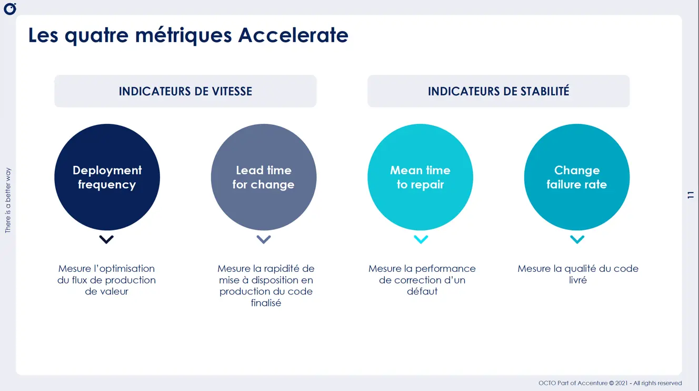

---
layout: center
---

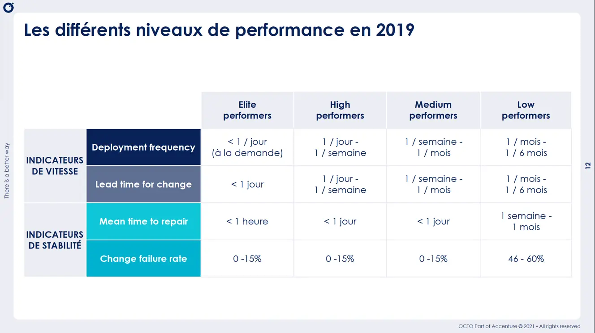

---
layout: center
---

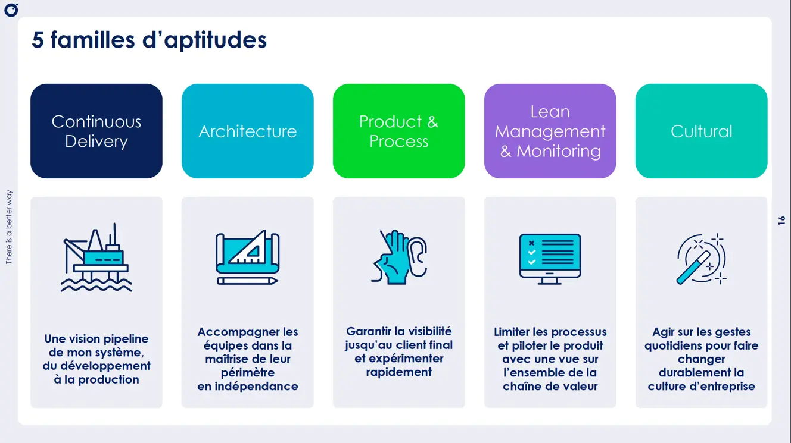

---
layout: center
---

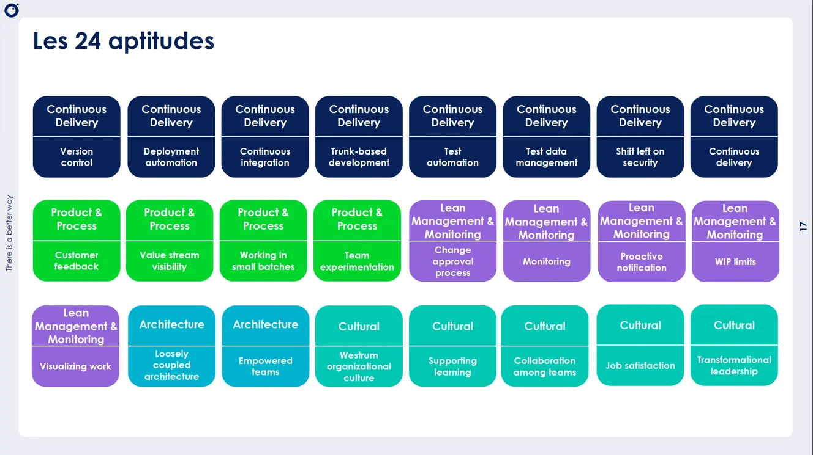

---
layout: center
---

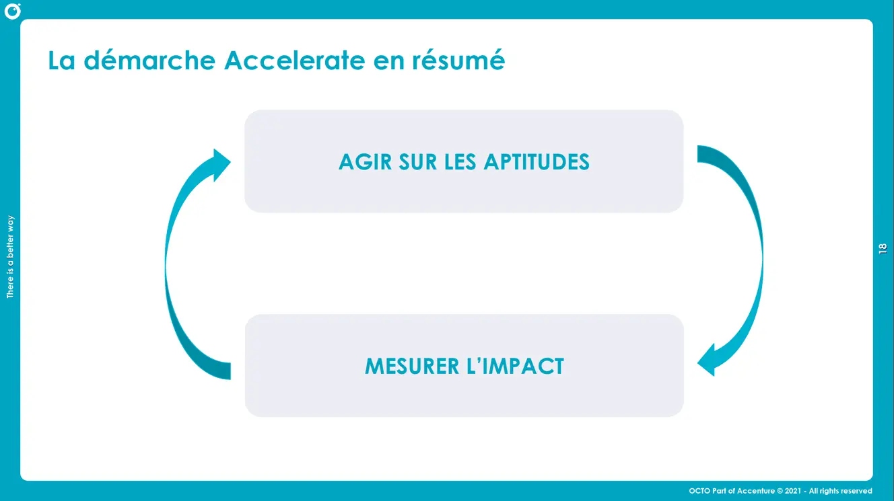

---
layout: center
---

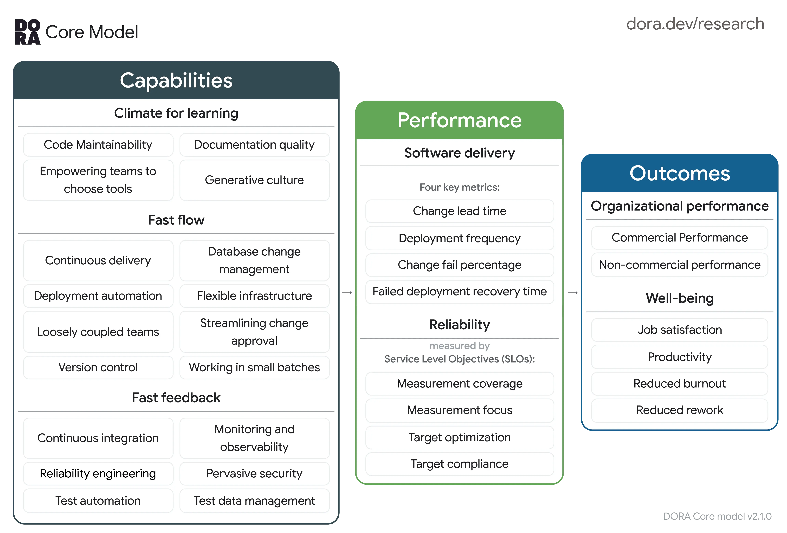

---

Concepts · garantir la qualité

# Du Waterfall à XP

<a href="https://martinfowler.com/bliki/WaterfallProcess.html" target="_blank">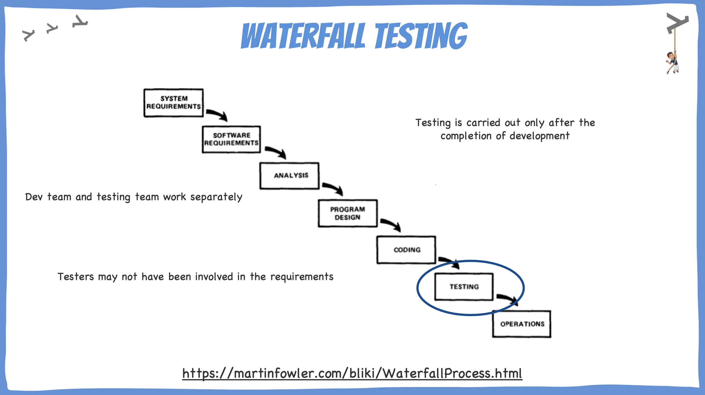</a>

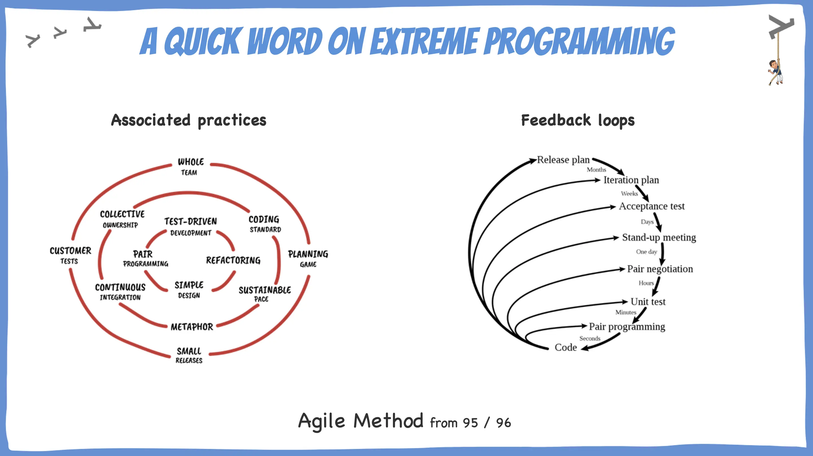

---
layout: center
---

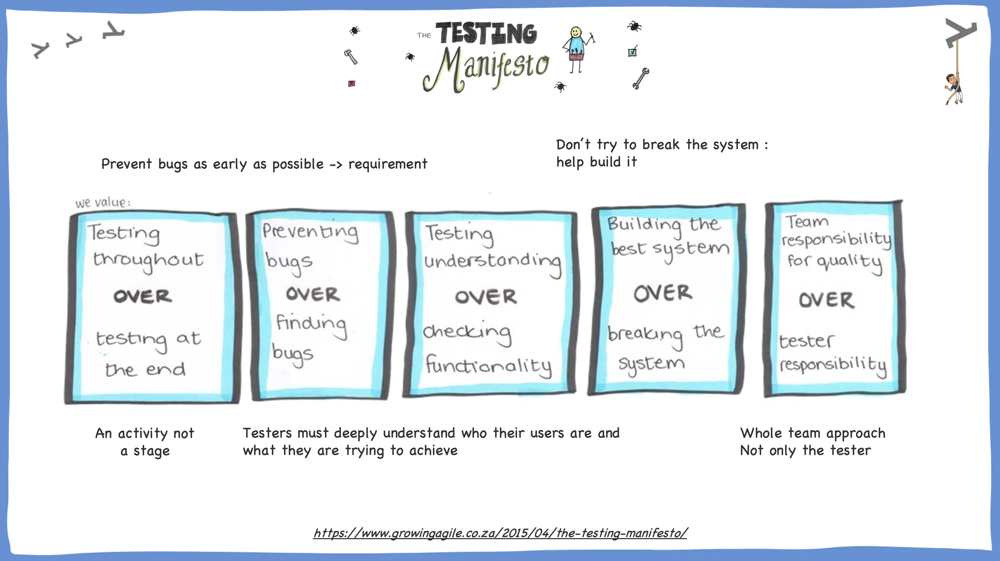

---

Concepts · garantir la qualité

# Agile testing

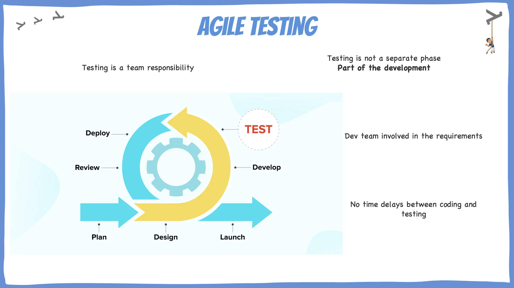

- Le test commence **dès la définition du besoin**
- Responsabilité **collective**
- Collaboration `PO` / `Dev` / `QA`
- Le test comme **activité continue**

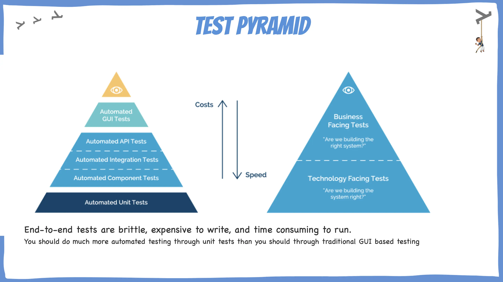

---

Concepts · garantir la qualité

# Les quadrants de test

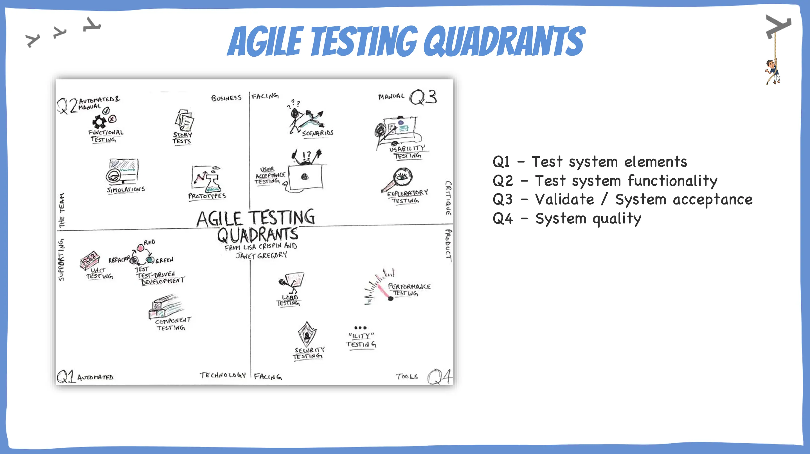

| Quadrant | Rôle                                   | Exemples                                     |
|----------|----------------------------------------|----------------------------------------------|
| Q1       | Tests techniques supportant le dev     | Unitaires, intégration                       |
| Q2       | Tests business supportant le dev       | BDD, tests d'acceptation, exemples concrets  |
| Q3       | Tests business critiquant le produit   | Exploratoire, UAT, feedback utilisateur      |
| Q4       | Tests techniques critiquant le produit | Performance, sécurité, robustesse            |

> Tous les tests ne servent pas la même finalité.

---
layout: center
---

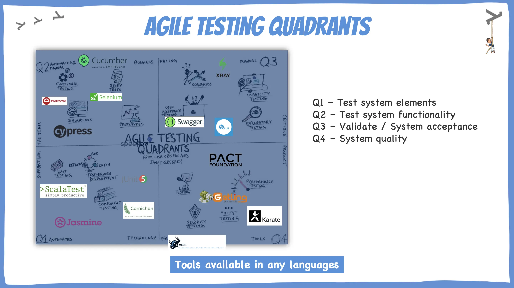

---

Concepts

# Les limites des métriques classiques

- Couverture de code **≠** qualité
- Nombre de bugs **≠** maturité
- Story points **≠** valeur

> **Que se passe-t-il quand on optimise une mauvaise métrique ?**

Voir la [loi de Goodhart](https://fr.wikipedia.org/wiki/Loi_de_Goodhart) et l'[effet Cobra](https://fr.wikipedia.org/wiki/Effet_cobra).

---

Pratique concrète · en groupe

# 50 nuances de tests

On travaille sur une application de **Yams** en ligne : lancer 5 dés, garder certains dés, scorer des combinaisons. L'application expose une API REST et persiste les scores en base.

Pour chaque snippet de test :

1. Identifiez le **type de test**
2. **Justifiez** votre réponse (dépendances, périmètre, rapidité, place dans la pyramide)

<Exercise path="02.code-quality/exercices/identifier-les-tests" />

---

Conclusions · seul, puis en binôme

# Et dans mon contexte ?

Au vu de ce que nous venons de voir :

- Qu'est-ce qui ferait sens d'**expérimenter** ou d'introduire dans mon contexte ?
- Quelle est la **première action** que je peux lancer pour tendre vers un mieux ?

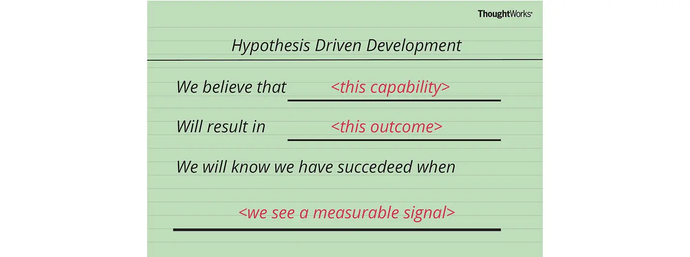

---

Ressources

# Pour aller plus loin

- [Livre Accelerate](https://itrevolution.com/product/accelerate/) · [DORA](https://dora.dev/)
- [The practical test pyramid](https://martinfowler.com/articles/practical-test-pyramid.html)
- [Integration test : Narrow vs Broad](https://martinfowler.com/bliki/IntegrationTest.html)
- [Test Desiderata par Kent Beck](https://testdesiderata.com/)
- [Loi de Goodhart](https://fr.wikipedia.org/wiki/Loi_de_Goodhart) · [Effet Cobra](https://fr.wikipedia.org/wiki/Effet_cobra)
