# Pair Programming
## Pour ou contre ?
En solo, listez tous les avantages et inconvénients que vous associez au `Pair Programming`.

Mettez en commun vos réponses avec le reste du groupe.

## Qu'est-ce que le Pair Programming ?

[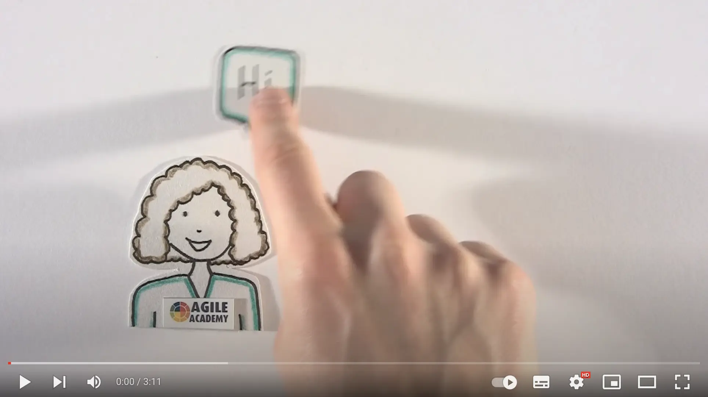](https://youtu.be/ET3Q6zNK3Io)

Après la vidéo :
- Qu'avez-vous observé ?
- Qu'en pensez-vous ?
- Quels sont les 2 rôles présentés ?

  
Avantages / Inconvénients

| Avantages                                             | Inconvénients            |
|-------------------------------------------------------|--------------------------|
| Partage instantané des bonnes pratiques et du savoir  | Fatiguant                |
| Meilleure conception / meilleure qualité de code      | Peut créer des frictions |
| Moins d'erreurs                                       |                          |
| Intégration plus rapide des nouveaux membres          |                          |
| Augmente le moral / la confiance                      |                          |
| Renforce la cohésion d'équipe / l'ownership collectif |                          |
| Code reviews instantanées (boucle de feedback courte) |                          |

### Ce que ce n'est pas

Ce n'est pas une personne qui dort pendant qu'une autre travaille.

### Quand le Pair Programming est utile

- Améliorer l'efficacité
- Développer les compétences techniques
- Faciliter le transfert de connaissance
- Améliorer la communication
- Renforcer les capacités de résolution de problèmes
- Simplifier la base de code existante

### Les différents styles

Plus de détails [ici](https://www.drovio.com/blog/the-different-styles-of-pair-programming/).

#### Driver-Navigator
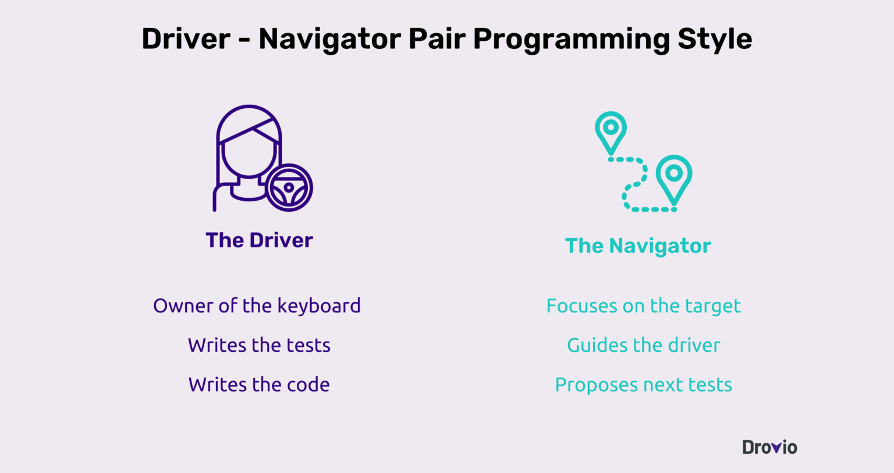

> Quand changer de rôle ?

#### Strong Style
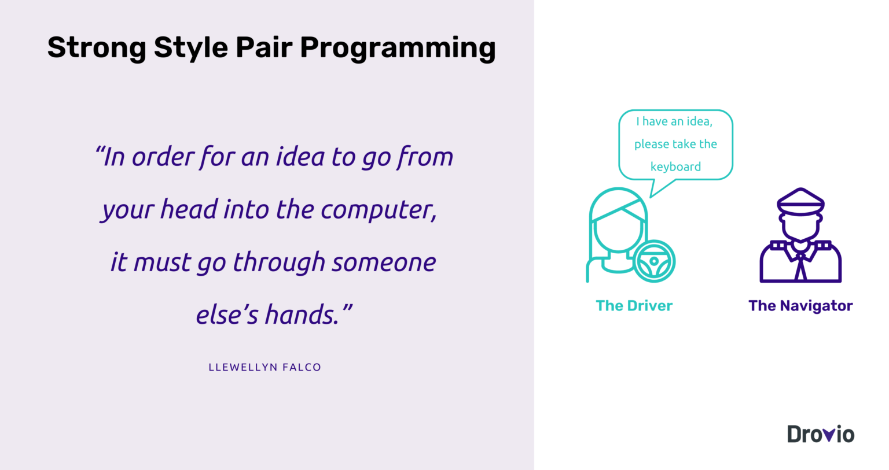

#### Ping-Pong
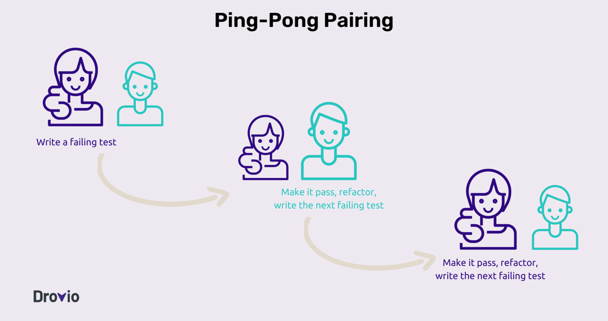

#### Unstructured
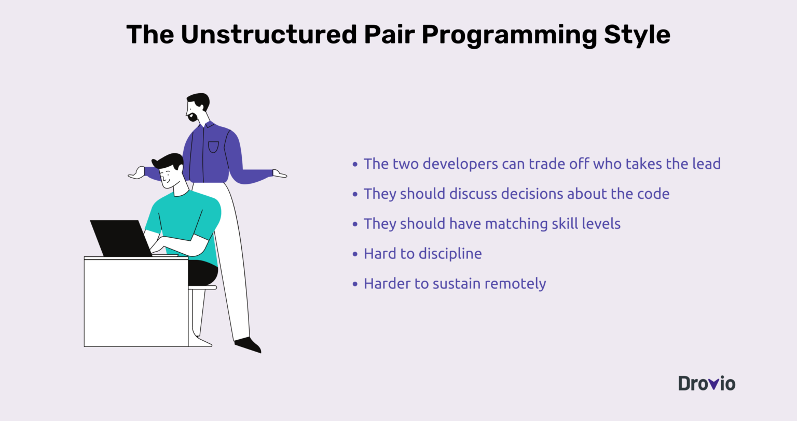

#### Backseat Navigator
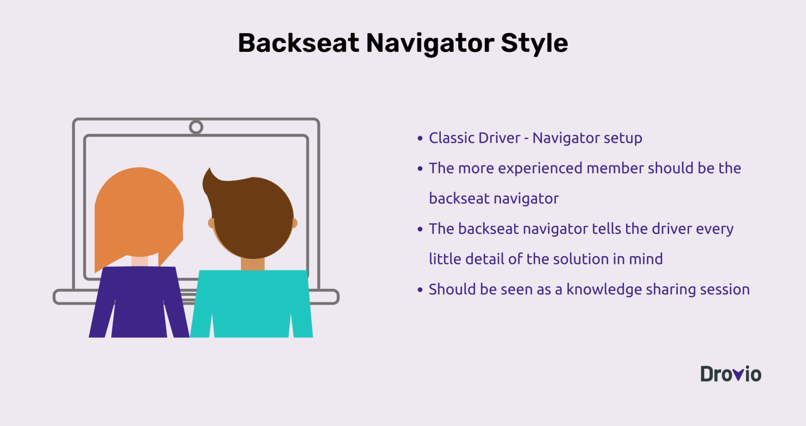

#### Tour Guide
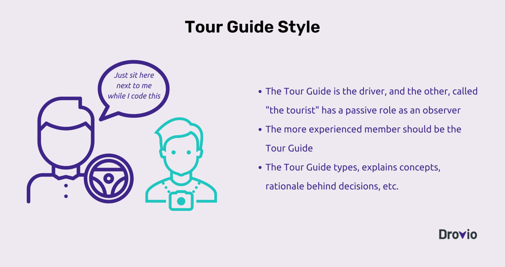

> Pour démarrer, utilisez un minuteur.

### Le coût du Pair Programming

[The Costs and Benefits of Pair Programming — Alistair Cockburn & Laurie Williams](https://www.researchgate.net/publication/2333697_The_Costs_and_Benefits_of_Pair_Programming)

Le coût de développement est d'environ `15% plus élevé`...

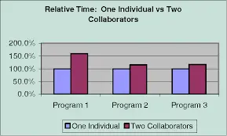

> MAIS compensé par :

- Des phases de test plus courtes et moins coûteuses
- Une meilleure assurance qualité

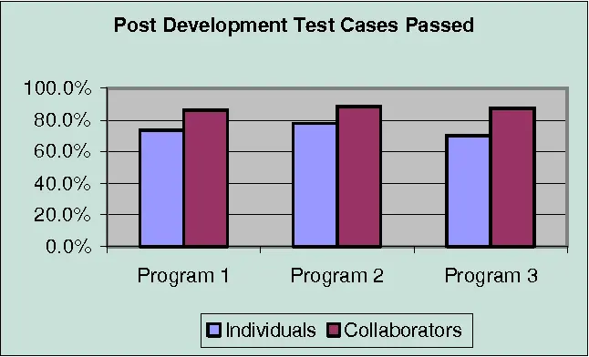

- Un code moins complexe / une meilleure qualité
- Moins de support en production

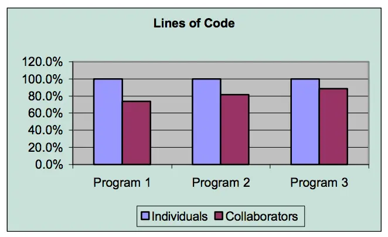

### Bonnes pratiques

- **Prendre des notes**
  - Points de décision
  - Avantages / inconvénients
- **Construire la confiance**
  - `Committer` souvent
  - Écrire des tests unitaires de qualité
- **Communiquer — sans violence**
  - Pour proposer une idée : *"Je pense que..."*
  - Pour confirmer un accord : *"On est d'accord pour dire que..."*
  - Pour évoquer la progression : *"On a décidé que..."*
  - Éviter de dire "Non" / "Mais"
    - Essayez plutôt : *"Oui, et..."*
  - Si vous n'êtes pas d'accord : *"Qu'est-ce qu'il faudrait pour te convaincre ?"*
- **Prendre du recul**
  - En fin de session
  - Mini-rétro : qu'avons-nous appris, qu'est-ce qui peut être amélioré ?
- **Vider sa tasse**
  - Comme dans les arts martiaux, videz votre esprit
  - Soyez prêt à apprendre
  - Soyez humble

## Yatzy

- Trouvez un binôme
  - Découvrez ensemble le code et les règles du `Yatzy` [ici](yatzy/YATZY.md)
  - Choisissez un langage de programmation
- Faites 2 itérations de 30 minutes
  - 25 minutes de code
  - 5 minutes de rétrospective

> Utilisez la carte "reflect"

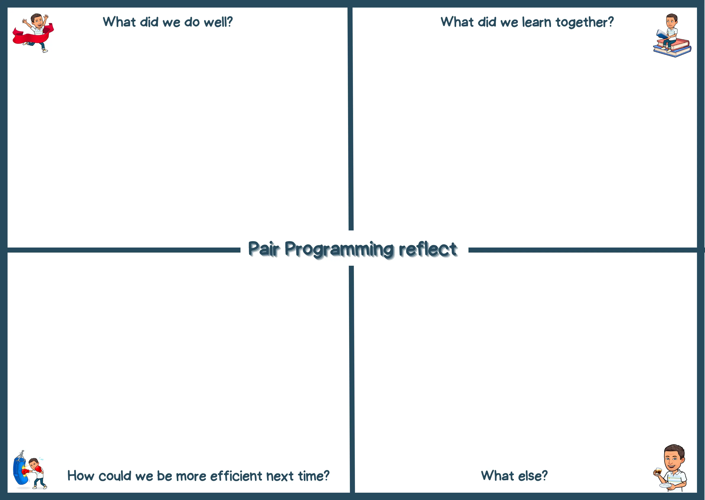

- Changez de binôme à chaque itération
- Utilisez le style `Strong Style`
  - Utilisez un minuteur : 5 minutes pour commencer, puis adaptez si nécessaire

## Conclusion

- Qu'avez-vous fait plus vite qu'à l'habitude en pair ?
- Qu'avez-vous fait plus lentement qu'à l'habitude en pair ?
- Comment s'est passée la communication ?
- Quels autres avantages ou inconvénients avez-vous découverts pendant cet atelier ?

### Comment se lancer ?

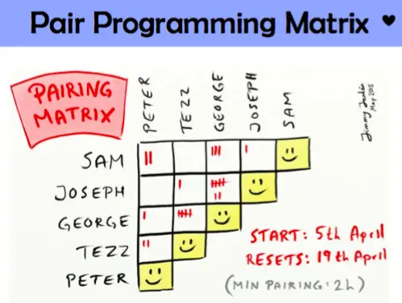

> Le Pair Programming vous aide à identifier vos angles morts.

## Ressources

- [The Different Styles of Pair Programming — Drovio](https://www.drovio.com/blog/the-different-styles-of-pair-programming/)
- [The Costs and Benefits of Pair Programming — Cockburn & Williams](https://www.researchgate.net/publication/2333697_The_Costs_and_Benefits_of_Pair_Programming)
- [Livre "Software Craft - TDD, Clean Code et autres pratiques essentielles"](https://www.dunod.com/sciences-techniques/software-craft-tdd-clean-code-et-autres-pratiques-essentielles-0)
