# Pair <mark>Programming</mark>

Deux personnes, un seul clavier, et des angles morts qui disparaissent.

---

Connexion · seul, puis en groupe

# Pour ou contre ?

En solo, listez tous les **avantages** et **inconvénients** que vous associez au `Pair Programming`.

Mettez ensuite en commun vos réponses avec le reste du groupe.

---

Concepts

# Qu'est-ce que le Pair Programming ?

<a href="https://youtu.be/ET3Q6zNK3Io" target="_blank">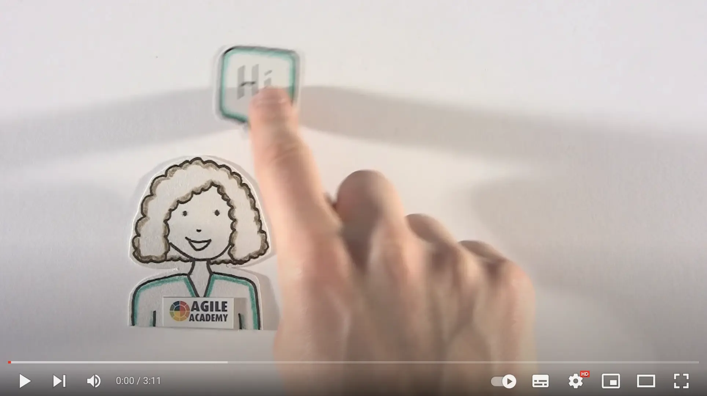</a>

Après la vidéo :

- Qu'avez-vous observé ?
- Qu'en pensez-vous ?
- Quels sont les **2 rôles** présentés ?

---

Concepts

# Avantages et inconvénients

| Avantages                                             | Inconvénients            |
|-------------------------------------------------------|--------------------------|
| Partage instantané des bonnes pratiques et du savoir  | Fatigant                 |
| Meilleure conception / meilleure qualité de code      | Peut créer des frictions |
| Moins d'erreurs                                       |                          |
| Intégration plus rapide des nouveaux membres          |                          |
| Augmente le moral / la confiance                      |                          |
| Renforce la cohésion d'équipe / l'ownership collectif |                          |
| Code reviews instantanées (boucle de feedback courte) |                          |

---

Concepts

# Ce que ce n'est pas... et quand c'est utile

Ce n'est **pas** une personne qui dort pendant qu'une autre travaille.

### Quand le Pair Programming est utile

- Améliorer l'efficacité
- Développer les compétences techniques
- Faciliter le transfert de connaissance
- Améliorer la communication
- Renforcer la résolution de problèmes
- Simplifier la base de code existante

---

Concepts · les différents styles

# Driver-Navigator

Le **Driver** tape le code, le **Navigator** pense la direction, relit et anticipe.

> Quand changer de rôle ?

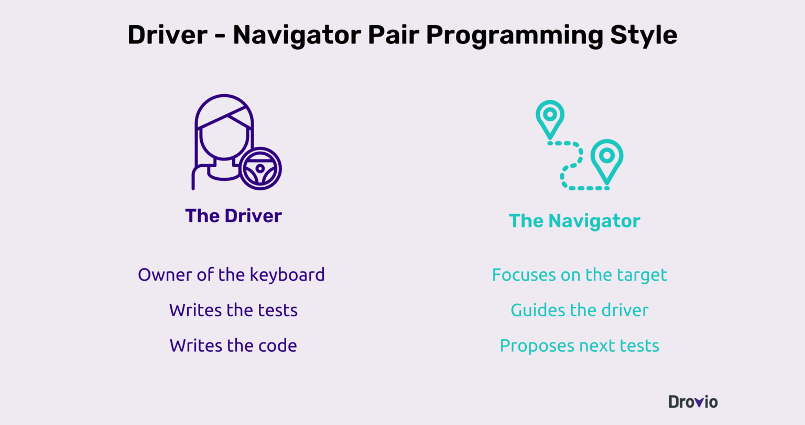

---

Concepts · les différents styles

# Strong Style et Ping-Pong

### Strong Style

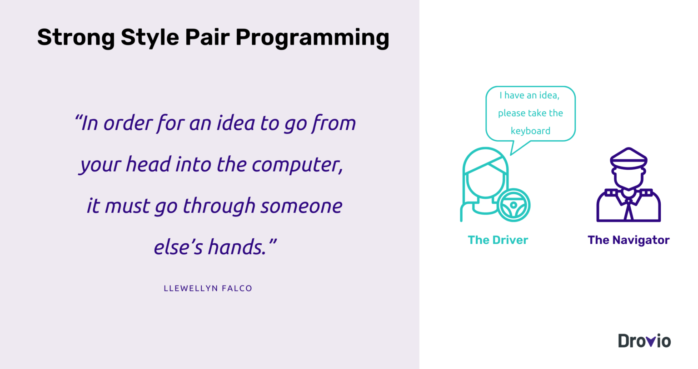

### Ping-Pong

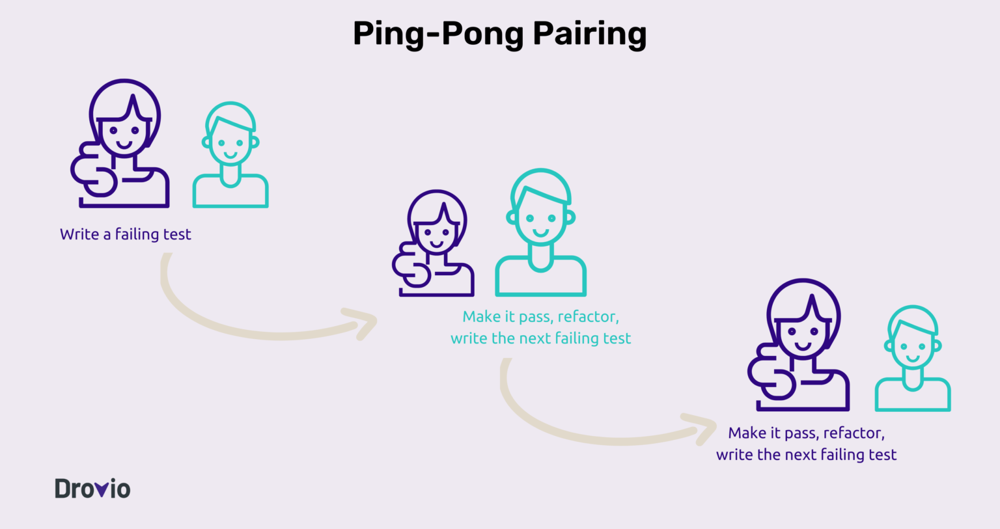

---

Concepts · les différents styles

# Les styles à éviter (ou à doser)

### Unstructured

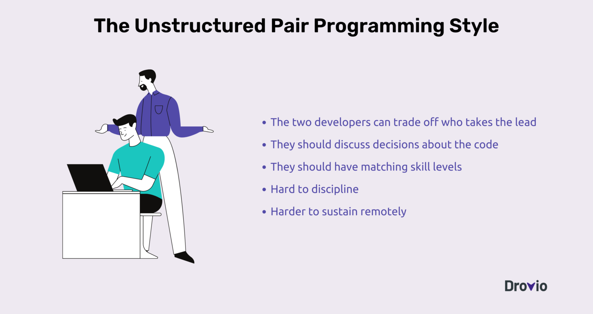

### Backseat Navigator

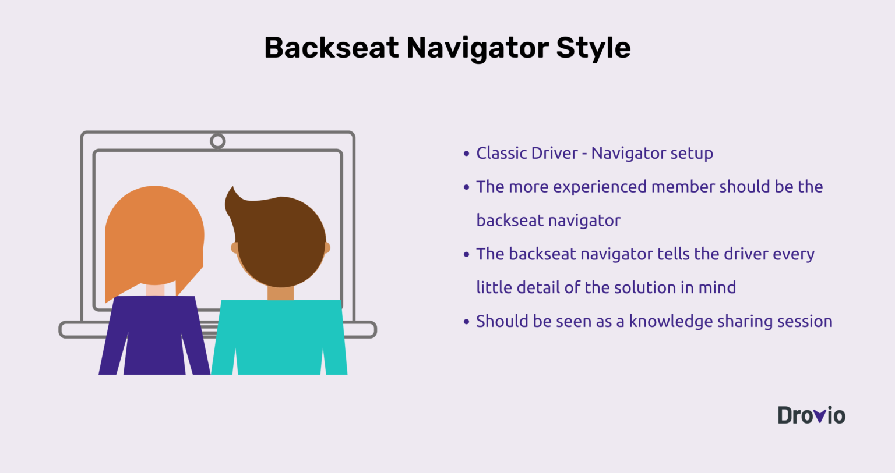

### Tour Guide

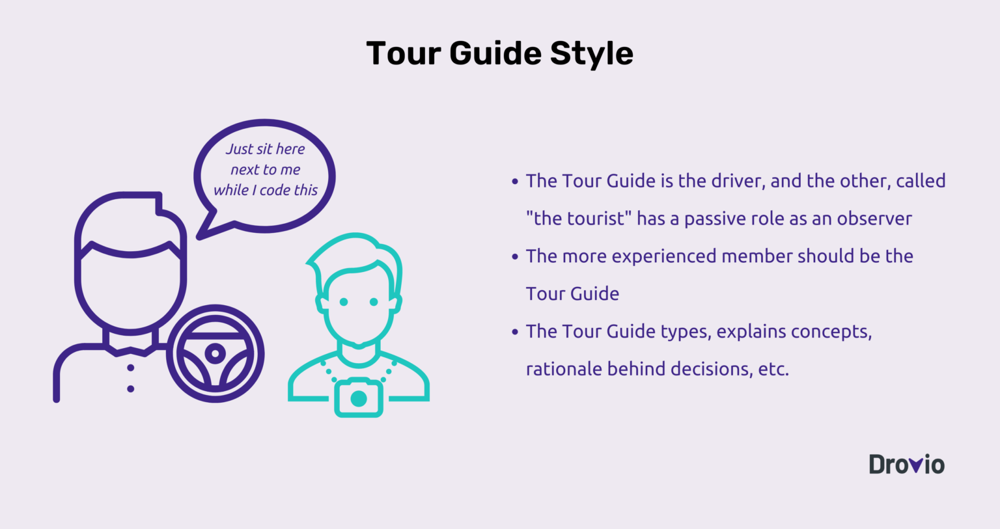

> Pour démarrer, utilisez un **minuteur**. Plus de détails : [The different styles of pair programming](https://www.drovio.com/blog/the-different-styles-of-pair-programming/).

---

Concepts

# Le coût du Pair Programming

D'après [The Costs and Benefits of Pair Programming](https://www.researchgate.net/publication/2333697_The_Costs_and_Benefits_of_Pair_Programming) (Cockburn & Williams), le coût de développement est environ **15 % plus élevé**...

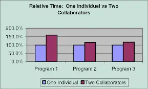

---

Concepts

# ... mais un coût compensé

- Des phases de test plus courtes et moins coûteuses
- Une meilleure assurance qualité

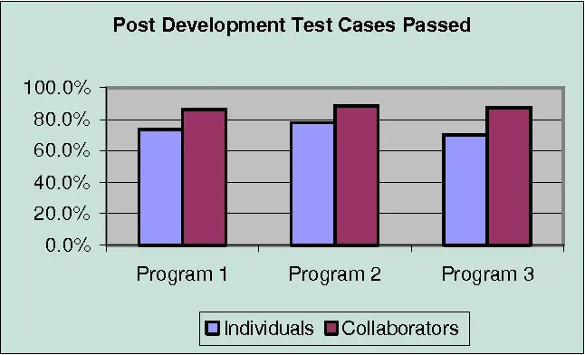

- Un code moins complexe
- Moins de support en production

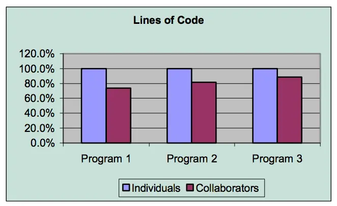

---
class: dense
---

Concepts

# Bonnes pratiques

- **Prendre des notes** : points de décision, avantages / inconvénients
- **Construire la confiance** : `committer` souvent, écrire des tests unitaires de qualité
- **Prendre du recul** en fin de session : mini-rétro, qu'avons-nous appris, que peut-on améliorer ?
- **Vider sa tasse** : comme dans les arts martiaux, videz votre esprit, soyez prêt à apprendre, soyez humble

### Communiquer, sans violence

- Proposer une idée : *"Je pense que..."*
- Confirmer un accord : *"On est d'accord pour dire que..."*
- Évoquer la progression : *"On a décidé que..."*
- Éviter "Non" / "Mais", essayer plutôt : *"Oui, et..."*
- En désaccord : *"Qu'est-ce qu'il faudrait pour te convaincre ?"*

---

Pratique concrète · en binôme · 2 × 30'

# Yatzy

- Trouvez un binôme
  - Découvrez ensemble le code et les règles du `Yatzy`
  - Choisissez un langage : Java, C#, TypeScript ou PHP
- Faites **2 itérations de 30 minutes** : 25 minutes de code, 5 minutes de rétrospective
- **Changez de binôme** à chaque itération
- Utilisez le style **Strong Style**, avec un minuteur : 5 minutes pour commencer, puis adaptez

<Exercise path="03.pair-programming/exercices/yatzy" />

---
layout: center
---

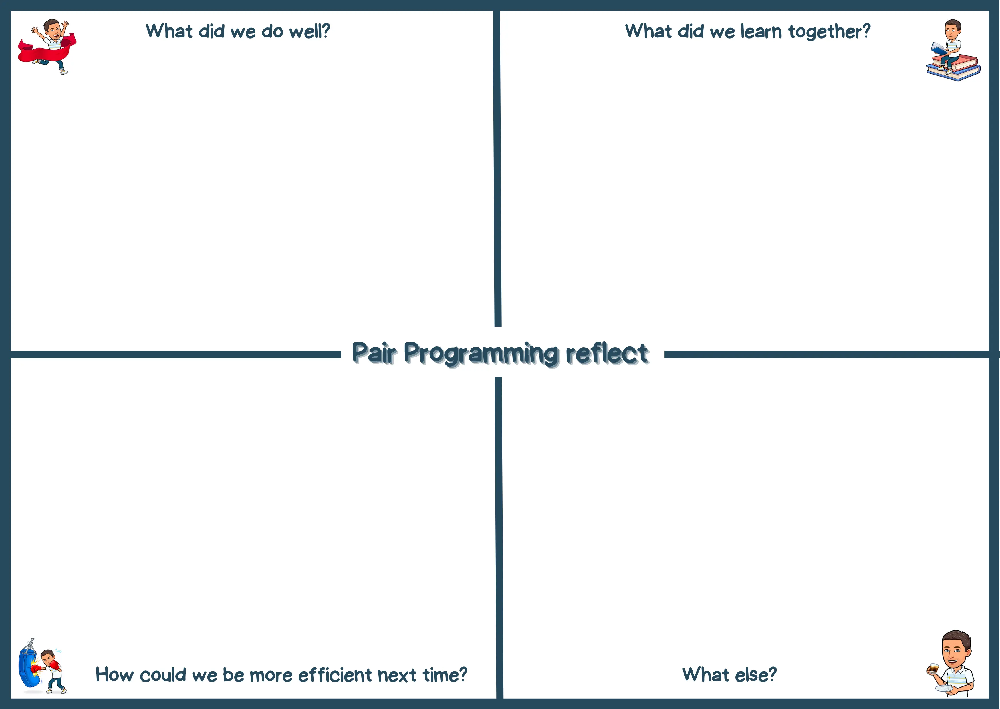

---

Conclusions · en groupe

# Qu'avez-vous appris ?

- Qu'avez-vous fait **plus vite** qu'à l'habitude en pair ?
- Qu'avez-vous fait **plus lentement** ?
- Comment s'est passée la **communication** ?
- Quels autres avantages ou inconvénients avez-vous découverts ?

### Comment se lancer ?

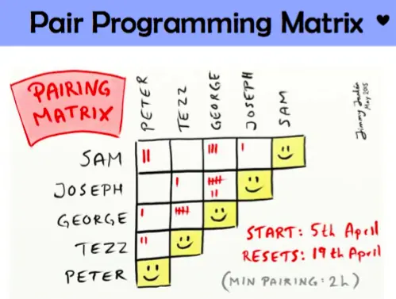

> Le Pair Programming vous aide à identifier vos angles morts.

---

Ressources

# Pour aller plus loin

- [The Different Styles of Pair Programming](https://www.drovio.com/blog/the-different-styles-of-pair-programming/), Drovio
- [The Costs and Benefits of Pair Programming](https://www.researchgate.net/publication/2333697_The_Costs_and_Benefits_of_Pair_Programming), Cockburn & Williams
- [Livre "Software Craft : TDD, Clean Code et autres pratiques essentielles"](https://www.dunod.com/sciences-techniques/software-craft-tdd-clean-code-et-autres-pratiques-essentielles-0)
