# Code Review — Devenir meilleur relecteur de code

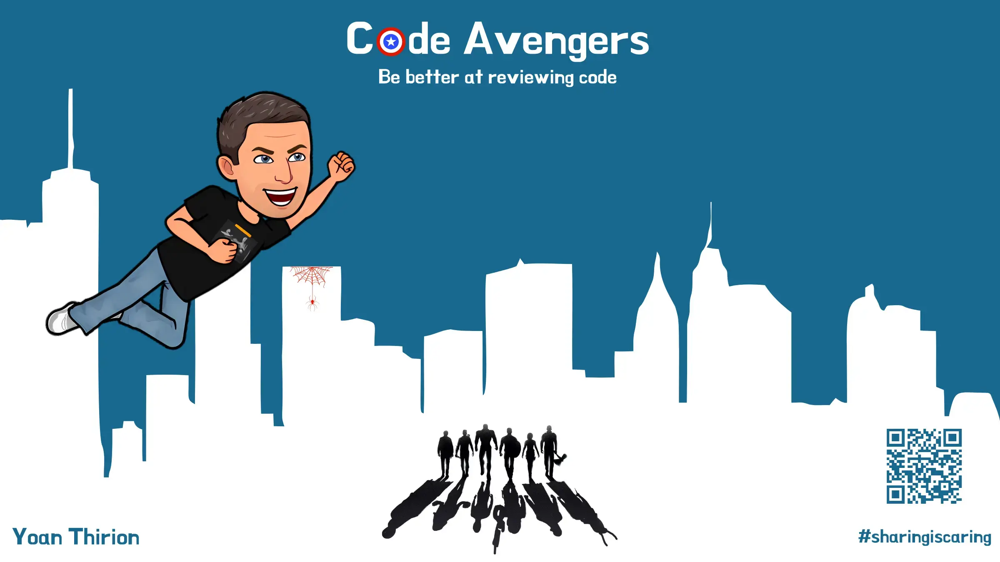

## Pourquoi faire des code reviews ?

En solo, répondez à ces questions :
- Quels sont vos objectifs quand vous relisez le code d'un pair ?
- Comment vous y prenez-vous ?
- Qu'est-ce qui fait qu'une code review est réussie ?

Partagez en binôme, puis en groupe de 4.

## Qu'est-ce que la Code Review ? (20 min)

> La code review est une évaluation méthodique du code visant à identifier des bugs, améliorer la qualité et permettre aux développeurs d'apprendre mutuellement.

C'est un outil d'amélioration de la qualité — mais il a un coût.

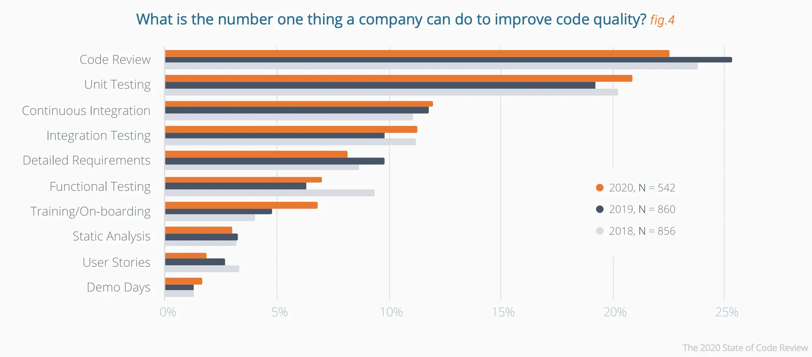
*Source : State of Code Review — Smartbear*

### Comment bien la pratiquer ?

- **N'auditez pas ce que vous pouvez automatiser**
  - Orthographe, formatage, style : confiez-les aux outils (linters, formatters)
- **Petits lots**
  - `Pas plus de 200 à 400 lignes de code` à la fois
  - Au-delà, le cerveau sature et laisse passer les erreurs
- **Adoptez le bon état d'esprit**
  > "Tu veux ma bénédiction ou mon feedback ?"

### Qui ?

- **Tout le monde** peut faire l'objet d'une review — y compris les plus expérimentés
- **Tout développeur** peut être relecteur
- Le relecteur doit :
  - Rester humble, donner du feedback, ne pas blâmer
  - Connaître le contexte fonctionnel
  - Idéalement, faire tourner le code sur sa machine

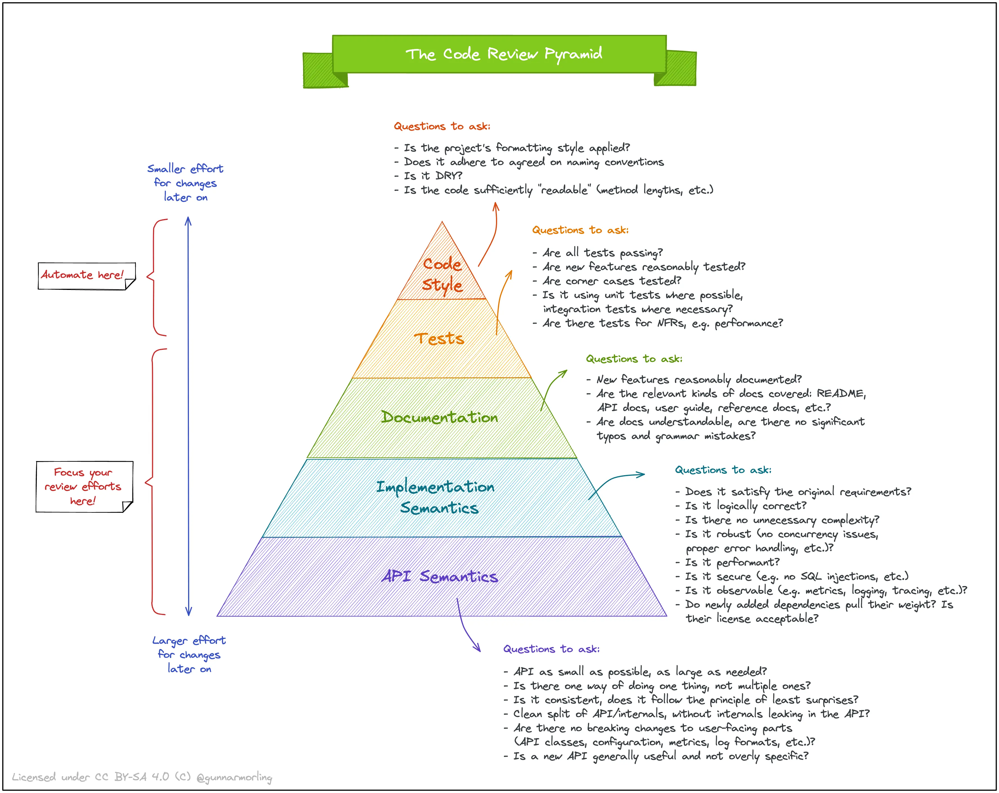
*Source : The Code Review Pyramid — Gunnar Morling*

### Quand ?

- À la demande
- Quand la quality gate CI échoue
- Systématiquement avant qu'une story soit considérée comme ***Done***

### Pourquoi ?

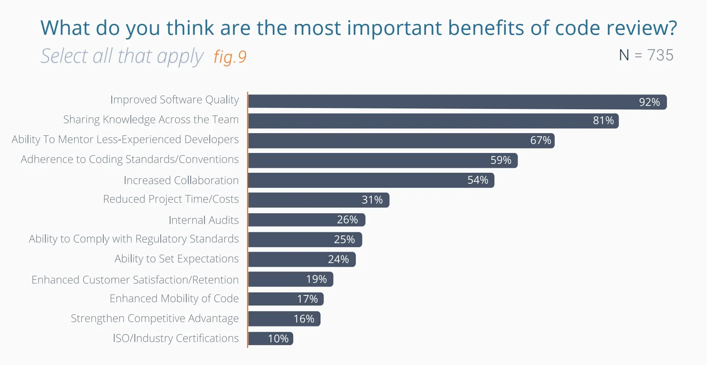
*Source : State of Code Review — Smartbear*

- **Améliorer le code** : standards respectés, bugs détectés, code compréhensible et maintenable
- **Partager la connaissance** : diffuser l'ownership collectif, propager les bonnes pratiques
- **Collaborer sur le design** : confronter les approches en équipe
- **Renforcer la communication** : tout le monde parle à tout le monde, la cohésion s'améliore
- **Se motiver à progresser** : savoir que son code sera lu pousse à soigner les nommages, les tests, les abstractions

### Les différents workflows

#### [Gateway Review](https://blog.jetbrains.com/upsource/2017/01/18/code-review-as-a-gateway/)

Un développeur implémente une fonctionnalité et la **soumet à review** avant de merger. Si tout est correct, le code est intégré à la branche principale.

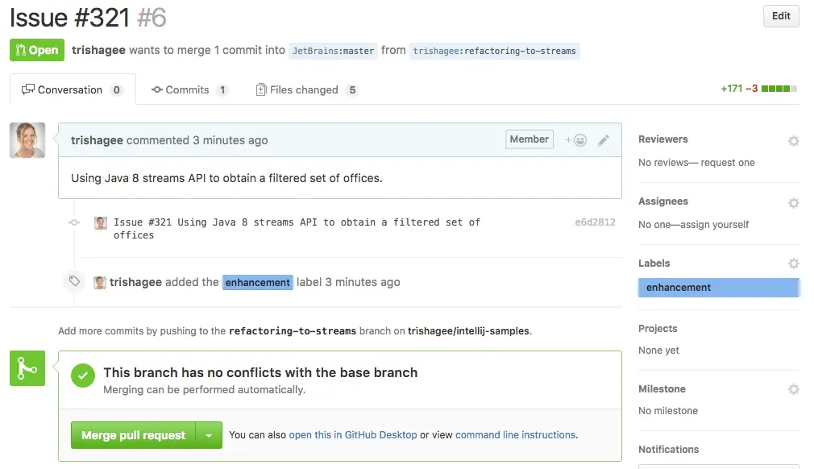

#### [Knowledge Sharing](https://blog.jetbrains.com/upsource/2017/03/14/code-review-for-knowledge-sharing/)

L'apprentissage est au cœur du processus. L'objectif n'est pas de vérifier que le code est correct, mais de **partager avec l'équipe les changements apportés**.

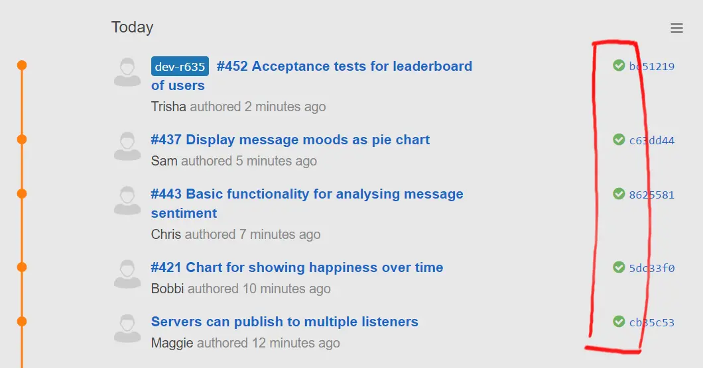

#### Early Design Feedback

Approche collaborative et itérative : **relire le code pendant qu'il se construit** pour que le feedback sur le design arrive au bon moment.

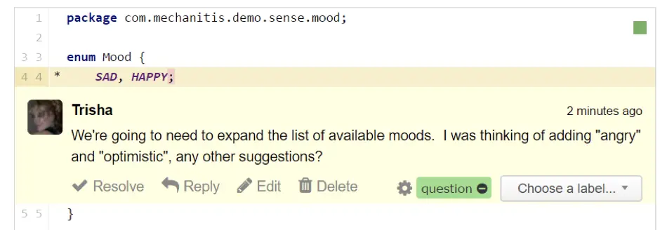

### Anti-patterns (d'après Trisha Gee)

- **"Mon rôle est de trouver des problèmes"** — Si vous cherchez des problèmes, vous en trouverez toujours. Rappelez-vous que vous apportez vos propres biais et préférences.
- **Nit-picking** — Espacement, formatage... automatisez ça. C'est une perte de temps humain.
- **Changer le design quand le code fonctionne** — "Vous arrivez trop tard." Le design doit être discuté en amont.
- **Feedback incohérent** — Biaisé par la dernière formation suivie, variable d'une semaine à l'autre. Remède : des guidelines claires et des checklists.
- **Le Relecteur Fantôme** — "Je n'ai pas le temps." Plus une review est grosse, plus elle a de chances de recevoir un simple pouce levé.
- **Ping-Pong** — Aller-retour sans fin entre auteur et relecteur, faute d'une Definition of Done commune.

> Plus la code review est volumineuse, plus elle a de chances de recevoir un simple ✅ sans vrai regard critique.

### Utiliser une checklist

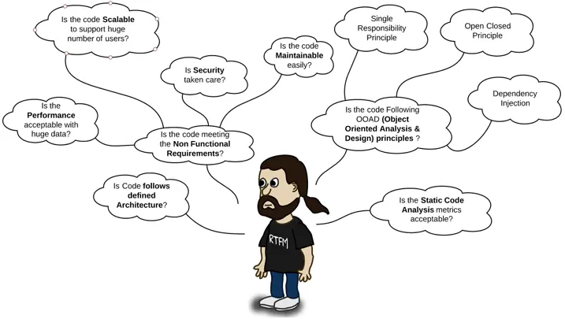

#### Exemple de checklist

- [ ] **Conformité**
  - [ ] Respect du tech radar interne (Lombok, MapStruct...)
  - [ ] Bonne version des librairies
  - [ ] Quality gates automatiques passées
- [ ] **Exploitabilité**
  - [ ] Les logs apportent du contexte pour le débogage
  - [ ] La configuration est séparée du code
- [ ] **Lisibilité**
  - [ ] Les noms expriment l'**intention**
  - [ ] Les APIs sont documentées
- [ ] **Qualité structurelle**
  - [ ] Conventions d'équipe respectées
  - [ ] Pas de code obsolète ni commenté
  - [ ] Pas de TODOs laissés en suspens
  - [ ] Patterns de conception utilisés à bon escient
- [ ] **Tests**
  - [ ] Couvrent les exigences
  - [ ] Couvrent les cas limites et les parties complexes
  - [ ] Vérifient les performances si pertinent

Vous pouvez également créer des **pull request templates** sur GitHub pour intégrer cette checklist directement dans vos PRs → [documentation](https://docs.github.com/en/communities/using-templates-to-encourage-useful-issues-and-pull-requests/creating-a-pull-request-template-for-your-repository).

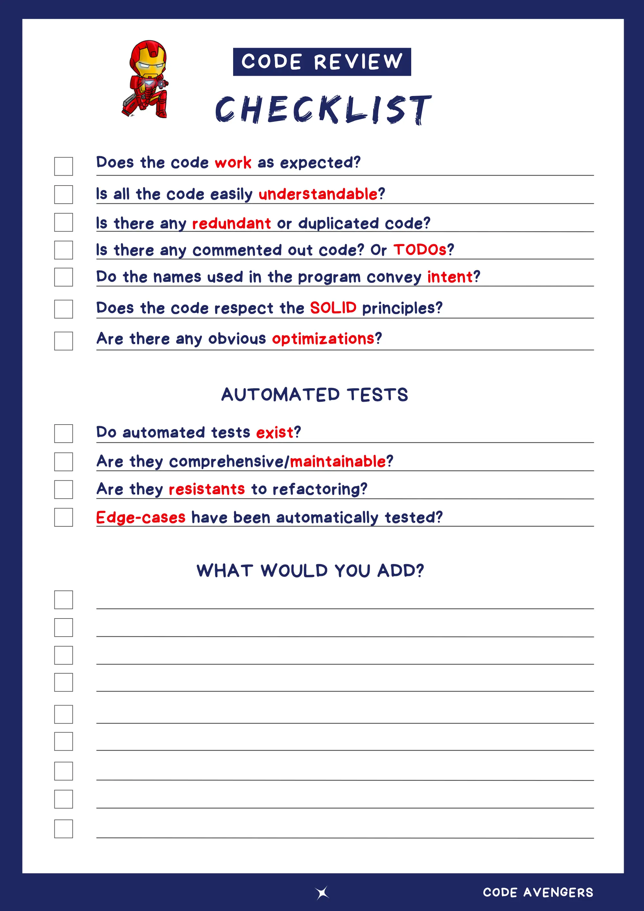

> Attention : les reviews asynchrones peuvent fortement impacter le Lead Time de l'équipe. Voir : [Async Code Reviews Are Killing Your Company's Throughput](https://www.slideshare.net/kobac/async-code-reviews-are-killing-your-companys-throughput-248758692).

### Mesurer pour progresser

| Métrique              | Description                                        |
|-----------------------|----------------------------------------------------|
| `Taux d'inspection`   | Vitesse à laquelle une review est réalisée         |
| `Taux de défauts`     | Nombre de bugs trouvés par heure de review         |
| `Densité de défauts`  | Nombre moyen de bugs trouvés par ligne de code     |

## Code Avengers

[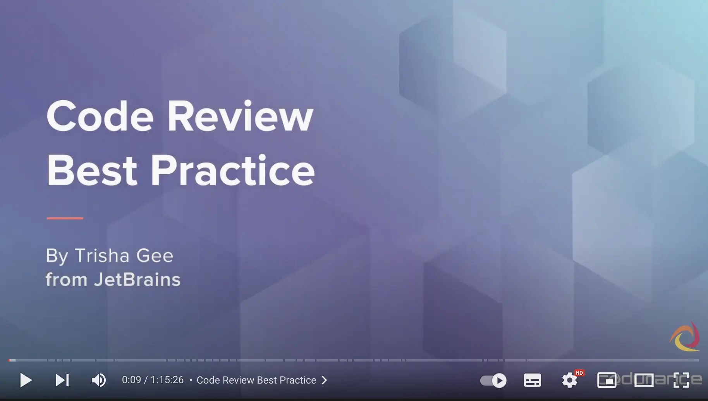](https://youtu.be/3pth05Rgr8U)

Formez des groupes de 3.

### Itération 1 — Jouer un rôle (25 min)

#### Préparation

Chaque participant pioche :
- Une **carte de rôle** (à garder secrète)
- Une [checklist](files/checklist.pdf)
- Un extrait de code différent :
  - [TimelineEvents.scala](https://github.com/hmrc/customs-declare-exports-frontend/blob/57e007083fb833079df239a2747b633186b599ff/app/views/helpers/TimelineEvents.scala)
  - [ssh.scala](https://github.com/seL4/isabelle/blob/38e7963558cc4c73e9bd4886e97e8a9f027be416/src/Pure/General/ssh.scala)
  - [preview-images.ts](https://github.com/Irithys/moive/blob/e8ea89ff701eaf3a7ea844f9448c59ecb222594d/lib/preview-images.ts)
  - [message_stream.ts](https://github.com/snislam/faucets-server/blob/14fa7b42401ea7c19798ecc11d91bd659cf8f2a9/node_modules/mongodb/src/cmap/message_stream.ts)
  - [424-longest-repeating-character-replacement.kt](https://github.com/raymondwzeng/2021-2022-Leetcode/blob/28754156e224b7ed2c71b15cc86cf1f182ace899/424-longest-repeating-character-replacement/424-longest-repeating-character-replacement.kt)
  - [BestEffortTimeStatistic.kt](https://github.com/nbulteau/mystravastats/blob/a5628b86ac3006f17e68e72ee7d8d2f77dafd610/src/main/kotlin/me/nicolas/stravastats/service/statistics/BestEffortTimeStatistic.kt)
  - [EdibleProductsRetailerController.java](https://github.com/shivtu/kucchil-kitchen/blob/774245ae8eccb1e81f66960db6130fa5ebbc843d/src/main/java/com/example/retail/controllers/retailer/edibleproducts_retailer/EdibleProductsRetailerController.java)
  - [PhpFileWriter.java](https://github.com/meghrajdadhich/PhpCodeWriter_microservice/blob/51b9c0e282d96857cefaea1e7cc67bbea3a38e51/src/PhpFileWriter.java)
  - [Dao.java](https://github.com/yxl1014/JAVA-Curriculum-design/blob/ad367125e6c50835a657fdacec65981d5f01b754/src/demo/mysql/Dao.java)
  - [CallExpression.php](https://github.com/IagoB7ima/glpicss/blob/54ce418c1580432edf5bfcf5b25f87eb752b4689/glpi/vendor/twig/twig/src/Node/Expression/CallExpression.php)
  - [EscaperExtension.php](https://github.com/IagoB7ima/glpicss/blob/54ce418c1580432edf5bfcf5b25f87eb752b4689/glpi/vendor/twig/twig/src/Extension/EscaperExtension.php)

#### Review solo
Préparez une code review en incarnant votre rôle.

#### Temps de présentation (5 min)
- Chaque membre présente ses observations aux deux autres
- Les 2 autres prennent des notes pour capturer les **moments clés**

Vous pouvez structurer vos notes ainsi :

| Ce que j'ai pensé / ressenti              | Ce que ___ a dit                                    |
|-------------------------------------------|------------------------------------------------------|
| *Notez tout ce qui vous traverse l'esprit* | *Notez tout ce qui vous semble important*           |

- Identifiez les questions posées
  - Distinguez les **vraies questions** (curiosité sincère) des autres
  - Calculez : `curiosité = vraies questions / total de questions`

#### Débrief de groupe (10 min)
- Partagez vos notes
- Essayez de deviner quel rôle chacun jouait

  
Cartes de rôle (ne pas révéler avant le débrief)

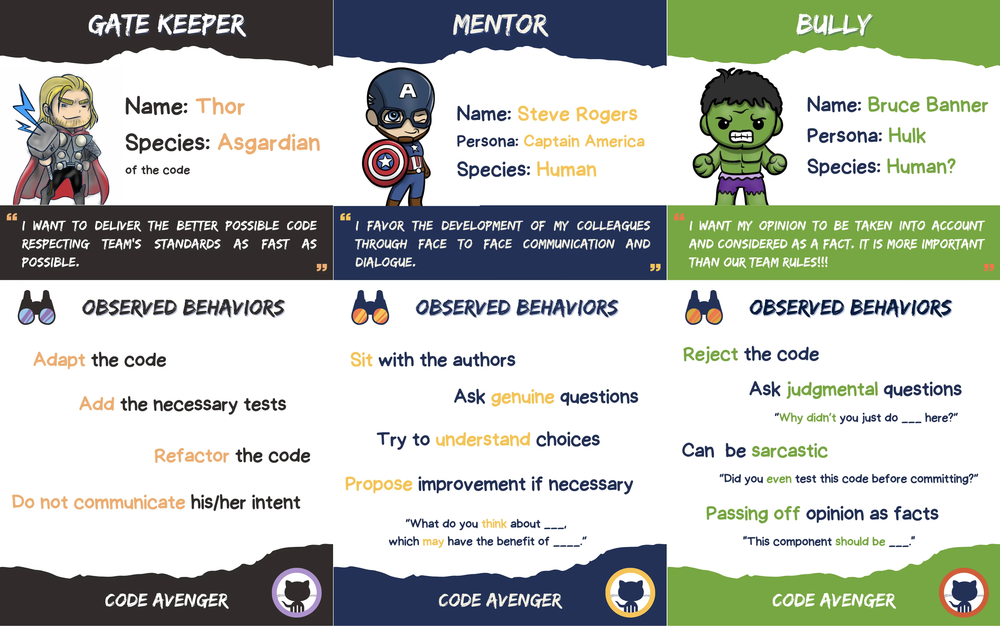

- [Version PDF imprimable](files/code-avengers.pdf)
- [Cartes PNG](files/code-avengers.zip)

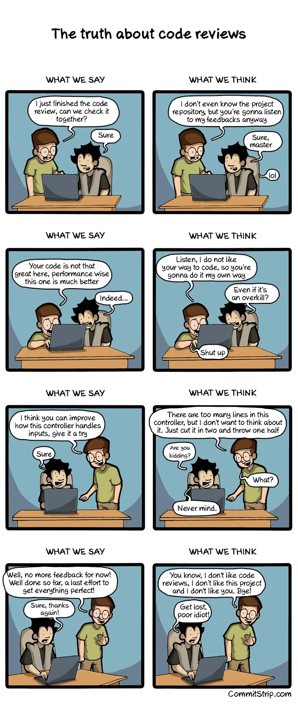
*Source : [Commitstrip](https://www.commitstrip.com/en/2015/02/10/the-truth-about-code-reviews/)*

### Itération 2 — Donner du feedback (25 min)

Cette fois, chaque relecteur utilise le **Feedback Wrap** pour formuler ses retours.

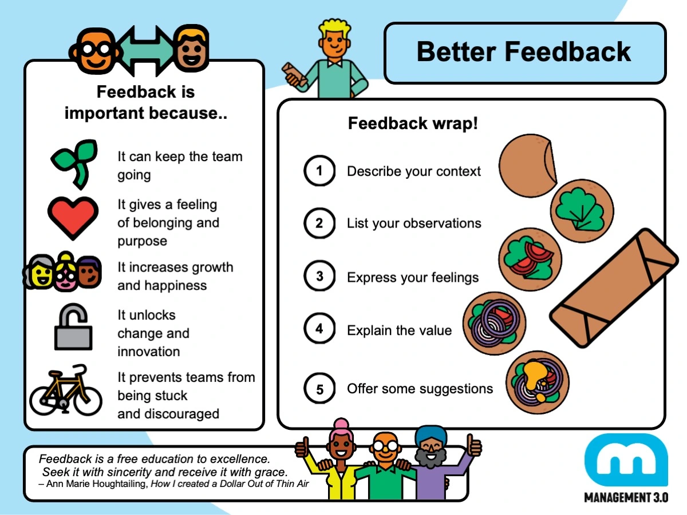

#### Review solo (10 min)
Préparez une code review en appliquant le Feedback Wrap.

#### Temps de présentation (5 min)
- Chaque membre présente ses observations aux deux autres
- Les 2 autres prennent des notes sur les moments clés

#### Débrief de groupe (10 min)
> Qu'est-ce qui était différent dans vos ressentis et vos pensées ?

## Conclusion

> Ne laissez pas la code review devenir un match d'ego.

- Qu'est-ce que vous pourriez mettre en place dans les **10 prochains jours** pour améliorer la qualité des code reviews dans votre équipe ?
- Comment le Pair Programming et la Code Review peuvent-ils s'articuler dans votre processus de développement ?

> Être le plus expérimenté de l'équipe ne signifie pas que votre code n'a pas besoin d'être relu.

## Pour aller plus loin
[Ship / Show / Ask — Martin Fowler](https://martinfowler.com/articles/ship-show-ask.html)

## Ressources
- [Egoless Programming](https://blog.codinghorror.com/the-ten-commandments-of-egoless-programming/)
- [Code Review Pyramid](https://www.morling.dev/blog/the-code-review-pyramid/)
- [Egoless Crafting](https://egolesscrafting.org/)
- [Code Review Best Practices — Trisha Gee](https://blog.jetbrains.com/upsource/2018/08/30/code-review-best-practices/)
- [The Code Review Pyramid — Gunnar Morling](https://www.morling.dev/blog/the-code-review-pyramid/)
- [Code Review Workflows — JetBrains](https://blog.jetbrains.com/upsource/tag/code-review-workflows/)
- [Code Review Guidelines — Patrick Smacchia](https://blog.ndepend.com/what-is-code-review-guidelines-best-practices/)
- [Ebook "What to look for in a code review"](http://jb.gg/book/codereview)
- [Agile Conversations — QRC](https://hennyportman.files.wordpress.com/2020/09/qrc-agile-conversations.pdf)
- [Management 3.0 — Better Feedback](https://management30.com/develop-competence/better-feedback/)
