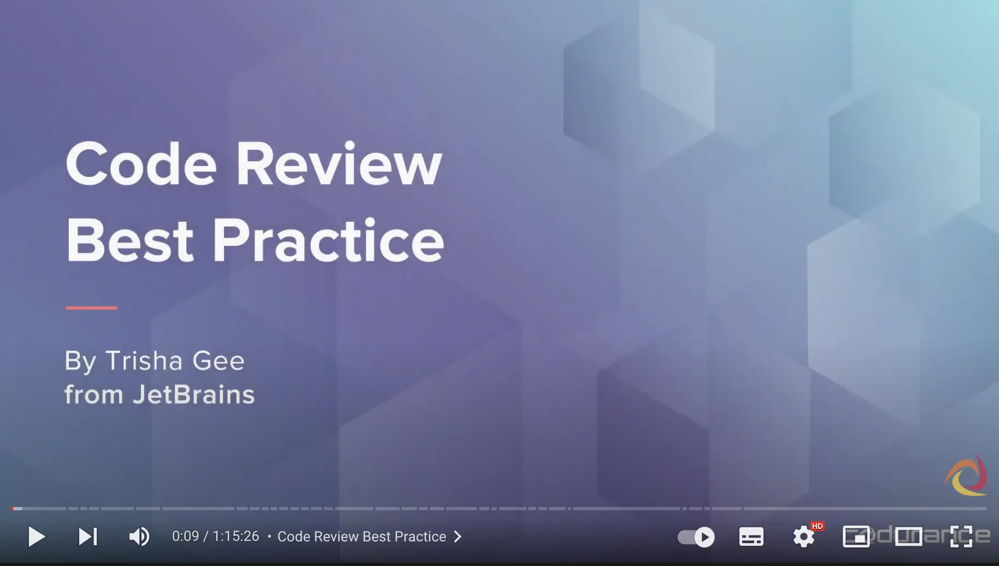
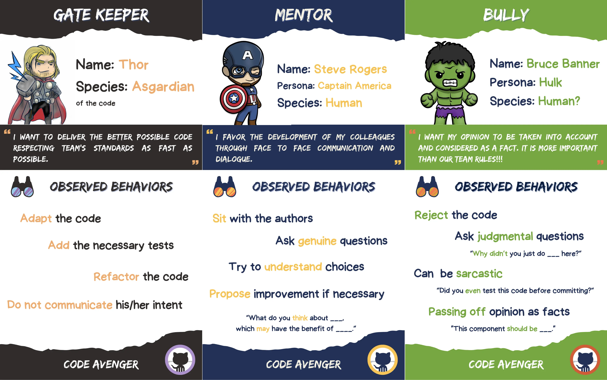
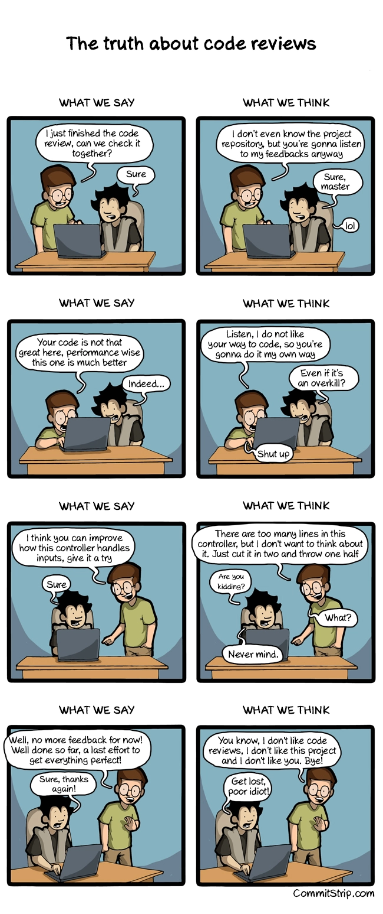
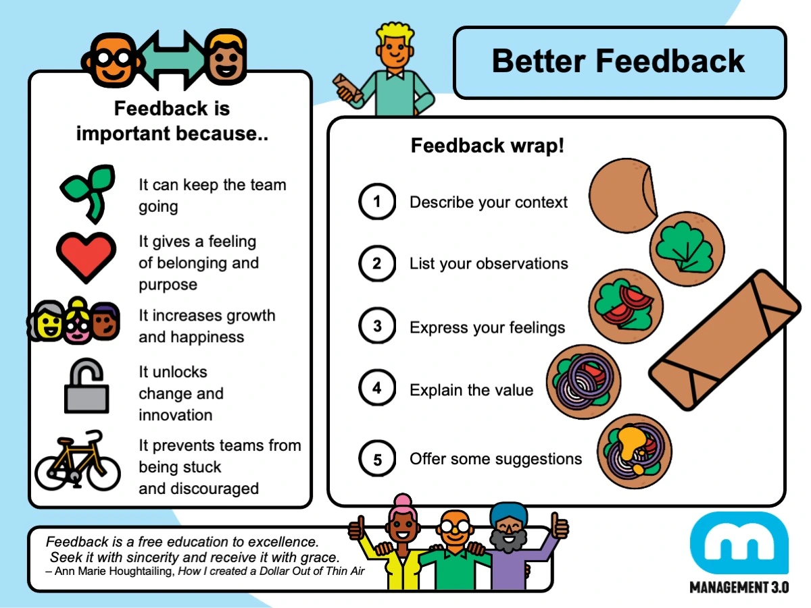

# Code Avengers

Formez des groupes de 3.

## Itération 1 : jouer un rôle (25 min)

### Préparation

Chaque participant pioche :
- Une **carte de rôle** (à garder secrète)
- Une [checklist](checklist.pdf)
- Un extrait de code différent :
  - [TimelineEvents.scala](https://github.com/hmrc/customs-declare-exports-frontend/blob/57e007083fb833079df239a2747b633186b599ff/app/views/helpers/TimelineEvents.scala)
  - [ssh.scala](https://github.com/seL4/isabelle/blob/38e7963558cc4c73e9bd4886e97e8a9f027be416/src/Pure/General/ssh.scala)
  - [preview-images.ts](https://github.com/Irithys/moive/blob/e8ea89ff701eaf3a7ea844f9448c59ecb222594d/lib/preview-images.ts)
  - [message_stream.ts](https://github.com/snislam/faucets-server/blob/14fa7b42401ea7c19798ecc11d91bd659cf8f2a9/node_modules/mongodb/src/cmap/message_stream.ts)
  - [424-longest-repeating-character-replacement.kt](https://github.com/raymondwzeng/2021-2022-Leetcode/blob/28754156e224b7ed2c71b15cc86cf1f182ace899/424-longest-repeating-character-replacement/424-longest-repeating-character-replacement.kt)
  - [BestEffortTimeStatistic.kt](https://github.com/nbulteau/mystravastats/blob/a5628b86ac3006f17e68e72ee7d8d2f77dafd610/src/main/kotlin/me/nicolas/stravastats/service/statistics/BestEffortTimeStatistic.kt)
  - [EdibleProductsRetailerController.java](https://github.com/shivtu/kucchil-kitchen/blob/774245ae8eccb1e81f66960db6130fa5ebbc843d/src/main/java/com/example/retail/controllers/retailer/edibleproducts_retailer/EdibleProductsRetailerController.java)
  - [PhpFileWriter.java](https://github.com/meghrajdadhich/PhpCodeWriter_microservice/blob/51b9c0e282d96857cefaea1e7cc67bbea3a38e51/src/PhpFileWriter.java)
  - [Dao.java](https://github.com/yxl1014/JAVA-Curriculum-design/blob/ad367125e6c50835a657fdacec65981d5f01b754/src/demo/mysql/Dao.java)
  - [CallExpression.php](https://github.com/IagoB7ima/glpicss/blob/54ce418c1580432edf5bfcf5b25f87eb752b4689/glpi/vendor/twig/twig/src/Node/Expression/CallExpression.php)
  - [EscaperExtension.php](https://github.com/IagoB7ima/glpicss/blob/54ce418c1580432edf5bfcf5b25f87eb752b4689/glpi/vendor/twig/twig/src/Extension/EscaperExtension.php)

### Review solo
Préparez une code review en incarnant votre rôle.

### Temps de présentation (5 min)
- Chaque membre présente ses observations aux deux autres
- Les 2 autres prennent des notes pour capturer les **moments clés**

Vous pouvez structurer vos notes ainsi :

| Ce que j'ai pensé / ressenti               | Ce que ___ a dit                          |
|--------------------------------------------|-------------------------------------------|
| *Notez tout ce qui vous traverse l'esprit* | *Notez tout ce qui vous semble important* |

- Identifiez les questions posées
  - Distinguez les **vraies questions** (curiosité sincère) des autres
  - Calculez : `curiosité = vraies questions / total de questions`

### Débrief de groupe (10 min)
- Partagez vos notes
- Essayez de deviner quel rôle chacun jouait

  
Cartes de rôle (ne pas révéler avant le débrief)

- [Version PDF imprimable](code-avengers.pdf)

*Source : [Commitstrip](https://www.commitstrip.com/en/2015/02/10/the-truth-about-code-reviews/)*

## Itération 2 : donner du feedback (25 min)

Cette fois, chaque relecteur utilise le **Feedback Wrap** pour formuler ses retours.

### Review solo (10 min)
Préparez une code review en appliquant le Feedback Wrap.

### Temps de présentation (5 min)
- Chaque membre présente ses observations aux deux autres
- Les 2 autres prennent des notes sur les moments clés

### Débrief de groupe (10 min)
> Qu'est-ce qui était différent dans vos ressentis et vos pensées ?
