# Code <mark>Review</mark>

Devenir meilleur relecteur de code.

---
layout: center
---

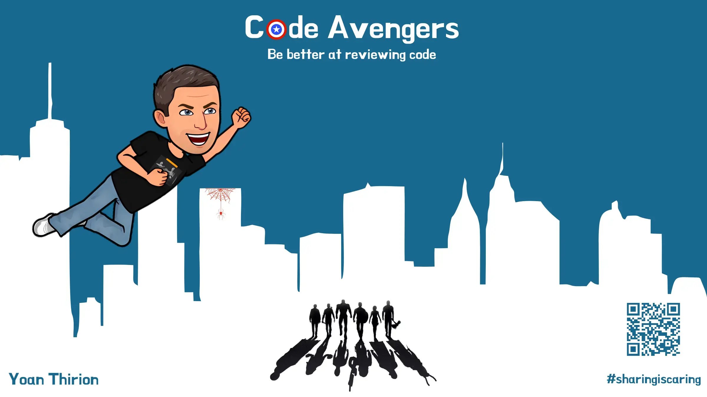

---

Connexion · seul, puis en binôme, puis à 4

# Pourquoi faire des code reviews ?

En solo, répondez à ces questions :

- Quels sont vos **objectifs** quand vous relisez le code d'un pair ?
- **Comment** vous y prenez-vous ?
- Qu'est-ce qui fait qu'une code review est **réussie** ?

Partagez en binôme, puis en groupe de 4.

---

Concepts

# Qu'est-ce que la Code Review ?

> La code review est une évaluation méthodique du code visant à identifier des bugs, améliorer la qualité et permettre aux développeurs d'apprendre mutuellement.

C'est un outil d'amélioration de la qualité, mais il a un **coût**.

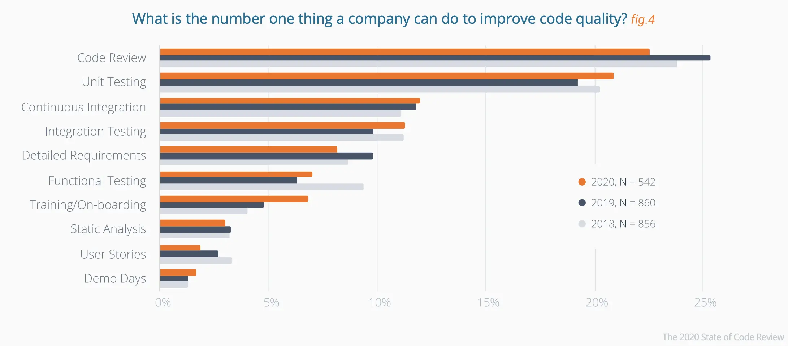

*Source : State of Code Review, Smartbear*

---

Concepts

# Comment bien la pratiquer ?

- **N'auditez pas ce que vous pouvez automatiser** : orthographe, formatage, style, confiez-les aux outils (linters, formatters)
- **Petits lots** : `pas plus de 200 à 400 lignes de code` à la fois. Au-delà, le cerveau sature et laisse passer les erreurs
- **Adoptez le bon état d'esprit**

> "Tu veux ma bénédiction ou mon feedback ?"

---

Concepts

# Qui ? Quand ?

### Qui ?

- **Tout le monde** peut faire l'objet d'une review, y compris les plus expérimentés
- **Tout développeur** peut être relecteur
- Le relecteur doit :
  - rester humble, donner du feedback, ne pas blâmer
  - connaître le contexte fonctionnel
  - idéalement, faire tourner le code sur sa machine

### Quand ?

- À la demande
- Quand la quality gate CI échoue
- Systématiquement avant qu'une story soit ***Done***

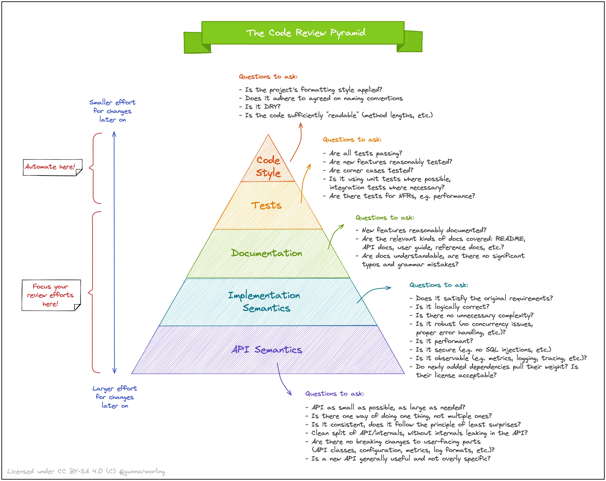

*Source : The Code Review Pyramid, Gunnar Morling*

---

Concepts

# Pourquoi ?

- **Améliorer le code** : standards respectés, bugs détectés, code compréhensible et maintenable
- **Partager la connaissance** : diffuser l'ownership collectif, propager les bonnes pratiques
- **Collaborer sur le design** : confronter les approches en équipe
- **Renforcer la communication** : tout le monde parle à tout le monde
- **Se motiver à progresser** : savoir que son code sera lu pousse à soigner nommages, tests, abstractions

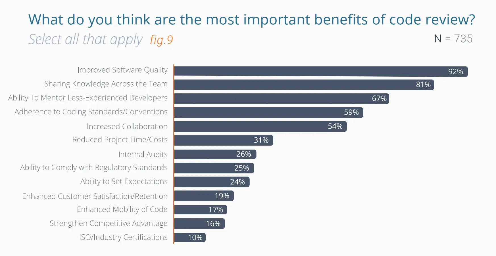

*Source : State of Code Review, Smartbear*

---

Concepts · les différents workflows

# Gateway, Knowledge Sharing, Early Design Feedback

### [Gateway Review](https://blog.jetbrains.com/upsource/2017/01/18/code-review-as-a-gateway/)

Le code est **soumis à review avant de merger**. Si tout est correct, il est intégré à la branche principale.

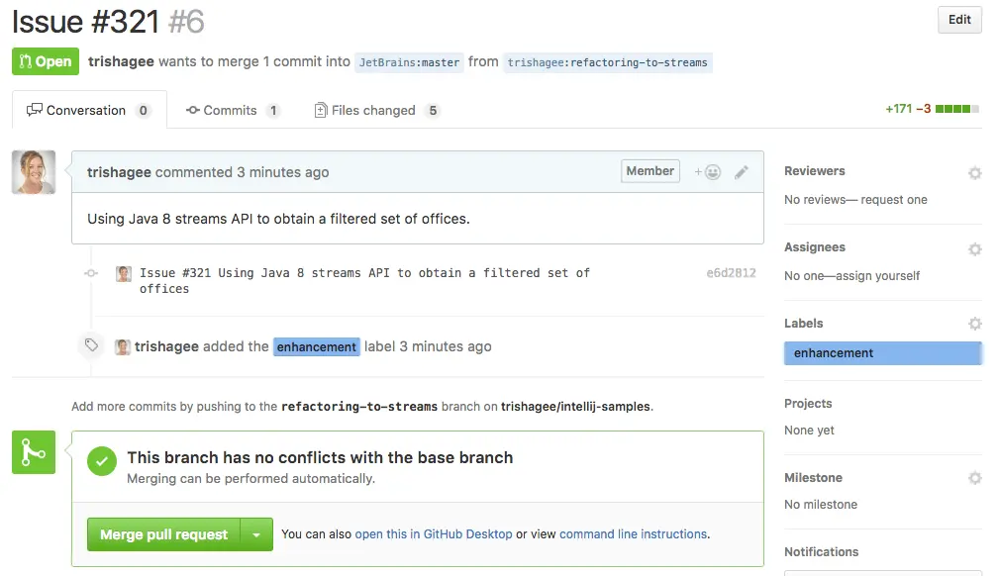

### [Knowledge Sharing](https://blog.jetbrains.com/upsource/2017/03/14/code-review-for-knowledge-sharing/)

L'objectif n'est pas de vérifier que le code est correct, mais de **partager les changements** avec l'équipe.

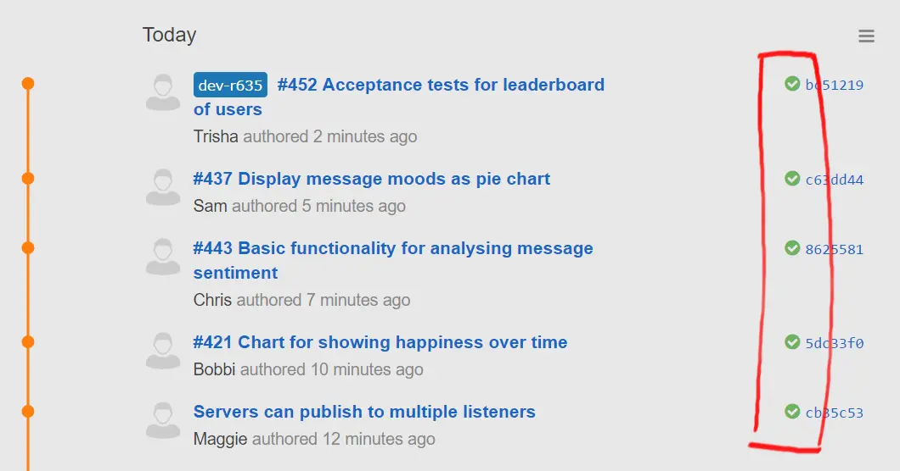

### Early Design Feedback

**Relire le code pendant qu'il se construit**, pour que le feedback sur le design arrive au bon moment.

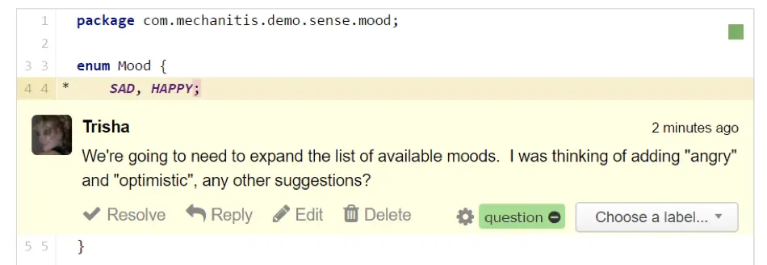

---
class: dense
---

Concepts

# Anti-patterns (d'après Trisha Gee)

| Anti-pattern                              | Pourquoi ça pose problème                                                                                    |
|-------------------------------------------|--------------------------------------------------------------------------------------------------------------|
| "Mon rôle est de trouver des problèmes"   | Si vous cherchez des problèmes, vous en trouverez toujours. Vous apportez vos propres biais et préférences.  |
| Nit-picking                               | Espacement, formatage... automatisez ça. C'est une perte de temps humain.                                    |
| Changer le design quand le code fonctionne | "Vous arrivez trop tard." Le design doit être discuté en amont.                                             |
| Feedback incohérent                       | Biaisé par la dernière formation suivie. Remède : des guidelines claires et des checklists.                  |
| Le Relecteur Fantôme                      | "Je n'ai pas le temps." Plus une review est grosse, plus elle reçoit un simple pouce levé.                   |
| Ping-Pong                                 | Aller-retour sans fin entre auteur et relecteur, faute d'une Definition of Done commune.                     |

> Plus la code review est volumineuse, plus elle a de chances de recevoir un simple ✅ sans vrai regard critique.

---
class: dense
---

Concepts

# Utiliser une checklist

- **Conformité** : tech radar interne respecté, bonnes versions des librairies, quality gates passées
- **Exploitabilité** : logs utiles au débogage, configuration séparée du code
- **Lisibilité** : noms qui expriment l'**intention**, APIs documentées
- **Qualité structurelle** : conventions d'équipe, pas de code obsolète ou commenté, pas de TODOs en suspens, patterns utilisés à bon escient
- **Tests** : couvrent les exigences, les cas limites et les parties complexes, vérifient les performances si pertinent

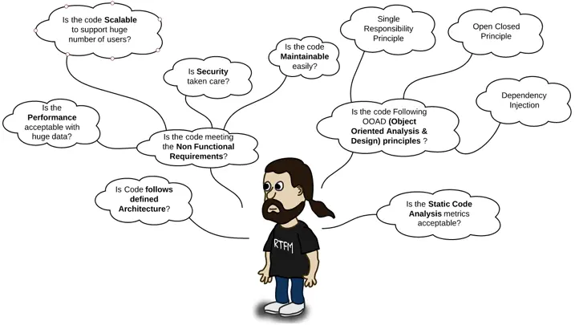

---

Concepts

# La checklist dans vos PRs

Intégrez la checklist à vos PRs avec un [pull request template](https://docs.github.com/en/communities/using-templates-to-encourage-useful-issues-and-pull-requests/creating-a-pull-request-template-for-your-repository) GitHub.

> Attention : les reviews asynchrones peuvent fortement impacter le Lead Time. Voir [Async Code Reviews Are Killing Your Company's Throughput](https://www.slideshare.net/kobac/async-code-reviews-are-killing-your-companys-throughput-248758692).

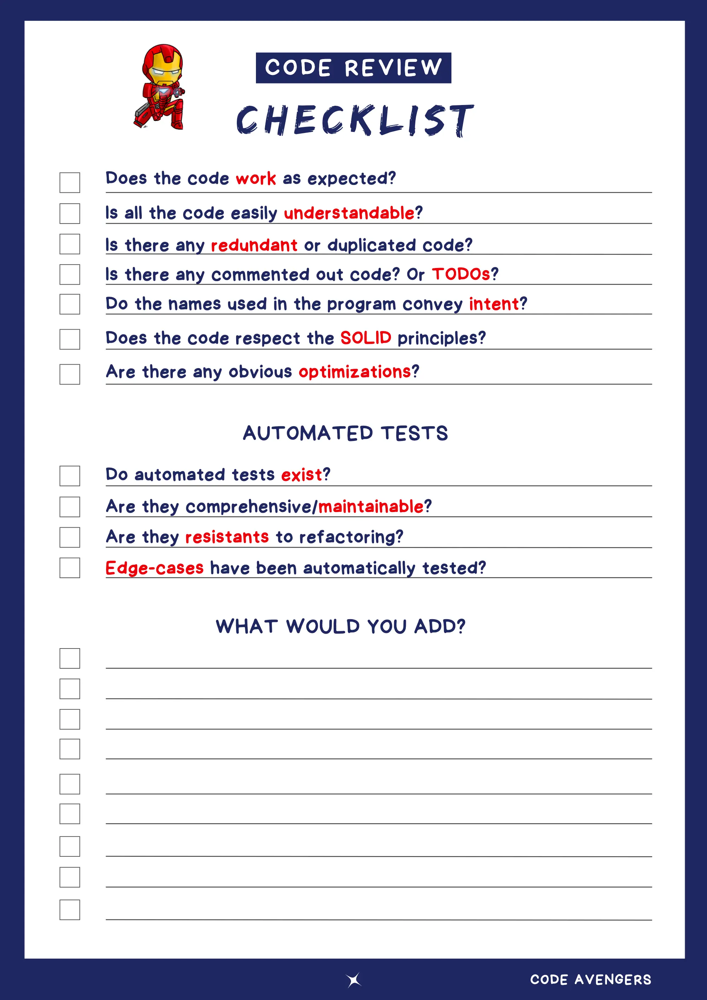

---

Concepts

# Mesurer pour progresser

| Métrique                 | Description                                    |
|----------------------|------------------------------------------------|
| **Taux d'inspection**  | Vitesse à laquelle une review est réalisée     |
| **Taux de défauts**    | Nombre de bugs trouvés par heure de review     |
| **Densité de défauts** | Nombre moyen de bugs trouvés par ligne de code |

---

Pratique concrète · groupes de 3 · 2 × 25'

# Code Avengers

### Itération 1 : jouer un rôle

Chaque participant pioche une **carte de rôle** secrète, une **checklist** et un **extrait de code**. Il prépare une review en incarnant son rôle, la présente, puis le groupe devine les rôles.

### Itération 2 : donner du feedback

Même déroulé, mais chaque relecteur formule ses retours avec le **Feedback Wrap**.

<a href="https://youtu.be/3pth05Rgr8U" target="_blank">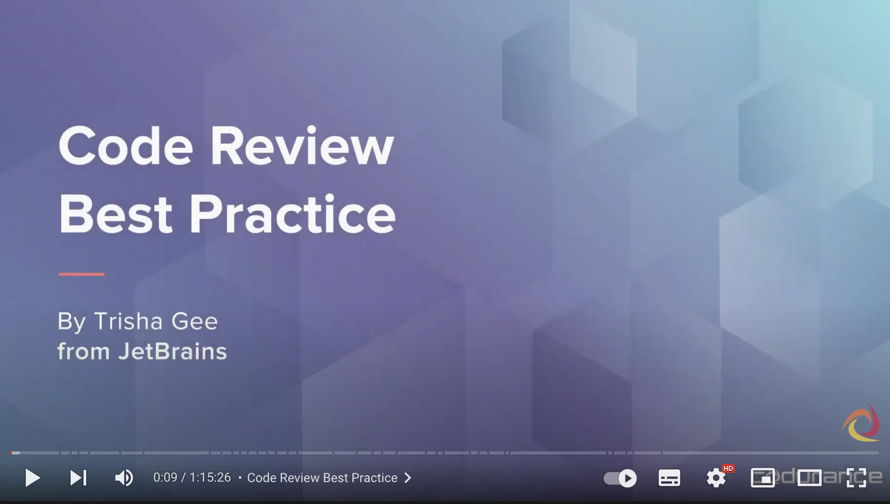</a>

<Exercise path="04.code-review/exercices/code-avengers" />

---
layout: center
---

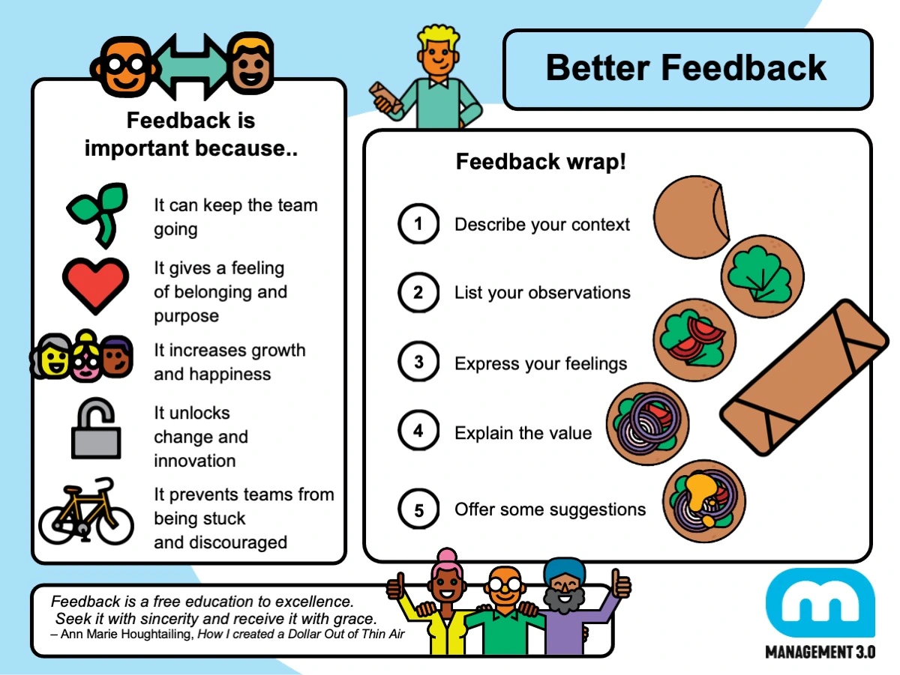

---

Conclusions · en groupe

# Ne laissez pas la review devenir un match d'ego

- Que pourriez-vous mettre en place dans les **10 prochains jours** pour améliorer la qualité des code reviews de votre équipe ?
- Comment le **Pair Programming** et la **Code Review** peuvent-ils s'articuler dans votre processus ?

> Être le plus expérimenté de l'équipe ne signifie pas que votre code n'a pas besoin d'être relu.

Pour aller plus loin : [Ship / Show / Ask](https://martinfowler.com/articles/ship-show-ask.html), Martin Fowler.

---
class: dense
---

Ressources

# Pour aller plus loin

- [Egoless Programming](https://blog.codinghorror.com/the-ten-commandments-of-egoless-programming/) · [Egoless Crafting](https://egolesscrafting.org/)
- [The Code Review Pyramid](https://www.morling.dev/blog/the-code-review-pyramid/), Gunnar Morling
- [Code Review Best Practices](https://blog.jetbrains.com/upsource/2018/08/30/code-review-best-practices/), Trisha Gee
- [Code Review Workflows](https://blog.jetbrains.com/upsource/tag/code-review-workflows/), JetBrains
- [Code Review Guidelines](https://blog.ndepend.com/what-is-code-review-guidelines-best-practices/), Patrick Smacchia
- [Ebook "What to look for in a code review"](http://jb.gg/book/codereview)
- [Agile Conversations : QRC](https://hennyportman.files.wordpress.com/2020/09/qrc-agile-conversations.pdf)
- [Management 3.0 : Better Feedback](https://management30.com/develop-competence/better-feedback/)
