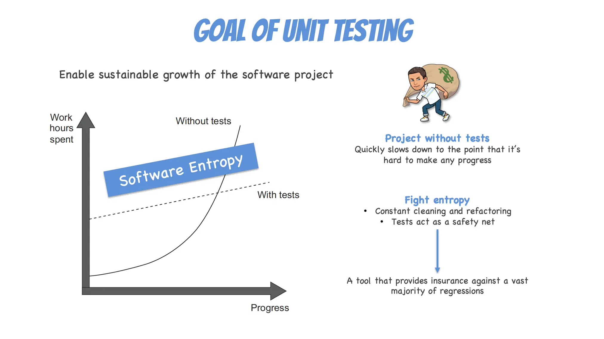
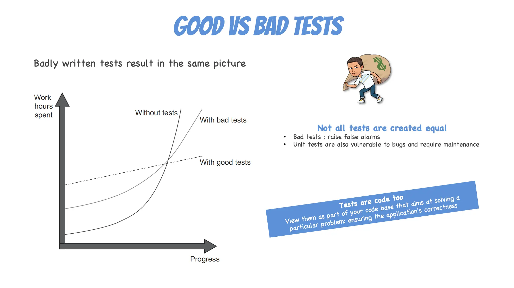
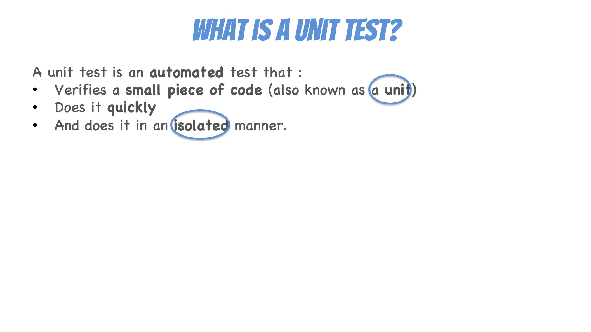
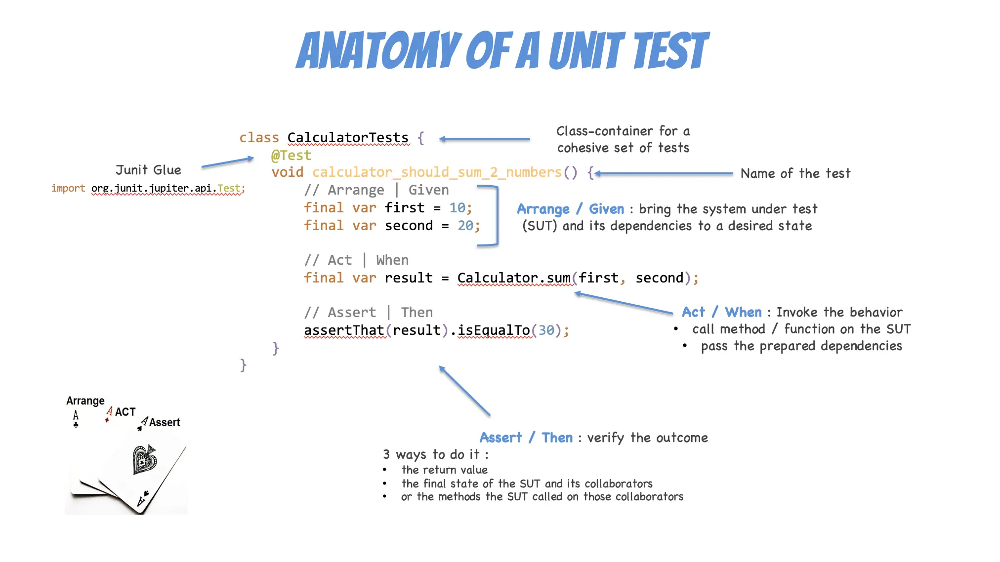
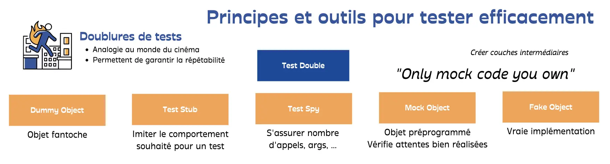

# Introduction aux Tests Unitaires
## Trois faits et une question

- En binôme, prenez 2 minutes pour trouver 3 faits sur les `Tests Unitaires` et 1 question que vous vous posez
  - Consolidez tous les faits de chaque binôme en une seule liste
- Revenez sur les faits et questions dans la partie `conclusion` si ce n'est pas fait avant

## Tests Unitaires







---

## Écrire des tests de qualité

### Pattern AAA — Arrange / Act / Assert

Le pattern **AAA** structure chaque test en trois phases distinctes pour améliorer la lisibilité et la maintenabilité.

| Phase       | Rôle                                            |
|-------------|-------------------------------------------------|
| **Arrange** | Préparer le contexte (données, objets, mocks)   |
| **Act**     | Exécuter l'action à tester (appel de méthode)   |
| **Assert**  | Vérifier que le résultat correspond à l'attendu |

```java
@Test
void shouldIncreaseBalanceWhenDepositing() {
    // Arrange
    var account = new BankAccount(100);

    // Act
    account.deposit(50);

    // Assert
    assertThat(account.getBalance()).isEqualTo(150);
}
```

> Une seule phase **Act** par test. Si vous avez besoin de deux actions pour vérifier un comportement, vous testez probablement deux choses différentes.

---

### F.I.R.S.T — Les propriétés d'un bon test unitaire

Un test unitaire de qualité respecte cinq propriétés :

#### ⚡ Fast — Rapide

Les tests doivent s'exécuter en millisecondes. Des tests lents découragent leur exécution fréquente.

```java
// ✅ Rapide : pas d'I/O, pas de base de données, pas de réseau
@Test
void shouldDecreaseBalanceWhenWithdrawing() {
    var account = new BankAccount(200);
    account.withdraw(80);
    assertThat(account.getBalance()).isEqualTo(120);
}
```

#### 🔒 Isolated — Isolé

Chaque test est indépendant des autres. L'ordre d'exécution ne doit pas influencer les résultats. Utilisez des **Test Doubles** (mocks, stubs) pour isoler les dépendances externes.

```java
// ✅ Isolé : la dépendance externe est substituée par un mock
@Test
void shouldSendConfirmationWhenTransferSucceeds() {
    var notifier = mock(Notifier.class);
    var account = new BankAccount(500, notifier);

    account.transfer(200);

    verify(notifier).send("Transfer of 200 completed");
}
```

#### 🔁 Repeatable — Reproductible

Un test doit produire le même résultat à chaque exécution, quel que soit l'environnement (CI, machine locale, heure du jour...). Évitez les dépendances au temps, au réseau ou à l'état global.

```java
// ❌ Non reproductible : dépend d'un état global mutable
@Test
void shouldGenerateUniqueId() {
    var id = IdGenerator.next(); // résultat différent à chaque appel
    assertThat(id).isEqualTo("ID-1"); // Échoue dès la 2e exécution !
}
```

#### ✅ Self-validating — Auto-validant

Le test doit clairement indiquer succès ou échec **sans intervention humaine**. Pas de `System.out.println`, pas d'inspection manuelle de logs.

```java
// ✅ Auto-validant : l'assertion est explicite
@Test
void shouldThrowWhenWithdrawingMoreThanBalance() {
    var account = new BankAccount(100);

    assertThatThrownBy(() -> account.withdraw(200))
        .isInstanceOf(IllegalArgumentException.class)
        .hasMessage("Insufficient funds");
}
```

#### ⏱️ Timely — Au bon moment

Les tests sont écrits **au moment** où le code est produit — idéalement avant (TDD). Un test écrit après coup est souvent biaisé par l'implémentation existante.

---

### Test Desiderata — Ce qu'on désire d'un test

Kent Beck liste 12 propriétés souhaitables pour un test. Elles ne sont pas toutes atteignables simultanément — c'est une question de compromis conscient.

| Propriété                 | Description                                              |
|---------------------------|----------------------------------------------------------|
| **Isolated**              | Le test ne dépend pas d'autres tests                     |
| **Composable**            | Les tests peuvent s'assembler librement                  |
| **Fast**                  | Exécution rapide                                         |
| **Inspiring**             | Les tests qui passent inspirent confiance                |
| **Writable**              | Facile à écrire                                          |
| **Readable**              | Facile à lire et comprendre                              |
| **Behavioral**            | Sensible aux changements de comportement                 |
| **Structure-insensitive** | Insensible aux refactorings internes                     |
| **Automated**             | S'exécute sans intervention humaine                      |
| **Specific**              | Si le test échoue, la cause est évidente                 |
| **Deterministic**         | Même résultat à chaque exécution                         |
| **Predictive**            | Si tous les tests passent, le code est prêt pour la prod |

> "Tests are not just about finding bugs — they're about designing the system." — Kent Beck

#### Exemple : Specific vs. vague

```java
// ❌ Vague : que s'est-il passé exactement ?
@Test
void testBankAccount() {
    var account = new BankAccount(100);
    account.deposit(50);
    account.withdraw(200); // ← lequel échoue ? les deux ? le premier ?
    assertThat(account.getBalance()).isEqualTo(0);
}

// ✅ Spécifique : un seul comportement par test, nom explicite
@Test
void shouldIncreaseBalanceWhenDepositing() {
    var account = new BankAccount(100);
    account.deposit(50);
    assertThat(account.getBalance()).isEqualTo(150);
}

@Test
void shouldThrowWhenWithdrawingMoreThanBalance() {
    var account = new BankAccount(100);
    assertThatThrownBy(() -> account.withdraw(200))
        .isInstanceOf(IllegalArgumentException.class);
}
```

---

## Test it or Die Trying

- [Java](java/how-to.md)
- [C#](c#/how-to.md)

## Retour sur les questions

Revenez sur les faits et questions du début :
- Êtes-vous capable de répondre à vos questions maintenant ?
- Relisez vos faits et mettez à jour ceux que vous avez appris différemment

## Ressources

- [Guide step-by-step](https://github.com/ythirion/unit-tests-intro/blob/main/solutions/java/step-by-step.md)
- [Unit Testing - Principles, Practices and Patterns — Vladimir Khorikov](resources/unit-testing-principles-practices-patterns.pdf)
- [Test Desiderata — Kent Beck](https://kentbeck.github.io/TestDesiderata/)
- [F.I.R.S.T Principles — Clean Code, Robert C. Martin](https://www.oreilly.com/library/view/clean-code-a/9780136083238/)
- [JUnit 5 User Guide](https://junit.org/junit5/docs/current/user-guide/)
- [Mockito Documentation](https://site.mockito.org/)
