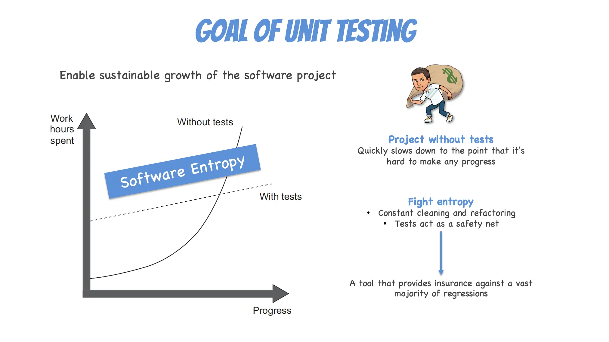
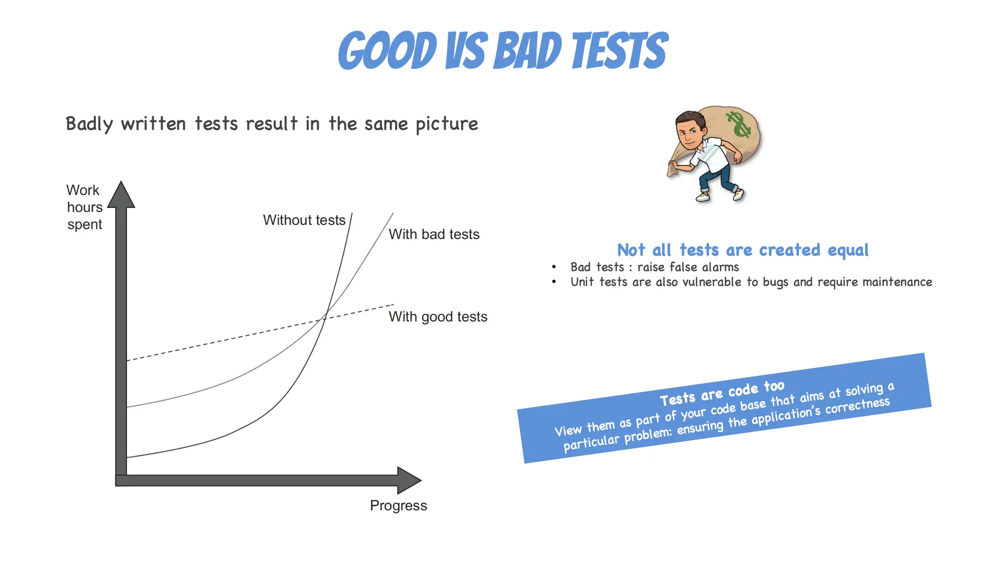
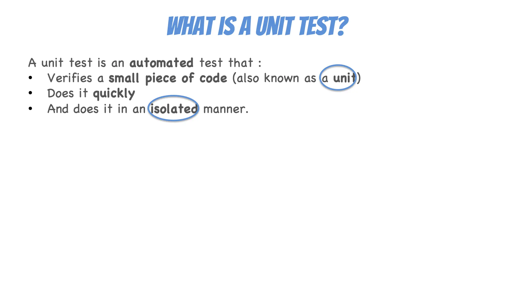
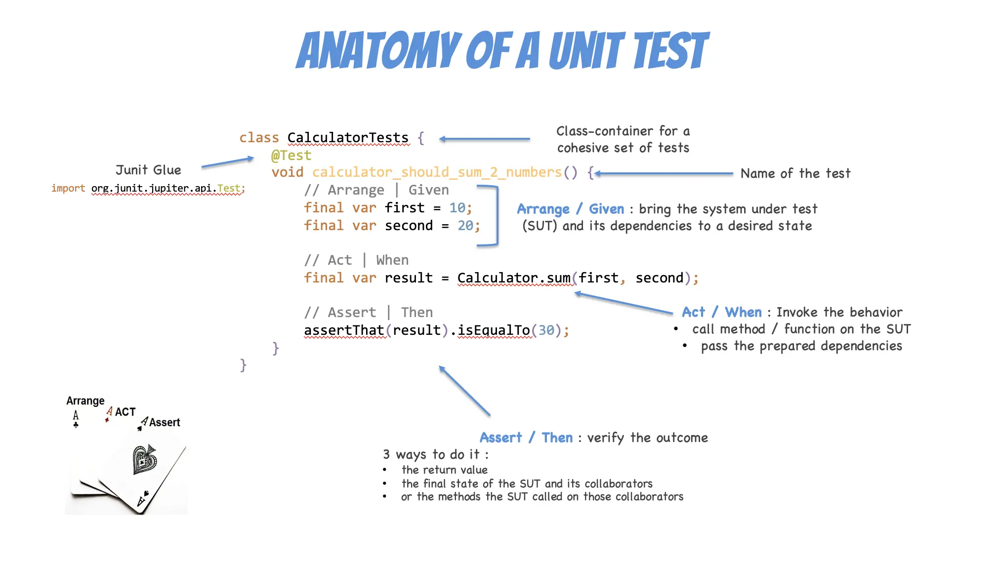
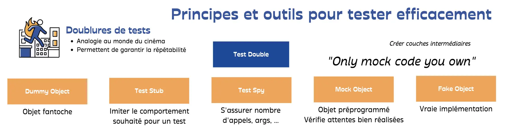

# Introduction aux <mark>tests unitaires</mark>

Rapides, isolés, reproductibles : ce qu'on attend d'un bon test.

---

<span class="kicker">Connexion · en binôme · 2'</span>

# Trois faits et une question

- En binôme, trouvez **3 faits** sur les `Tests Unitaires` et **1 question** que vous vous posez
- Consolidez les faits de chaque binôme en une seule liste
- On y revient en conclusion

---
layout: center
---



---
layout: center
---



---
layout: center
---



---
layout: center
---



---
layout: center
---



---

<span class="kicker">Concepts · écrire des tests de qualité</span>

# Le pattern AAA : Arrange / Act / Assert

<div class="cols">
<div>

| Phase       | Rôle                                            |
|-------------|-------------------------------------------------|
| **Arrange** | Préparer le contexte (données, objets, mocks)   |
| **Act**     | Exécuter l'action à tester (appel de méthode)   |
| **Assert**  | Vérifier que le résultat correspond à l'attendu |

> Une seule phase **Act** par test. Si vous avez besoin de deux actions pour vérifier un comportement, vous testez probablement deux choses différentes.

</div>
<div v-click>

```java
@Test
void shouldIncreaseBalanceWhenDepositing() {
    // Arrange
    var account = new BankAccount(100);

    // Act
    account.deposit(50);

    // Assert
    assertThat(account.getBalance()).isEqualTo(150);
}
```

</div>
</div>

---

<span class="kicker">Concepts · F.I.R.S.T</span>

# Fast et Isolated

<div class="cols">
<div>

### ⚡ Fast : rapide

Les tests s'exécutent en millisecondes. Des tests lents découragent leur exécution fréquente.

```java
// ✅ Pas d'I/O, pas de base, pas de réseau
@Test
void shouldDecreaseBalanceWhenWithdrawing() {
    var account = new BankAccount(200);
    account.withdraw(80);
    assertThat(account.getBalance()).isEqualTo(120);
}
```

</div>
<div v-click>

### 🔒 Isolated : isolé

Chaque test est indépendant des autres. On utilise des **Test Doubles** pour isoler les dépendances externes.

```java
// ✅ La dépendance externe est un mock
@Test
void shouldSendConfirmationWhenTransferSucceeds() {
    var notifier = mock(Notifier.class);
    var account = new BankAccount(500, notifier);

    account.transfer(200);

    verify(notifier).send("Transfer of 200 completed");
}
```

</div>
</div>

---

<span class="kicker">Concepts · F.I.R.S.T</span>

# Repeatable, Self-validating, Timely

<div class="cols">
<div>

### 🔁 Repeatable : reproductible

Même résultat à chaque exécution, quel que soit l'environnement. Évitez le temps, le réseau, l'état global.

```java
// ❌ Dépend d'un état global mutable
@Test
void shouldGenerateUniqueId() {
    var id = IdGenerator.next();
    assertThat(id).isEqualTo("ID-1"); // échoue à la 2e exécution
}
```

### ⏱️ Timely : au bon moment

Écrit **au moment** où le code est produit, idéalement avant (TDD).

</div>
<div v-click>

### ✅ Self-validating : auto-validant

Succès ou échec **sans intervention humaine**. Pas de `System.out.println`, pas d'inspection de logs.

```java
@Test
void shouldThrowWhenWithdrawingMoreThanBalance() {
    var account = new BankAccount(100);

    assertThatThrownBy(() -> account.withdraw(200))
        .isInstanceOf(IllegalArgumentException.class)
        .hasMessage("Insufficient funds");
}
```

</div>
</div>

---
class: dense
---

<span class="kicker">Concepts</span>

# Test Desiderata

Kent Beck liste 12 propriétés souhaitables. Elles ne sont pas toutes atteignables en même temps : c'est une question de **compromis conscient**.

<div class="cols">
<div>

| Propriété      | Description                              |
|----------------|------------------------------------------|
| **Isolated**   | Ne dépend pas d'autres tests             |
| **Composable** | Les tests s'assemblent librement         |
| **Fast**       | Exécution rapide                         |
| **Inspiring**  | Les tests qui passent inspirent confiance |
| **Writable**   | Facile à écrire                          |
| **Readable**   | Facile à lire et comprendre              |

</div>
<div v-click>

| Propriété                 | Description                                      |
|---------------------------|--------------------------------------------------|
| **Behavioral**            | Sensible aux changements de comportement         |
| **Structure-insensitive** | Insensible aux refactorings internes             |
| **Automated**             | S'exécute sans intervention humaine              |
| **Specific**              | Si le test échoue, la cause est évidente         |
| **Deterministic**         | Même résultat à chaque exécution                 |
| **Predictive**            | Tous verts : le code est prêt pour la prod       |

</div>
</div>

> "Tests are not just about finding bugs, they're about designing the system." Kent Beck

---

<span class="kicker">Concepts · Test Desiderata</span>

# Specific vs vague

<div class="cols">
<div>

```java
// ❌ Vague : que s'est-il passé exactement ?
@Test
void testBankAccount() {
    var account = new BankAccount(100);
    account.deposit(50);
    account.withdraw(200); // lequel échoue ?
    assertThat(account.getBalance()).isEqualTo(0);
}
```

</div>
<div v-click>

```java
// ✅ Un comportement par test, nom explicite
@Test
void shouldIncreaseBalanceWhenDepositing() {
    var account = new BankAccount(100);
    account.deposit(50);
    assertThat(account.getBalance()).isEqualTo(150);
}

@Test
void shouldThrowWhenWithdrawingMoreThanBalance() {
    var account = new BankAccount(100);
    assertThatThrownBy(() -> account.withdraw(200))
        .isInstanceOf(IllegalArgumentException.class);
}
```

</div>
</div>

---

<span class="kicker">Pratique concrète · en binôme · 35'</span>

# Test it or Die Trying

<div class="cols">
<div>

### Calculator

- Écrivez quelques tests sur la classe `Calculator`
- Quels sont les **cas limites** ? Testez-les aussi

> Vous n'avez pas le droit de modifier le code de production.

</div>
<div v-click>

### TimeUtility

- Écrivez au moins un test
- Quel **problème** rencontrez-vous ?
- Vous pouvez utiliser `mockito` (Java) comme bibliothèque de Test Doubles

> Never trust a test that you have not seen failed.

</div>
</div>

<Exercise path="05.unit-tests/exercices/test-it-or-die-trying" />

---

<span class="kicker">Pratique concrète · Test it or Die Trying</span>

# Le code à tester

<div class="cols">
<div>

```java
public class Calculator {
    public static final String ADD = "add";
    public static final String MULTIPLY = "multiply";
    public static final String DIVIDE = "divide";
    public static final String SUBTRACT = "subtract";

    private static final Map<String, BiFunction<Integer, Integer, Integer>>
        supportedOperators = Map.of(
            ADD, (a, b) -> a + b,
            MULTIPLY, (a, b) -> a * b,
            DIVIDE, (a, b) -> a / b,
            SUBTRACT, (a, b) -> a - b
        );

    public int calculate(int a, int b, String operator) {
        if (!supportedOperators.containsKey(operator)) {
            throw new IllegalArgumentException("Not supported operator");
        }
        return supportedOperators.get(operator).apply(a, b);
    }
}
```

</div>
<div v-click>

```java
public class TimeUtility {
    public String getTimeOfDay() {
        var time = now();

        if (time.getHour() < 6) {
            return "Night";
        } else if (time.getHour() < 12) {
            return "Morning";
        } else if (time.getHour() < 18) {
            return "Afternoon";
        }
        return "Evening";
    }
}
```

</div>
</div>

---

<span class="kicker">Conclusions · en binôme</span>

# Retour sur les questions

Revenez sur les faits et questions du début :

- Êtes-vous capable de **répondre à vos questions** maintenant ?
- Relisez vos faits et **mettez à jour** ceux que vous avez appris différemment

---

<span class="kicker">Ressources</span>

# Pour aller plus loin

- [Unit Testing : Principles, Practices and Patterns](https://www.manning.com/books/unit-testing), Vladimir Khorikov
- [Test Desiderata](https://kentbeck.github.io/TestDesiderata/), Kent Beck
- [F.I.R.S.T Principles : Clean Code](https://www.oreilly.com/library/view/clean-code-a/9780136083238/), Robert C. Martin
- [JUnit 5 User Guide](https://junit.org/junit5/docs/current/user-guide/) · [Mockito](https://site.mockito.org/) · [xUnit](https://xunit.net/)

<Exercise path="05.unit-tests/resources/unit-testing-principles-practices-patterns.pdf" tag="PDF" />
