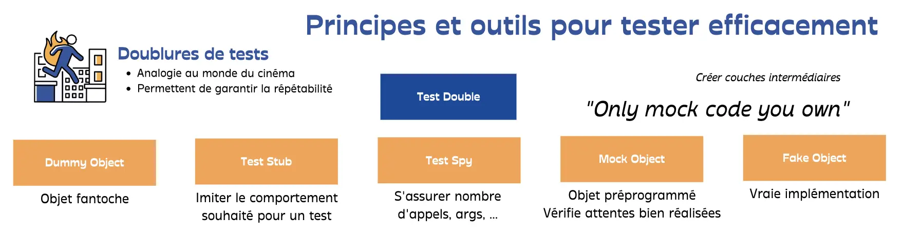

# Test <mark>Doubles</mark>

Les 50 nuances de doublures de tests.

---
class: dense
---

<span class="kicker">Connexion · en binôme</span>

# Association de mots

<div class="cols cols--wide-left">
<div>

Associez chaque mot à sa définition :

<div class="chips"><span>Test Double</span><span>Spy</span><span>Mock</span><span>Fake</span><span>Stub</span><span>Dummy</span><span>SUT</span></div>

1. Remplace un objet dont dépend le SUT par un objet de test qui vérifie que le SUT l'utilise correctement
2. Capture les appels sortants faits par le SUT vers un autre composant, pour vérification ultérieure
3. On remplace un composant dont dépend le SUT par un "équivalent spécifique au test"
4. On remplace un composant par une implémentation allégée mais fonctionnelle
5. Le code que l'on teste
6. On passe un objet sans implémentation comme argument d'une méthode appelée sur le SUT
7. On remplace un objet réel par un objet de test qui fournit les entrées indirectes souhaitées au SUT

</div>
<div>


</div>
</div>

---
class: dense
---

<span class="kicker">Association de mots · correction</span>

# Les définitions

| Mot             | Définition                                                                                      |
|-----------------|-------------------------------------------------------------------------------------------------|
| `Test Double`   | On remplace un composant dont dépend le SUT par un "équivalent spécifique au test"              |
| `Spy`           | Capture les appels sortants faits par le SUT vers un autre composant, pour vérification ultérieure |
| `Fake`          | On remplace un composant par une implémentation allégée mais fonctionnelle                      |
| `Stub`          | On remplace un objet réel par un objet de test qui fournit les entrées indirectes souhaitées au SUT |
| `Mock`          | Remplace un objet dont dépend le SUT par un objet de test qui vérifie que le SUT l'utilise correctement |
| `Dummy`         | On passe un objet sans implémentation comme argument d'une méthode appelée sur le SUT           |
| `SUT`           | System Under Test : le code que l'on teste                                                      |

---

<span class="kicker">Concepts</span>

# Pourquoi des Test Doubles ?

<div class="cols">
<div>

### Isolation

Le code dépend toujours d'autres composants (collaborateurs). Les Test Doubles **brisent ces dépendances** pour tester le SUT seul.

### Répétabilité

Ils remplacent les dépendances non déterministes : API externe, base de données, données aléatoires ou temporelles...

### Performance

Des composants lourds remplacés par des équivalents légers : les tests restent **rapides**.

</div>
<div>


</div>
</div>

---

<span class="kicker">Concepts</span>

# Taxonomie des Test Doubles

| Type      | Usage                                    | Implémentation             | Ce qu'on vérifie  |
|-----------|------------------------------------------|----------------------------|-------------------|
| **Dummy** | Remplir un paramètre requis, non utilisé | `null` ou vide             | Rien              |
| **Fake**  | Remplacer une dépendance lourde          | Vraie logique, simplifiée  | État du SUT       |
| **Stub**  | Contrôler les **entrées** du SUT         | Retourne des valeurs fixes | État du SUT       |
| **Spy**   | Capturer les **sorties** du SUT          | Enregistre les appels      | Sorties capturées |
| **Mock**  | Vérifier les **interactions sortantes**  | Vérifie les appels         | Comportement      |

---

<span class="kicker">Concepts</span>

# Mock vs Stub : la distinction fondamentale

La différence tient dans la **direction de l'interaction** et dans ce qu'on vérifie :

|                | **Stub**                                             | **Mock**                                                   |
|----------------|------------------------------------------------------|------------------------------------------------------------|
| Direction      | Interaction **entrante** (le SUT reçoit des données) | Interaction **sortante** (le SUT appelle un collaborateur) |
| Question posée | Le SUT produit-il le bon résultat ?                  | Le SUT a-t-il bien invoqué la dépendance ?                 |
| Vérification   | État du SUT                                          | Comportement du SUT                                        |

> "Mocks are not stubs", Martin Fowler

Un stub qui sert aussi à vérifier des interactions devient un mock. Ne mélangez pas les deux rôles dans un même objet.

---

<span class="kicker">Concepts · les doubles un par un</span>

# Dummy

> On passe un objet sans implémentation comme argument d'une méthode appelée sur le SUT.

Un placeholder requis par la signature, **sans aucun impact** sur le résultat.

```java
@Test
void shouldThrowWhenDividingByZero() {
    var calculator = new Calculator();
    int numerator = new Random().nextInt(); // dummy : sa valeur n'a aucun impact
    int zero = 0;

    assertThatThrownBy(() -> calculator.divide(numerator, zero))
        .isInstanceOf(IllegalArgumentException.class);
}
```

> `null` est souvent suffisant comme Dummy, sauf si le SUT le valide à l'entrée.

---
class: dense
---

<span class="kicker">Concepts · les doubles un par un</span>

# [Fake](http://xunitpatterns.com/Fake%20Object.html)

> On remplace un composant par une implémentation allégée mais fonctionnelle.

<div class="cols">
<div>

```java
@Test
void shouldNotifyAllClientsWhenScenarioIsReceived() {
    var logs = new StringBuilder();
    var clients = List.of(
        new Client("Cliff Booth", "cliff.booth@double.com"),
        new Client("Rick Dalton", "rick.dalton@double.com")
    );
    var notifier = new FakeNotifier(logs::append);
    var handler = new ScenarioReceivedEventHandler(notifier, clients);

    handler.handle(new ScenarioReceived("The 14 fists of McCluskey"));

    assertThat(logs.toString())
        .contains("Hello : Cliff Booth, I have just received ...")
        .contains("Hello : Rick Dalton, I have just received ...");
}
```

</div>
<div v-click>

```java
static class FakeNotifier implements Notifier {
    private final Consumer<String> output;

    FakeNotifier(Consumer<String> output) { this.output = output; }

    @Override
    public void notify(Client client, ScenarioReceived scenario) {
        output.accept("Hello : " + client.name()
            + ", I have just received a new scenario called '"
            + scenario.title() + "' !!!");
    }
}
```

Le `Fake` a une **vraie logique** : il s'écrit à la main, pas avec une librairie.

> Il peut aussi servir en recette : au lieu d'envoyer de vraies notifications, il écrit dans les logs.

</div>
</div>

---

<span class="kicker">Concepts · les doubles un par un</span>

# [Stub](http://xunitpatterns.com/Test%20Stub.html)

> On remplace un objet réel par un objet de test qui fournit les entrées indirectes souhaitées au SUT.

<div class="cols">
<div>

```java
@Test
void shouldDivideWhenAuthorizationIsAccepted() {
    var calculator = new Calculator(new AllowAccessAuthorizer());
    assertThat(calculator.divide(9, 3)).isEqualTo(3);
}

@Test
void shouldThrowWhenAuthorizationIsDenied() {
    var calculator = new Calculator(new DenyAccessAuthorizer());
    assertThatThrownBy(() -> calculator.divide(9, 3))
        .isInstanceOf(UnauthorizedAccessException.class);
}
```

</div>
<div v-click>

```java
static class AllowAccessAuthorizer implements Authorizer {
    @Override public boolean authorize() { return true; }
}

static class DenyAccessAuthorizer implements Authorizer {
    @Override public boolean authorize() { return false; }
}
```

Le `Stub` **contrôle les entrées** du SUT : comment réagit-il selon ce que lui renvoient ses collaborateurs ?

</div>
</div>

---
class: dense
---

<span class="kicker">Concepts · les doubles un par un</span>

# [Spy](http://xunitpatterns.com/Mock%20Object.html)

> Capture les appels sortants faits par le SUT vers un autre composant, pour vérification ultérieure.

<div class="cols">
<div>

```java
@Test
void shouldSaveJokeWhenHandlingRequest() {
    var repository = new SpyJokeRepository();
    var useCase = new CreateAJokeUseCase(repository);
    var request = new CreateJokeRequest(
        "Anonymous",
        "Quelle partie du légume ne passe pas dans le mixer ? La chaise roulante"
    );

    useCase.handle(request);

    repository.shouldContain(request);
}
```

</div>
<div v-click>

```java
static class SpyJokeRepository implements JokeRepository {
    private final List<Joke> jokes = new ArrayList<>();

    @Override
    public void save(Joke joke) { jokes.add(joke); }

    public void shouldContain(CreateJokeRequest request) {
        assertThat(jokes)
            .filteredOn(j -> j.author().equals(request.author())
                          && j.text().equals(request.text()))
            .hasSize(1);
    }
}
```

</div>
</div>

---
class: dense
---

<span class="kicker">Concepts · les doubles un par un</span>

# [Mock](http://xunitpatterns.com/Mock%20Object.html)

> Remplace un objet dont dépend le SUT par un objet de test qui **vérifie** que le SUT l'utilise correctement.

<div class="cols">
<div>

```java
@Test
void shouldNotifyAllClientsWhenScenarioIsReceived() {
    var clients = List.of(
        new Client("Cliff Booth", "cliff.booth@double.com"),
        new Client("Rick Dalton", "rick.dalton@double.com")
    );
    var mockNotifier = new MockNotifier();
    var handler = new ScenarioReceivedEventHandler(mockNotifier, clients);
    var event = new ScenarioReceived("The 14 fists of McCluskey");

    handler.handle(event);

    assertThat(mockNotifier.hasBeenCalledForAll(clients, event)).isTrue();
}
```

</div>
<div v-click>

```java
static class MockNotifier implements Notifier {
    private final List<Map.Entry<Client, ScenarioReceived>> calls
        = new ArrayList<>();

    @Override
    public void notify(Client client, ScenarioReceived scenario) {
        calls.add(Map.entry(client, scenario));
    }

    public boolean hasBeenCalledForAll(List<Client> clients,
                                       ScenarioReceived event) {
        return clients.stream()
            .allMatch(c -> calls.contains(Map.entry(c, event)));
    }
}
```

</div>
</div>

---

<span class="kicker">Concepts</span>

# Limites : only mock what you own

<div class="cols">
<div>

Substituer un objet d'un système externe expose à des risques : si l'API externe change, vos mocks ne le détecteront pas. **Les tests passent, la prod casse.**

**Règle** : ne mockez que **vos propres interfaces**. Pour les dépendances externes, créez une couche d'abstraction (pattern Adapter) et mockez cette interface à vous.

</div>
<div>



</div>
</div>

---

<span class="kicker">Pratique concrète · en binôme</span>

# Avec une librairie : Mockito

<div class="cols">
<div>

Les doubles écrits à la main sont du code de test **à maintenir**. Une librairie de mocking les remplace par du code déclaratif.

```java
// Créer un mock
var notifier = mock(Notifier.class);

// Stubber une méthode (contrôler une entrée)
when(authorizer.authorize()).thenReturn(true);

// Vérifier une interaction sortante
verify(notifier, times(1)).notify(client, event);
verify(notifier, never()).notify(any(), any());
```

</div>
<div v-click>

Refactorez les tests pour utiliser **[Mockito](https://site.mockito.org/)** (ou `Moq` en C#) :

- `AllowAccessAuthorizer` et `DenyAccessAuthorizer` → `when(...).thenReturn(...)`
- `SpyJokeRepository` → `verify(...)`
- `MockNotifier` → `verify(...)` pour chaque client

> Et le `FakeNotifier` ? Peut-on le remplacer ?

</div>
</div>

<Exercise path="07.test-doubles/exercices/mockito" />

---

<span class="kicker">Conclusions · en groupe</span>

# La chose la plus importante apprise aujourd'hui ?

- Quand préférez-vous un **Stub** à un **Mock** ?
- Dans quel cas écrire un **Fake** à la main plutôt que d'utiliser Mockito ?
- Que risque-t-on à mocker du code qu'on **ne possède pas** ?

### Ressources

- [XUnit Test Patterns](http://xunitpatterns.com/), Gerard Meszaros
- [Mocks Aren't Stubs](https://martinfowler.com/articles/mocksArentStubs.html), Martin Fowler
- [The Little Mocker](https://blog.cleancoder.com/uncle-bob/2014/05/14/TheLittleMocker.html), Robert C. Martin
- [Dummy vs Stub vs Spy vs Fake vs Mock](https://nirajrules.wordpress.com/2011/08/27/dummy-vs-stub-vs-spy-vs-fake-vs-mock/)
