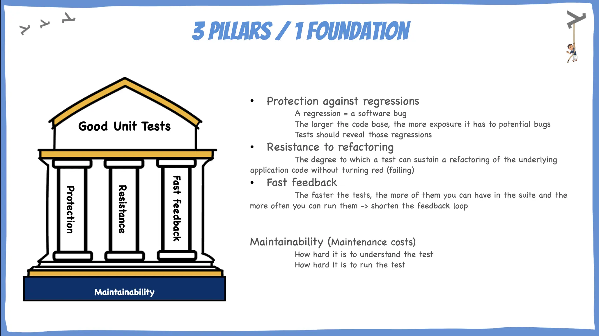
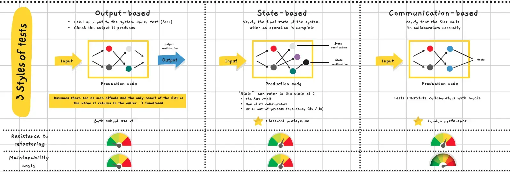

# Clean Tests
## Mythbusters

En petits groupes, classez chaque affirmation sur les tests unitaires en **Mythe** ou **Vérité**.

| Affirmation                                                              |
|--------------------------------------------------------------------------|
| Les tests rendent les modifications plus difficiles à faire              |
| Avec des tests, je n'ai plus de portion de code que j'ai peur de toucher |
| Les tests unitaires sont écrits uniquement par les testeurs              |
| Mon code est tellement simple que je n'ai pas besoin de tests            |
| Un code testé unitairement est de meilleure qualité qu'un code non testé |
| Les tests unitaires ne sont utiles que dans les grandes équipes          |
| Les tests réduisent le coût du développement                             |
| Écrire des tests prend trop de temps                                     |

<details>
  <summary>Corrections</summary>

| Affirmation                                                              | Réalité                                                                                                                                        |
|--------------------------------------------------------------------------|------------------------------------------------------------------------------------------------------------------------------------------------|
| ~~Les tests rendent les modifications plus difficiles à faire~~          | **Vérité inversée** : les tests facilitent les modifications — ils permettent de refactorer sans crainte, encore et encore.                    |
| Avec des tests, je n'ai plus de portion de code que j'ai peur de toucher | **Vérité** : les tests agissent comme un filet de sécurité et renforcent la confiance.                                                         |
| ~~Les tests unitaires sont écrits uniquement par les testeurs~~          | **Mythe** : ce sont les développeurs qui écrivent les tests — idéalement à chaque modification du code.                                        |
| ~~Mon code est tellement simple que je n'ai pas besoin de tests~~        | **Mythe** : un code simple mérite des tests simples. Il n'y a pas d'excuse.                                                                    |
| Un code testé unitairement est de meilleure qualité qu'un code non testé | **Vérité** : les tests identifient les défauts en amont, exposent les cas limites et forcent à mieux concevoir le code.                        |
| ~~Les tests unitaires ne sont utiles que dans les grandes équipes~~      | **Mythe** : même une équipe d'une seule personne en bénéficie — et c'est encore plus risqué de tout concentrer dans une seule tête.            |
| Les tests réduisent le coût du développement                             | **Vérité** : les bugs détectés tôt coûtent beaucoup moins cher à corriger.                                                                     |
| ~~Écrire des tests prend trop de temps~~                                 | **Mythe** : c'est une question d'habitude. Les tests de régression font avancer sans regresser — comment testeriez-vous votre code autrement ? |

</details>

## Principes et pratiques des tests
### L'objectif du test unitaire

> L'objectif d'un test unitaire est de permettre la **croissance durable** d'un projet logiciel.

Un projet sans tests :
- Ralentit rapidement jusqu'à rendre toute progression difficile
- Accumule de l'**entropie logicielle** : le code se dégrade au fil des modifications

Les tests combattent cette entropie :
- Ils exigent un nettoyage et un refactoring constant
- Ils agissent comme un **filet de sécurité** contre les régressions

### Bons vs mauvais tests

Des tests mal écrits produisent les mêmes problèmes qu'un code mal écrit :
- Ils déclenchent de **fausses alarmes**
- Ils nécessitent une **maintenance coûteuse**

> Les tests sont du code. Traitez-les avec le même soin.

Un bon test a de la valeur. Un mauvais test en a peu — voire aucune. La clé est de savoir **reconnaître et écrire des tests de valeur**.

### Qu'est-ce qu'un test unitaire ?

Un test unitaire est un test automatisé qui :
1. **Vérifie un petit bout de code** (une "unité")
2. **S'exécute rapidement**
3. **S'exécute de manière isolée**

> Le test unitaire n'est pas une activité secondaire — c'est l'activité **principale** d'un bon développeur.

#### Les deux écoles

Il existe deux visions de ce que constitue une "unité" :

|                                               | École de Londres                          | École Classique (Detroit)                              |
|-----------------------------------------------|-------------------------------------------|--------------------------------------------------------|
| **Une unité, c'est...**                       | Une classe                                | Une classe ou un ensemble de classes (un comportement) |
| **On isole avec des doubles de test pour...** | Toutes les dépendances sauf les immuables | Les dépendances **partagées** uniquement               |

### Les 3 piliers + 1 fondation

Un bon test unitaire repose sur 3 piliers et 1 fondation :



| Pilier                                | Description                                                                             |
|---------------------------------------|-----------------------------------------------------------------------------------------|
| **Protection contre les régressions** | Un test doit détecter les bugs introduits lors des modifications                        |
| **Résistance au refactoring**         | Un test ne doit pas échouer quand on refactore le code sans changer son comportement    |
| **Feedback rapide**                   | Plus les tests sont rapides, plus on peut en lancer souvent → boucle de feedback courte |
| **Maintenabilité**                    | Un test doit être facile à lire et facile à faire tourner                               |

### Nommer ses tests

Un bon nom de test doit permettre de comprendre **ce que le test vérifie** et **comment le système se comporte**.

❌ Mauvais noms :
```
delivery_is_invalid
delivery_should_be_invalid
```

✅ Bon nom :
```
delivery_with_past_date_should_be_invalid
```

Un nom de test doit contenir :
- Le **scénario** testé
- Le **résultat attendu**

**Règles importantes :**
- Ne pas suivre une convention de nommage rigide — elle bride l'expression
- Nommer le test comme si vous décriviez le scénario à un expert métier **non technique**
- Un business analyst ou un domaine expert doit pouvoir comprendre le nom
- Utiliser des phrases — elles améliorent la lisibilité, surtout pour les noms longs

### Les 3 styles de tests unitaires



| Style                   | Description                                                                 | Avantage                        | Inconvénient                                                     |
|-------------------------|-----------------------------------------------------------------------------|---------------------------------|------------------------------------------------------------------|
| **Output-based**        | On fournit une entrée au SUT et on vérifie sa sortie. Pas d'effets de bord. | Résistant au refactoring        | Nécessite un code fonctionnel (sans effets de bord)              |
| **State-based**         | On vérifie l'état du système après une opération                            | Naturel pour la plupart des cas | Plus fragile si l'état interne change                            |
| **Communication-based** | On vérifie que le SUT appelle correctement ses collaborateurs (via mocks)   | Utile pour les interactions     | Fragile au refactoring — si l'interaction change, le test change |

### Couverture de code (Code Coverage)

> La couverture de code mesure quelle portion du code source est exécutée par la suite de tests.

**Règle fondamentale :**
- Une couverture **faible** (ex : 10%) prouve qu'on ne teste pas assez ✅
- Une couverture **élevée** (même 100%) ne prouve **pas** qu'on a de bons tests ❌

> La couverture est un bon **indicateur négatif**, mais un mauvais indicateur positif.

#### Branch Coverage

La couverture de branches se concentre sur les structures de contrôle (`if`, `switch`) : combien de chemins sont traversés par au moins un test.

```java
// 2 chemins possibles : length > 5 et length <= 5
// Un test sur un seul chemin = 50% de branch coverage
public static boolean isLong(String s) {
    return s.length() > 5;
}
```

### Les 4 types de code

Tout code de production peut être catégorisé selon deux dimensions :
- **Complexité / importance métier** : nombre de chemins de décision (complexité cyclomatique), importance pour le domaine
- **Nombre de collaborateurs** : couplage avec d'autres classes ou services

|                                  | Peu de collaborateurs              | Beaucoup de collaborateurs   |
|----------------------------------|------------------------------------|------------------------------|
| **Complexe / important métier**  | Modèle de domaine & algorithmes 🎯 | Code sur-compliqué ⚠️        |
| **Peu complexe / peu important** | Code trivial                       | Contrôleurs / orchestrateurs |

- **Modèle de domaine & algorithmes** : testez prioritairement ici — c'est là que le ROI est le meilleur
- **Code sur-compliqué** : à refactorer en séparant les algorithmes des contrôleurs

## Anti-patterns

Ouvrez le projet `clean-tests` :
- [Java](anti-patterns/java)
- [C#](anti-patterns/csharp)

1. **Identifiez les anti-patterns** dans les 3 classes de tests du package `antipatterns` — 10 min
2. **Débrief collectif** — 10 min
3. **Refactorez** les tests — 15 min
4. **Débrief collectif** — 10 min

Détails des anti-patterns [ici](ANTI-PATTERNS.md).

## Conclusion

### Bonnes pratiques récapitulatives

- **Un comportement par test** — pas une donnée, un comportement
- **Triangulation** : écrivez des tests plus spécifiques pour forcer des solutions plus génériques
- **Noms métier** : les noms reflètent le domaine, compréhensibles par un expert non-technique
- **Voyez le test échouer** : assurez-vous qu'il échoue pour la bonne raison
- **Feedback utile** : un test en échec doit indiquer clairement *pourquoi*
- **Tests séparés du code de production** : structure de projet miroir
- **Évitez les données non-déterministes** : passez une horloge ou une fonction pour les dates


## Ressources

- [Unit Testing — Principles, Practices and Patterns — Vladimir Khorikov](https://www.manning.com/books/unit-testing)
- [Clean Tests Workshop — Yoan Thirion](https://yoan-thirion.gitbook.io/knowledge-base/software-craftsmanship/testing/clean-tests)
