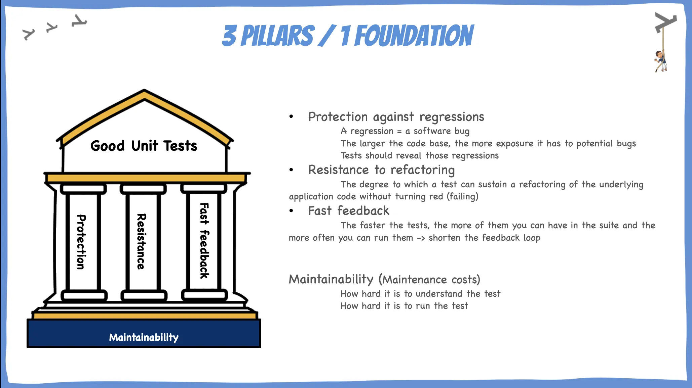
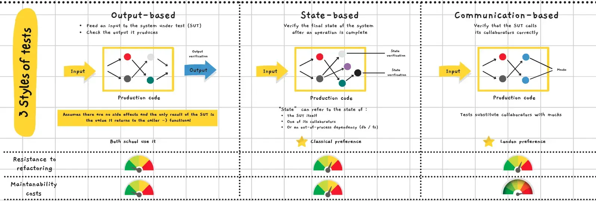

# Clean <mark>Tests</mark>

Les tests sont du code : traitez-les avec le même soin.

---

<span class="kicker">Connexion · en petits groupes</span>

# Mythbusters

Classez chaque affirmation sur les tests unitaires en **Mythe** ou **Vérité**.

| #  | Affirmation                                                              |
|----|--------------------------------------------------------------------------|
| 1  | Les tests rendent les modifications plus difficiles à faire              |
| 2  | Avec des tests, je n'ai plus de portion de code que j'ai peur de toucher |
| 3  | Les tests unitaires sont écrits uniquement par les testeurs              |
| 4  | Mon code est tellement simple que je n'ai pas besoin de tests            |
| 5  | Un code testé unitairement est de meilleure qualité qu'un code non testé |
| 6  | Les tests unitaires ne sont utiles que dans les grandes équipes          |
| 7  | Les tests réduisent le coût du développement                             |
| 8  | Écrire des tests prend trop de temps                                     |

---
class: dense
---

<span class="kicker">Mythbusters · correction</span>

# Démystifions

| #  | Verdict    | Explication                                                                                                      |
|----|------------|------------------------------------------------------------------------------------------------------------------|
| 1  | ❌ Mythe   | C'est l'inverse : les tests permettent de refactorer sans crainte, encore et encore.                             |
| 2  | ✅ Vérité  | Les tests agissent comme un filet de sécurité et renforcent la confiance.                                        |
| 3  | ❌ Mythe   | Ce sont les développeurs qui écrivent les tests, idéalement à chaque modification du code.                       |
| 4  | ❌ Mythe   | Un code simple mérite des tests simples. Il n'y a pas d'excuse.                                                  |
| 5  | ✅ Vérité  | Les tests identifient les défauts en amont, exposent les cas limites et forcent à mieux concevoir.               |
| 6  | ❌ Mythe   | Même une équipe d'une personne en bénéficie, et c'est encore plus risqué de tout concentrer dans une seule tête. |
| 7  | ✅ Vérité  | Les bugs détectés tôt coûtent beaucoup moins cher à corriger.                                                    |
| 8  | ❌ Mythe   | C'est une question d'habitude. Comment testeriez-vous votre code autrement ?                                     |

---

<span class="kicker">Concepts · principes et pratiques</span>

# L'objectif du test unitaire

> Permettre la **croissance durable** d'un projet logiciel.

<div class="cols">
<div>

### Un projet sans tests

- Ralentit rapidement jusqu'à rendre toute progression difficile
- Accumule de l'**entropie logicielle** : le code se dégrade au fil des modifications

### Les tests combattent cette entropie

- Ils exigent un nettoyage et un refactoring constants
- Ils agissent comme un **filet de sécurité** contre les régressions

</div>
<div v-click>

### Bons vs mauvais tests

Des tests mal écrits produisent les mêmes problèmes qu'un code mal écrit :

- de **fausses alarmes**
- une **maintenance coûteuse**

Un bon test a de la valeur. Un mauvais test en a peu, voire aucune. La clé : **reconnaître et écrire des tests de valeur**.

</div>
</div>

---

<span class="kicker">Concepts</span>

# Qu'est-ce qu'un test unitaire ?

Un test automatisé qui :

1. **Vérifie un petit bout de code** (une "unité")
2. **S'exécute rapidement**
3. **S'exécute de manière isolée**

### Les deux écoles

|                                          | École de Londres                          | École Classique (Detroit)                              |
|------------------------------------------|-------------------------------------------|--------------------------------------------------------|
| **Une unité, c'est...**                  | Une classe                                | Une classe ou un ensemble de classes (un comportement) |
| **On isole avec des doubles de test...** | Toutes les dépendances sauf les immuables | Les dépendances **partagées** uniquement               |

---

<span class="kicker">Concepts</span>

# Les 3 piliers + 1 fondation

<div class="cols">
<div>



</div>
<div v-click>

| Pilier                                | Description                                                       |
|---------------------------------------|-------------------------------------------------------------------|
| **Protection contre les régressions** | Détecter les bugs introduits lors des modifications               |
| **Résistance au refactoring**         | Ne pas échouer quand on refactore sans changer le comportement    |
| **Feedback rapide**                   | Plus les tests sont rapides, plus la boucle de feedback est courte |
| **Maintenabilité**                    | Facile à lire et facile à faire tourner                           |

</div>
</div>

---

<span class="kicker">Concepts</span>

# Nommer ses tests

<div class="cols">
<div>

Un bon nom permet de comprendre **ce que le test vérifie** et **comment le système se comporte**.

❌ Mauvais noms

```text
delivery_is_invalid
delivery_should_be_invalid
```

✅ Bon nom

```text
delivery_with_past_date_should_be_invalid
```

Il contient le **scénario** testé et le **résultat attendu**.

</div>
<div v-click>

### Règles importantes

- Pas de convention de nommage rigide : elle bride l'expression
- Nommez le test comme si vous décriviez le scénario à un **expert métier non technique**
- Un business analyst doit pouvoir comprendre le nom
- Utilisez des phrases : elles améliorent la lisibilité, surtout pour les noms longs

</div>
</div>

---
class: dense
---

<span class="kicker">Concepts</span>

# Les 3 styles de tests unitaires

<div class="cols cols--wide-right">
<div>



</div>
<div v-click>

| Style                   | Description                                                      | Avantage                        | Inconvénient                                    |
|-------------------------|------------------------------------------------------------------|---------------------------------|-------------------------------------------------|
| **Output-based**        | On fournit une entrée et on vérifie la sortie. Pas d'effet de bord. | Résistant au refactoring        | Nécessite un code fonctionnel (sans effet de bord) |
| **State-based**         | On vérifie l'état du système après une opération                 | Naturel pour la plupart des cas | Plus fragile si l'état interne change           |
| **Communication-based** | On vérifie que le SUT appelle ses collaborateurs (via mocks)     | Utile pour les interactions     | Fragile au refactoring                          |

</div>
</div>

---

<span class="kicker">Concepts</span>

# Couverture de code

> La couverture mesure quelle portion du code source est exécutée par la suite de tests.

<div class="cols">
<div>

- Une couverture **faible** (ex : 10 %) prouve qu'on ne teste pas assez ✅
- Une couverture **élevée** (même 100 %) ne prouve **pas** qu'on a de bons tests ❌

> Un bon **indicateur négatif**, mais un mauvais indicateur positif.

</div>
<div v-click>

### Branch coverage

Combien de chemins des structures de contrôle (`if`, `switch`) sont traversés par au moins un test ?

```java
// 2 chemins : length > 5 et length <= 5
// Un test sur un seul chemin = 50 % de branch coverage
public static boolean isLong(String s) {
    return s.length() > 5;
}
```

</div>
</div>

---

<span class="kicker">Concepts</span>

# Les 4 types de code

Deux dimensions : la **complexité / importance métier** et le **nombre de collaborateurs**.

|                                  | Peu de collaborateurs              | Beaucoup de collaborateurs   |
|----------------------------------|------------------------------------|------------------------------|
| **Complexe / important métier**  | Modèle de domaine & algorithmes 🎯 | Code sur-compliqué ⚠️        |
| **Peu complexe / peu important** | Code trivial                       | Contrôleurs / orchestrateurs |

- **Modèle de domaine & algorithmes** : testez ici en priorité, c'est là que le ROI est le meilleur
- **Code sur-compliqué** : à refactorer en séparant les algorithmes des contrôleurs

---

<span class="kicker">Pratique concrète · en binôme · 45'</span>

# Anti-patterns

Ouvrez le projet `clean-tests` (Java ou C#) :

1. **Identifiez les anti-patterns** dans les 3 classes de tests du package `antipatterns` <span class="timer">10'</span>
2. **Débrief collectif** <span class="timer">10'</span>
3. **Refactorez** les tests <span class="timer">15'</span>
4. **Débrief collectif** <span class="timer">10'</span>

<Exercise path="08.clean-tests/exercices/anti-patterns" />

---
class: dense
---

<span class="kicker">Anti-patterns · débrief</span>

# Ce qu'on pouvait trouver

| #  | Anti-pattern                                      | Remède                                                          |
|----|---------------------------------------------------|-----------------------------------------------------------------|
| 1  | Fuite d'implémentation dans les tests             | Affirmer une valeur concrète, hardcodée                         |
| 2  | Tester la librairie externe plutôt que notre code | Le SUT doit être notre code, pas un mock                        |
| 3  | Un assert par test sur un même comportement       | Un test par **comportement**, regroupés par cas d'usage         |
| 4  | Noms techniques au lieu de noms métier            | Des noms compréhensibles par un expert métier                   |
| 5  | Test sans assertion                               | Toujours vérifier, et voir le test échouer                      |
| 6  | Duplication dans les tests                        | Factoriser : un seul endroit à mettre à jour                    |
| 7  | Commenter les tests en échec                      | Corriger le code, supprimer ou mettre à jour le test            |
| 8  | La course aux 100 % de couverture                 | Branch coverage et mutation testing                             |

---

<span class="kicker">Conclusions</span>

# Bonnes pratiques récapitulatives

- **Un comportement par test** : pas une donnée, un comportement
- **Triangulation** : des tests plus spécifiques pour forcer des solutions plus génériques
- **Noms métier** : compréhensibles par un expert non technique
- **Voyez le test échouer** : assurez-vous qu'il échoue pour la bonne raison
- **Feedback utile** : un test en échec doit indiquer clairement *pourquoi*
- **Tests séparés du code de production** : structure de projet miroir
- **Évitez les données non déterministes** : passez une horloge ou une fonction pour les dates

### Ressources

- [Unit Testing : Principles, Practices and Patterns](https://www.manning.com/books/unit-testing), Vladimir Khorikov
- [Clean Tests Workshop](https://yoan-thirion.gitbook.io/knowledge-base/software-craftsmanship/testing/clean-tests), Yoan Thirion
