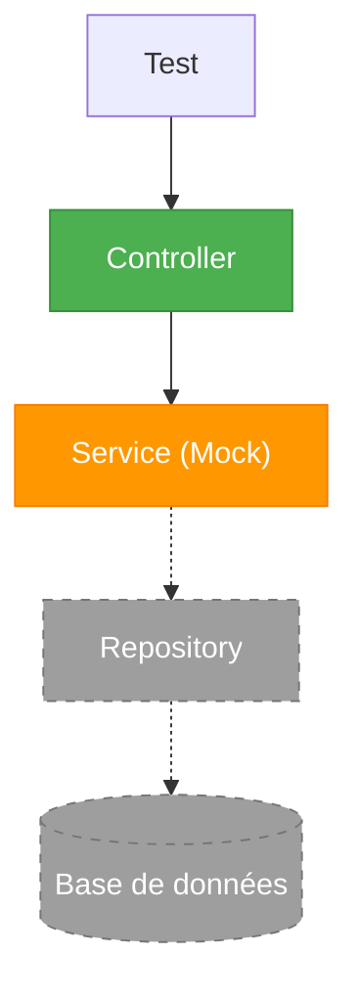
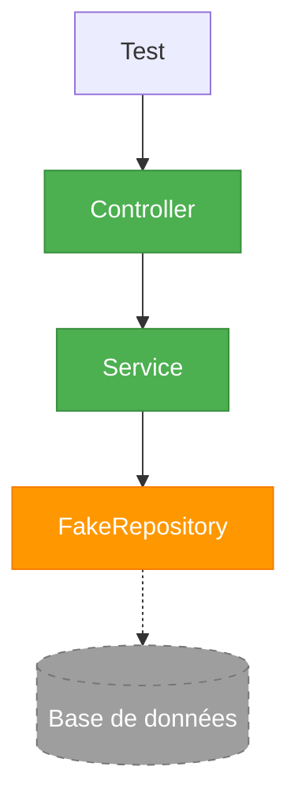

# Tests <mark>d'intégration</mark>

Vérifier les coutures entre composants.

---

<span class="kicker">Connexion · en binôme</span>

# Où ça se place ?

Remplissez le tableau :

|                       | Test Unitaire | Test d'Intégration |
|-----------------------|---------------|--------------------|
| **Composants / Unit** |               |                    |
| **Vitesse**           |               |                    |
| **Isolation**         |               |                    |
| **Confiance**         |               |                    |

---

<span class="kicker">Concepts</span>

# Qu'est-ce qu'un test d'intégration ?

Il vérifie **plusieurs composants ensemble**, là où le test unitaire teste un seul composant isolé.

|                | Test Unitaire       | Test d'Intégration       |
|----------------|---------------------|--------------------------|
| **Composants** | 1 seul              | Plusieurs                |
| **Vitesse**    | Très rapide (ms)    | Plus lent (sec)          |
| **Isolation**  | Totale              | Partielle                |
| **Confiance**  | Sur le comportement | Sur l'intégration réelle |

> Il n'existe pas de définition universelle. Les frontières dépendent du contexte et de la cible choisie.

---

<span class="kicker">Concepts</span>

# La pyramide des tests

- **Beaucoup** de tests unitaires : rapides, peu coûteux, très isolés
- **Quelques** tests d'intégration : vérifier les "coutures" entre composants
- **Peu** de tests E2E : lents, fragiles, coûteux mais forte confiance

> Une pyramide renversée (beaucoup d'E2E, peu d'unitaires) est un signal de dette technique.

---

<span class="kicker">Concepts · Spring Boot</span>

# Test slices et l'API du module

Spring Boot propose des **slices de test** : des contextes partiels qui ne chargent que le nécessaire.

| Annotation        | Contexte chargé       | Utilisation typique               |
|-------------------|-----------------------|-----------------------------------|
| `@WebMvcTest`     | Slice HTTP uniquement | Tester un Controller isolément    |
| `@SpringBootTest` | Contexte complet      | Tester plusieurs couches ensemble |
| `@DataJpaTest`    | Slice JPA uniquement  | Tester les repositories           |

### Gestion des notes étudiantes

| Méthode | URL                                                 | Description         |
|---------|-----------------------------------------------------|---------------------|
| `GET`   | `/students/{studentId}/grades?subject=&assignment=` | Consulter les notes |
| `POST`  | `/students/{studentId}/grades`                      | Créer une note      |

---
class: dense
---

<span class="kicker">Concepts · approche 1</span>

# Avec un mock : `@WebMvcTest` + `@MockBean`

<div class="cols">
<div>

`@WebMvcTest` charge uniquement la couche HTTP. Les autres composants sont fournis via `@MockBean`.



</div>
<div v-click>

```java
@WebMvcTest(GradeController.class)
class GradeControllerTest {
    @Autowired MockMvc mockMvc;
    @MockBean  GradeService gradeService;

    @Test
    void shouldReturn200WithGradesWhenFound() throws Exception {
        given(gradeService.getGrades("alice", "math", "exam1"))
            .willReturn(List.of(new Grade("alice", "math", "exam1", 17.5)));

        mockMvc.perform(get("/students/alice/grades")
                .param("subject", "math")
                .param("assignment", "exam1"))
            .andExpect(status().isOk())
            .andExpect(jsonPath("$[0].value").value(17.5));
    }
}
```

</div>
</div>

---

<span class="kicker">Concepts · approche 1</span>

# Avantages et limites du mock

| Avantages                                             | Limites                                                                                      |
|-------------------------------------------------------|----------------------------------------------------------------------------------------------|
| Rapide : contexte minimal, démarrage en millisecondes | Ne teste pas le wiring réel entre controller et service                                      |
| Controller parfaitement isolé                         | Le mock peut masquer des divergences avec l'implémentation réelle (`Only mock what you own`) |

> **Vert** = couche réellement testée · **Orange** = remplacée (mock/fake) · **Gris** = hors périmètre

---
class: dense
---

<span class="kicker">Concepts · approche 2</span>

# Sans mock, avec un fake : `@SpringBootTest`

<div class="cols">
<div>

Le contexte complet est chargé, mais le repository est remplacé par un **Fake en mémoire** : pas de base de données réelle.



</div>
<div v-click>

```java
// Une vraie logique, simplifiée, sans dépendance externe
class FakeGradeRepository implements GradeRepository {
    private final List<Grade> store = new ArrayList<>();

    @Override
    public List<Grade> findBy(String studentId,
                              String subject,
                              String assignment) {
        return store.stream()
            .filter(g -> g.studentId().equals(studentId)
                      && g.subject().equals(subject)
                      && g.assignment().equals(assignment))
            .toList();
    }

    @Override
    public void save(Grade grade) { store.add(grade); }

    public void clear() { store.clear(); }
}
```

</div>
</div>

---
class: dense
---

<span class="kicker">Concepts · approche 2</span>

# Le test avec le fake

```java
@SpringBootTest(webEnvironment = RANDOM_PORT)
class GradeApiTest {
    @Autowired TestRestTemplate restTemplate;
    @Autowired GradeRepository  gradeRepository;

    @TestConfiguration
    static class Config {
        @Bean @Primary
        GradeRepository gradeRepository() { return new FakeGradeRepository(); }
    }

    @BeforeEach
    void setUp() { ((FakeGradeRepository) gradeRepository).clear(); }

    @Test
    void shouldReturnGradesForStudent() {
        gradeRepository.save(new Grade("alice", "math", "exam1", 18.0));

        var response = restTemplate.getForEntity(
            "/students/alice/grades?subject=math&assignment=exam1", Grade[].class);

        assertThat(response.getStatusCode()).isEqualTo(OK);
        assertThat(response.getBody()).hasSize(1);
        assertThat(response.getBody()[0].value()).isEqualTo(18.0);
    }
}
```

---

<span class="kicker">Concepts · approche 2</span>

# Avantages et limites du fake

| Avantages                                                                                | Limites                                    |
|------------------------------------------------------------------------------------------|--------------------------------------------|
| Teste la stack complète (HTTP → Service → Repository)                                    | Plus lent : démarrage du contexte complet  |
| Vérifie le vrai wiring Spring (injection de dépendances, sérialisation JSON, validation) | Le fake peut diverger de la vraie base     |
| Pas de surprise entre test et prod                                                       | Le Fake est du code à maintenir            |

---

<span class="kicker">Concepts</span>

# Quand utiliser quoi ?

|                    | `@WebMvcTest` + Mock     | `@SpringBootTest` + Fake      |
|--------------------|--------------------------|-------------------------------|
| **Vitesse**        | Rapide (~100 ms)         | Lent (~2 à 5 s)               |
| **Ce qu'on teste** | Controller uniquement    | Stack complète                |
| **Confiance**      | Partielle                | Forte                         |
| **Cas d'usage**    | Status codes, JSON shape | Intégration réelle end-to-end |

> Les deux approches sont complémentaires. Dans un projet réel, les deux ont leur place.

---

<span class="kicker">Pratique concrète · en binôme</span>

# Test it or Die Trying : Grades API

Écrivez les tests d'intégration de l'API selon les deux approches :

1. **Avec un mock** : `@WebMvcTest` + `@MockBean` (ou son équivalent ASP.NET Core en C#)
2. **Avec un fake** : `@SpringBootTest` + `FakeGradeRepository`

> Que se passe-t-il si le contrat de `GradeRepository` change ? Lequel de vos deux jeux de tests le détecte ?

<Exercise path="09.integraton-tests/exercices/grades-api" />

---

<span class="kicker">Conclusions</span>

# Pour aller plus loin

- [Testcontainers](https://testcontainers.com/) : des tests avec de vraies dépendances
- [Consumer-Driven Contract Testing](https://github.com/ythirion/pact-jvm-demo)

### Ressources

- [Spring Boot Testing Documentation](https://docs.spring.io/spring-boot/reference/testing/index.html)
- [Testing the Web Layer](https://spring.io/guides/gs/testing-web/), Spring Guides
- [SpringDoc OpenAPI](https://springdoc.org/)
- [Practical Test Pyramid](https://martinfowler.com/articles/practical-test-pyramid.html), Martin Fowler
- [Integration tests in ASP.NET Core](https://learn.microsoft.com/en-us/aspnet/core/test/integration-tests), Microsoft
