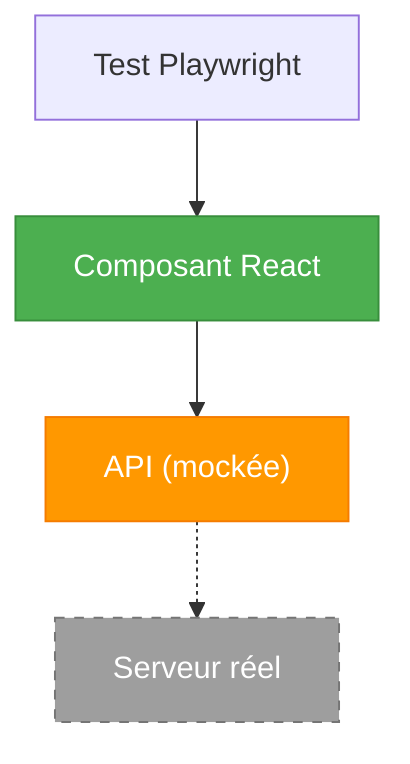

# Tests <mark>front-end</mark>

Tester une interface comme un utilisateur la perçoit.

---

<span class="kicker">Connexion · en binôme</span>

# Où ça se place ?

Remplissez le tableau :

|                       | Unitaire | Composant | Intégration | E2E |
|-----------------------|----------|-----------|-------------|-----|
| **Composants / Unit** |          |           |             |     |
| **Vitesse**           |          |           |             |     |
| **Isolation**         |          |           |             |     |
| **Confiance**         |          |           |             |     |

---

<span class="kicker">Concepts</span>

# La pyramide des tests côté front

| Type        | Outil        | Ce qu'on teste                      | Vitesse |
|-------------|--------------|-------------------------------------|---------|
| Unitaire    | `Vitest`     | Fonctions pures, hooks, utilitaires | ~ms     |
| Composant   | `Playwright` | Rendu isolé, snapshots visuels      | ~100 ms |
| Intégration | `Playwright` | Interactions + API mockée           | ~1–2 s  |
| E2E         | `Playwright` | Parcours utilisateur complet        | ~5–30 s |

---

<span class="kicker">Concepts · 1 · tests unitaires</span>

# Vitest

<div class="cols">
<div>

Le framework de test natif de l'écosystème Vite : il partage sa configuration et il est **très rapide**.

```ts
// vite.config.ts
export default defineConfig({
    plugins: [react()],
    test: {
        environment: 'node', // 'jsdom' pour des composants React
        globals: true,
    },
});
```

| Avantages                         | Limites                                    |
|-----------------------------------|--------------------------------------------|
| Ultra rapide (~ms)                | Ne teste pas le rendu HTML                 |
| Pas de navigateur nécessaire      | Ne détecte pas les problèmes d'intégration |
| Idéal pour la logique métier pure |                                            |

</div>
<div v-click>

```ts
// src/utils/validation.ts
export function validateEmail(email: string): boolean {
    return /^[^\s@]+@[^\s@]+\.[^\s@]+$/.test(email);
}
```

```ts
// src/utils/validation.test.ts
import { describe, it, expect } from 'vitest';
import { validateEmail } from './validation';

describe('validateEmail', () => {
    it('should return true for a valid email', () => {
        expect(validateEmail('test@example.com')).toBe(true);
    });

    it('should return false for an invalid email', () => {
        expect(validateEmail('not-an-email')).toBe(false);
    });
});
```

</div>
</div>

---

<span class="kicker">Concepts · 2 · tests de composants</span>

# Snapshots avec Playwright

<div class="cols">
<div>

Les snapshot tests capturent le **rendu visuel** d'un composant et détectent toute régression.

```ts
test('renders the initial form correctly', async ({ page }) => {
    await page.goto('/');
    await page.getByRole('button', { name: 'Show Form' }).click();

    const form = page.getByRole('form', { name: 'Contact form' });
    await expect(form).toHaveScreenshot('form-rendering.png');
});
```

```bash
# Premier lancement : génère les snapshots de référence
npx playwright test tests/components --update-snapshots
# Lancements suivants : compare avec la référence
npx playwright test tests/components
```

</div>
<div v-click>

> Commitez les snapshots avec votre code : ils font partie du **contrat visuel**.

| Avantages                                         | Limites                                              |
|---------------------------------------------------|------------------------------------------------------|
| Détecte les régressions visuelles automatiquement | Snapshots à mettre à jour lors de changements voulus |
| Documente le rendu attendu                        | Sensible aux différences OS / navigateur             |

</div>
</div>

---

<span class="kicker">Concepts · 3 · tests d'intégration</span>

# Mocker le réseau avec `page.route`

<div class="cols cols--wide-right">
<div>

On teste **les interactions utilisateur avec l'UI**, en mockant les appels réseau.



</div>
<div v-click>

```ts
test('should submit form data successfully', async ({ page }) => {
    // Intercepte la requête AVANT qu'elle parte
    await page.route('**/api/submit', (route) =>
        route.fulfill({
            status: 200,
            contentType: 'application/json',
            body: JSON.stringify({ message: 'Form submitted successfully!' }),
        })
    );

    await page.goto('/');
    await page.getByRole('button', { name: 'Show Form' }).click();
    await page.getByLabel('Name:').fill('John Doe');
    await page.getByLabel('Email:').fill('johndoe@example.com');
    await page.getByRole('button', { name: 'Submit' }).click();
    await expect(page.getByRole('status'))
        .toHaveText('Success: Form submitted successfully!');
});
```

</div>
</div>

---

<span class="kicker">Concepts · 3 · tests d'intégration</span>

# Avantages et limites du mock réseau

| Avantages                                  | Limites                                   |
|--------------------------------------------|-------------------------------------------|
| Teste les interactions utilisateur réelles | Ne valide pas le contrat d'API réel       |
| Rapide : pas de serveur backend nécessaire | Le mock peut masquer des divergences prod |
| Couvre les cas d'erreur réseau facilement  |                                           |

---

<span class="kicker">Concepts · 4 · tests E2E</span>

# Le parcours complet, sans mock

<div class="cols">
<div>

```ts
test('should increment the counter', async ({ page }) => {
    await page.goto('/');

    const counterButton = page.getByRole('button',
        { name: /Increment counter/ });

    await expect(counterButton).toHaveText('count is 0');
    await counterButton.click();
    await expect(counterButton).toHaveText('count is 1');
});
```

### Playwright Codegen

`npm run recorder` ouvre un navigateur et **enregistre vos interactions** pour générer du code de test.

> Le code généré utilise souvent des sélecteurs CSS ou `getByText`. **Révisez-le toujours** pour passer à `getByRole` / `getByLabel`.

</div>
<div v-click>

| Avantages                                    | Limites                              |
|----------------------------------------------|--------------------------------------|
| Confiance maximale : teste comme un vrai user | Lents, fragiles si le backend change |
| Détecte les problèmes d'intégration réels    | Nécessitent un backend fonctionnel   |
| Valide le contrat frontend ↔ backend         | À utiliser avec parcimonie           |

</div>
</div>

---

<span class="kicker">Concepts · sélecteurs robustes</span>

# Pourquoi les sélecteurs CSS sont fragiles ?

Ils couplent le test à l'**implémentation**, pas au **comportement**.

```ts
// ❌ Casse si on renomme la classe, change le tag ou réorganise le DOM
await page.locator('button:has-text("count is")');
await page.locator('p.read-the-docs');
await page.locator('img.logo.react');
await page.fill('input[name="name"]', "John");
```

Un refactoring innocent brise tous ces tests, alors que **l'application fonctionne toujours**.

### La solution : les sélecteurs ARIA

Ils ciblent les éléments **comme un utilisateur ou un lecteur d'écran** les perçoit : **robustes** (indépendants du CSS), **accessibles** (ils forcent un HTML sémantique) et **expressifs** (ils documentent l'intention).

---
class: dense
---

<span class="kicker">Concepts · sélecteurs robustes</span>

# Hiérarchie des sélecteurs Playwright

| Priorité | Sélecteur           | Méthode Playwright                        | Quand l'utiliser                      |
|----------|---------------------|-------------------------------------------|---------------------------------------|
| 1        | Rôle ARIA + nom     | `getByRole('button', { name: 'Submit' })` | Toujours en premier                   |
| 2        | Label de formulaire | `getByLabel('Email:')`                    | Champs de formulaire                  |
| 3        | Texte visible       | `getByText('Bienvenue')`                  | Contenu textuel unique                |
| 4        | Placeholder         | `getByPlaceholder('Votre email')`         | Si pas de label                       |
| 5        | Alt text / titre    | `getByAltText('Logo')`, `getByTitle()`    | Images, icônes                        |
| 6        | Test ID             | `getByTestId('submit-btn')`               | En dernier recours (`data-testid`)    |
| ❌       | CSS / XPath         | `locator('.btn-primary')`                 | À éviter : couplage à l'implémentation |

```ts
// ❌ Avant : sélecteurs CSS / texte fragiles
await page.click("text=Show Form");
await page.fill('input[name="name"]', "John Doe");
await page.click("button[type=submit]");

// ✅ Après : sélecteurs ARIA robustes
await page.getByRole('button', { name: 'Show Form' }).click();
await page.getByLabel('Name:').fill("John Doe");
await page.getByRole('button', { name: 'Submit' }).click();
```

---
class: dense
---

<span class="kicker">Concepts · sélecteurs robustes</span>

# Rendre le HTML testable : ARIA en pratique

<div class="cols">
<div>

```tsx
// ❌ HTML non accessible
<label>
    Name:
    <input type="text" name="name" />
</label>
{status && <p>{status}</p>}

// ✅ getByLabel et getByRole('status') fonctionnent
<label htmlFor="name">Name:</label>
<input
    id="name"
    type="text"
    name="name"
    aria-required="true"
/>
{status && <p role="status" aria-live="polite">{status}</p>}
```

</div>
<div v-click>

| Attribut ARIA        | Rôle                                              |
|----------------------|---------------------------------------------------|
| `htmlFor` / `id`     | Associe un label à son champ → `getByLabel`       |
| `aria-label`         | Nom accessible sans label visible                 |
| `aria-required`      | Champ obligatoire pour les lecteurs d'écran       |
| `role="status"`      | Zone de message dynamique → `getByRole('status')` |
| `aria-live="polite"` | Annonce les changements aux lecteurs d'écran      |
| `aria-expanded`      | État ouvert / fermé d'un élément toggle           |

> Les critères ARIA correspondent aux exigences WCAG 2.1 / **RGAA** 4.1 : tester avec des sélecteurs ARIA, c'est aussi vérifier l'accessibilité.

</div>
</div>

---

<span class="kicker">Concepts · Page Object Model</span>

# Découpler les tests de l'implémentation

Si dix tests cliquent sur `getByRole('button', { name: 'Show Form' })`, un renommage oblige à modifier dix fichiers. Le **Page Object Model** encapsule les interactions dans une classe par page ou composant.

```text
Sans POM                          Avec POM
─────────────────                 ──────────────────────────────
test A → page.getByRole(…)        test A → appPage.showForm()
test B → page.getByRole(…)   →    test B → appPage.showForm()
test C → page.getByRole(…)        test C → appPage.showForm()
                                  AppPage → page.getByRole(…)  ← un seul endroit
```

| Avantages                                       | Limites                                            |
|-------------------------------------------------|----------------------------------------------------|
| Changement UI = modification en un seul endroit | Surcharge initiale pour les petits projets         |
| Tests lisibles : ils décrivent le comportement  | Risque de POM trop génériques et difficiles à lire |

---
class: dense
---

<span class="kicker">Concepts · Page Object Model</span>

# Implémenter et utiliser un POM

<div class="cols">
<div>

```ts
// tests/pages/ContactFormPage.ts
export class ContactFormPage {
    readonly nameInput: Locator;
    readonly emailInput: Locator;
    readonly submitButton: Locator;
    readonly statusMessage: Locator;

    constructor(page: Page) {
        this.nameInput = page.getByLabel('Name:');
        this.emailInput = page.getByLabel('Email:');
        this.submitButton = page.getByRole('button', { name: 'Submit' });
        this.statusMessage = page.getByRole('status');
    }

    async fill(name: string, email: string) {
        await this.nameInput.fill(name);
        await this.emailInput.fill(email);
    }

    async submit() {
        await this.submitButton.click();
    }
}
```

</div>
<div v-click>

```ts
// tests/e2e/app.spec.ts
test('devrait soumettre le formulaire avec succès',
    async ({ page }) => {
    const appPage = new AppPage(page);
    const form = new ContactFormPage(page);

    await appPage.navigate();
    await appPage.showForm();
    await form.fill('John Doe', 'john@example.com');
    await form.submit();

    await expect(form.statusMessage).toContainText('Success');
});
```

> Le test exprime l'**intention**, pas les détails d'UI.

Pour aller plus loin, l'[article de Manon Carbonnel](https://dev.to/manon_carbonnel/tester-son-interface-efficacement-des-patterns-pour-des-tests-dui-robustes-1anl) présente aussi le **Screenplay Pattern**, une alternative plus modulaire au POM.

</div>
</div>

---

<span class="kicker">Concepts · 5 · tests d'accessibilité</span>

# axe-core avec Playwright

<div class="cols">
<div>

Détecter les violations des référentiels (WCAG, RGAA) directement dans la suite Playwright.

```bash
npm install --save-dev @axe-core/playwright
```

> Les outils automatisés détectent **~30 à 40 %** des problèmes réels. Ils ne remplacent pas les tests manuels avec un lecteur d'écran, mais forment un filet de sécurité contre les régressions.

| Tag(s)                    | Référentiel           |
|---------------------------|-----------------------|
| `'RGAAv4'`                | RGAA 4.1 (France)     |
| `'wcag2a'`, `'wcag2aa'`   | WCAG 2.0 niveaux A, AA |
| `'wcag21a'`, `'wcag21aa'` | WCAG 2.1 niveaux A, AA |

</div>
<div v-click>

```ts
import AxeBuilder from '@axe-core/playwright';

// Un describe par référentiel
test.describe('Page principale — RGAA', () => {
    test('aucune violation RGAA détectable', async ({ page }) => {
        await page.goto('/');

        const results = await new AxeBuilder({ page })
            .withTags(['RGAAv4'])
            .analyze();

        expect(results.violations).toEqual([]);
    });
});
```

Une violation donne la règle enfreinte (`id`), son `impact` (`critical` > `serious` > `moderate` > `minor`) et la `target` fautive.

</div>
</div>

---

<span class="kicker">Pratique concrète · en binôme</span>

# Test it or Die Trying

1. Lancez `npm run test:unit` puis `npm run test:e2e` : tout passe ?
2. Dans `Form.tsx`, supprimez `role="status"` du `<p>` de statut. Quel(s) test(s) échoue(nt) ? Pourquoi ?
3. Ajoutez un champ `telephone` avec son label et écrivez le test d'intégration avec `getByLabel`
4. Inspectez le test généré par le recorder (`recorded.spec.ts`) : quels sélecteurs sont fragiles ? Remplacez-les par des sélecteurs ARIA
5. Ajoutez les tests d'accessibilité avec `@axe-core/playwright`

<Exercise path="10.front-end-tests/exercices/react-tests" />

---

<span class="kicker">Pratique concrète · en binôme</span>

# Green Craft : le manifeste en FR et en EN

<div class="cols">
<div>

Un projet Playwright à part, qui teste le site en ligne [green-craft.fr](https://green-craft.fr/).

1. Lancez `npm test` : les 3 scénarios passent ?
2. Retirez `test.use({ locale: 'fr-FR' })` et relancez : que se passe-t-il ? Pourquoi ?

</div>
<div v-click>

3. Ajoutez le scénario retour : du manifeste **anglais** au **français**. Avez-vous touché aux Page Objects ?
4. Enregistrez un parcours avec `npm run recorder` (par exemple « Explorer les valeurs en détail »)
5. Révisez le code généré : **sélecteurs ARIA** uniquement, puis extrayez une `ValuesPage`

> Un E2E sur un site en ligne est un **smoke test** : il vérifie qu'un parcours clé est vivant, pas chaque règle.

</div>
</div>

<Exercise path="10.front-end-tests/exercices/green-craft-e2e" />

---
class: dense
---

<span class="kicker">Concepts · Page Object Model</span>

# Un E2E sur un site en ligne : le manifeste Green Craft

<div class="cols">
<div>

Valider que le manifeste de [green-craft.fr](https://green-craft.fr/) est accessible **en français et en anglais**.

- Un **projet à part** : `baseURL` en ligne, pas de `webServer` local
- Une **`locale`** fixée : le site choisit sa langue selon le navigateur
- Un **Page Object par page**, paramétré par la langue
- Les libellés par langue sont dans **`languages.ts`** : un seul endroit à modifier

> Un test qui dépend du réseau et d'un site tiers peut échouer sans que votre code change : gardez-le **hors** de la suite principale.

</div>
<div v-click>

```ts
// tests/pages/ManifestoPage.ts
export class ManifestoPage {
    readonly title: Locator;
    readonly url: RegExp;
    private readonly switchLanguageLink: Locator;

    constructor(private readonly page: Page,
                private readonly language: Language) {
        const texts = languages[language];
        this.title = page.getByRole('heading',
            { name: texts.manifestoTitle });
        this.url = texts.manifestoUrl;
        this.switchLanguageLink = page.getByRole('link',
            { name: texts.switchLanguageLink });
    }

    async switchLanguage(): Promise<ManifestoPage> {
        await this.switchLanguageLink.click();
        return new ManifestoPage(this.page,
            otherLanguage(this.language));
    }
}
```

</div>
</div>

---

<span class="kicker">Concepts · Page Object Model</span>

# Le test exprime l'intention

<div class="cols cols--wide-left">
<div>

```ts
// tests/manifesto.spec.ts
test.describe('Manifeste Green Craft en français', () => {
    test.use({ locale: languages.fr.locale });

    test('on peut passer du manifeste français au manifeste anglais',
        async ({ page }) => {
        const frenchManifesto = new ManifestoPage(page, 'fr');
        await frenchManifesto.goto();

        const englishManifesto = await frenchManifesto.switchLanguage();

        await expect(page).toHaveURL(englishManifesto.url);
        await expect(englishManifesto.title).toBeVisible();
    });
});
```

</div>
<div v-click>

- Aucun libellé, aucune URL, aucun sélecteur dans le test
- Une action qui change de page **retourne le Page Object suivant**
- Les **assertions restent dans le test** : le Page Object expose des `Locator`, il ne vérifie rien

</div>
</div>

---
class: dense
---

<span class="kicker">Ressources</span>

# Pour aller plus loin

- [Playwright : Best Practices](https://playwright.dev/docs/best-practices)
- [Playwright : Locators](https://playwright.dev/docs/locators)
- [Vitest : Getting Started](https://vitest.dev/guide/)
- [ARIA Roles](https://developer.mozilla.org/en-US/docs/Web/Accessibility/ARIA/Roles), MDN
- [RGAA 4.1 : critères et tests](https://accessibilite.numerique.gouv.fr/methode/criteres-et-tests/)
- [WAI-ARIA Authoring Practices](https://www.w3.org/WAI/ARIA/apg/)
- [Testing Accessibility with Playwright](https://playwright.dev/docs/accessibility-testing)
- [Tester son interface efficacement : des patterns pour des tests d'UI robustes](https://dev.to/manon_carbonnel/tester-son-interface-efficacement-des-patterns-pour-des-tests-dui-robustes-1anl)
