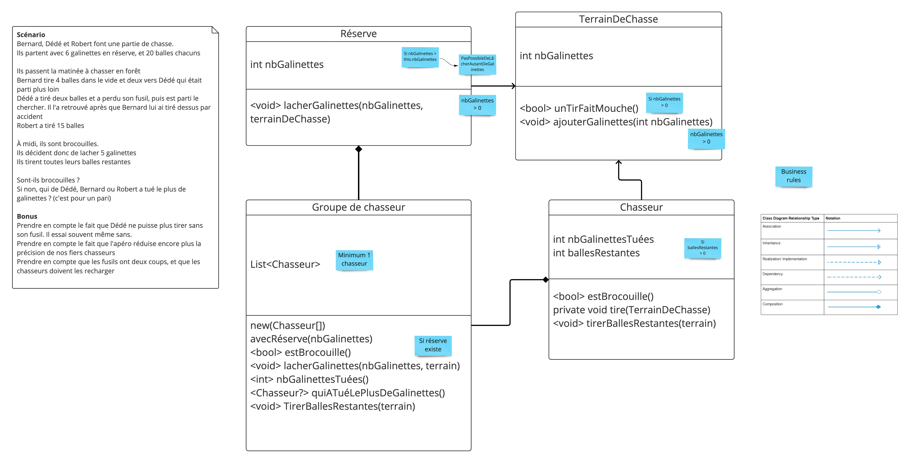

# Une partie de chasse du Bouchonnois

En binôme, implémentez le scénario et les classes ci-dessous **en générant le code depuis son usage**.

> Contrainte : vous n'avez le droit de créer du code nouveau qu'à partir de son usage (depuis un test ou du code de production).

1. Écrire le test comme si le code existait déjà
2. L'IDE souligne les identifiants manquants en rouge
3. Utiliser l'action contextuelle (`Alt+Enter` / `⌥⏎`) pour générer une classe, une méthode, une propriété ou un type
4. Passer à l'erreur suivante et recommencer

Notez les raccourcis découverts au fil de la session.
