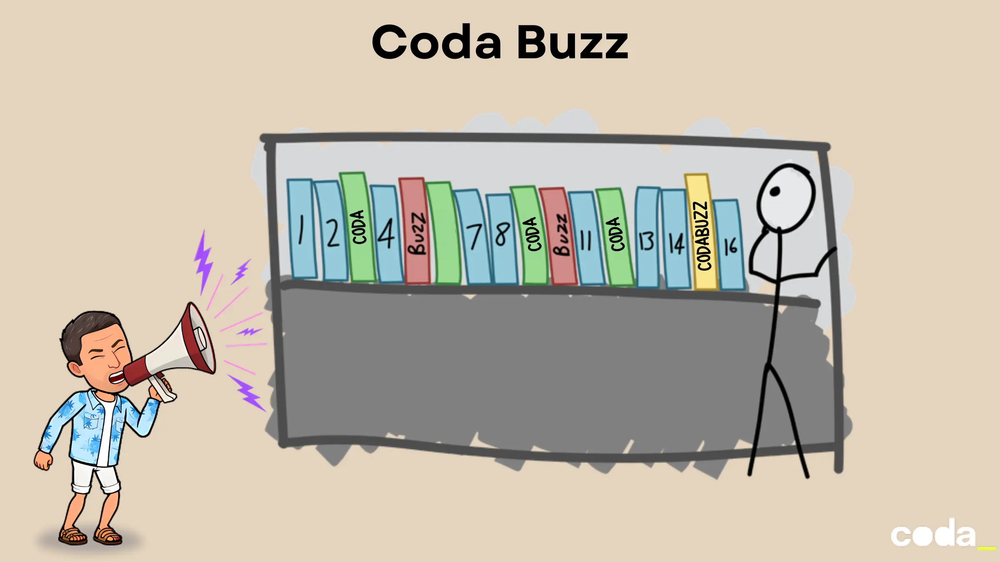

# CodaBuzz

Écrivez une fonction qui, pour un nombre de 1 à 100, retourne ce nombre, sauf :
- Pour les multiples de 3 : retourne `”Coda”`
- Pour les multiples de 5 : retourne `”Buzz”`
- Pour les multiples de 3 **et** de 5 : retourne `”CodaBuzz”`

> Avant de coder, construire un **Example Mapping**.

## Trop facile ?
- Supprimez les `if` de votre code
- Paramétrisez le code, implémentez cette méthode :
    - int limit : 100
    - int fizz : 3
    - int buzz : 5
- Étendez votre programme
    - Les multiples de 7 sont `Whizz`
    - Les multiples de 11 sont `Bang`
- Utilisez une `Higher Order Function`
- Ajoutez une sortie vocale
- Écrivez-le dans un langage inconnu (toujours en utilisant le TDD)
- ...

Un exemple d'implémentation [ici](https://github.com/advent-of-craft/2024/blob/main/docs/day02/solution/step-by-step.md).
