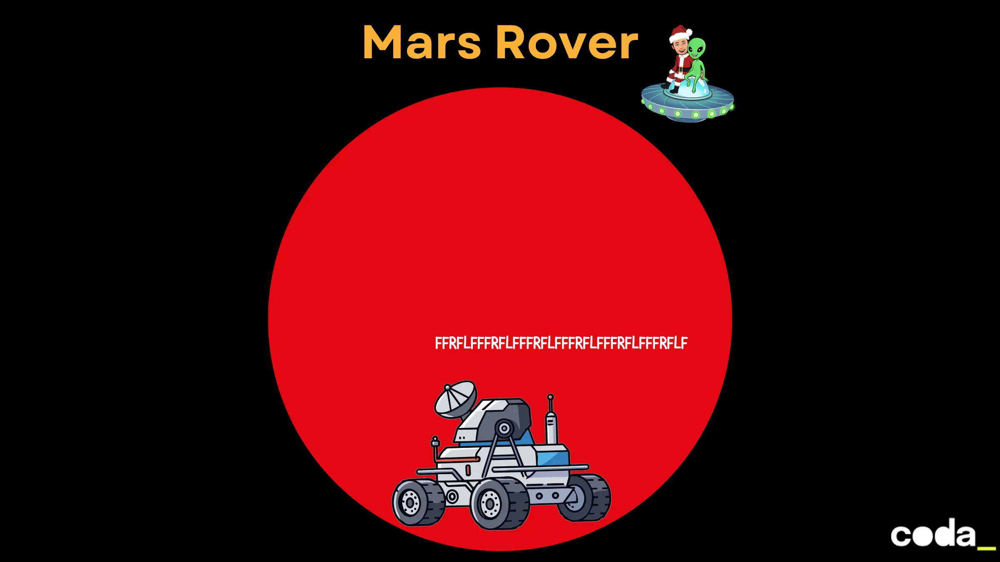

# Mars Rover

Vous développez un logiciel pour contrôler **un rover** sur Mars. Le rover se déplace sur un plateau rectangulaire et exécute une série de commandes pour explorer la planète.



## Objectif

Écrire un programme qui permet de :
1. **Positionner un rover** sur un plateau martien
2. **Envoyer une série de commandes** pour le déplacer
3. **Afficher la position finale** du rover après exécution des commandes

## Spécifications

**Le plateau** — grille rectangulaire N x M, coordonnées de `(0,0)` en bas à gauche jusqu'à `(N,M)` en haut à droite.

**Le rover** — défini par sa position `(x, y)` et son orientation parmi `N`, `S`, `E`, `W`.
Exemple : `1 2 N` (x=1, y=2, face au Nord).

**Les commandes** :

| Commande | Effet                   |
|----------|-------------------------|
| `F`      | Avancer d'une case      |
| `R`      | Tourner à droite (90°)  |
| `L`      | Tourner à gauche (90°)  |

**Grille toroïdale** — le plateau n'a pas de bords : dépasser un bord renvoie automatiquement au bord opposé.

## Exemple

```
Plateau  : 5 5
Position : 1 2 N
Commandes: FFRFLF
Résultat : 1 4 W
```

## Par où commencer ?

Avant de coder, construire un **Example Mapping** :
- Quels sont les cas simples ? (avancer face au Nord, tourner à droite depuis l'Est…)
- Quels sont les cas limites ? (dépasser un bord, enchaîner plusieurs rotations…)
- Quelle est la plus petite tranche de valeur à implémenter en premier ?

> Commencez par `F` seul, sur une grille sans bords, avec le rover face au Nord. Un baby step à la fois.
