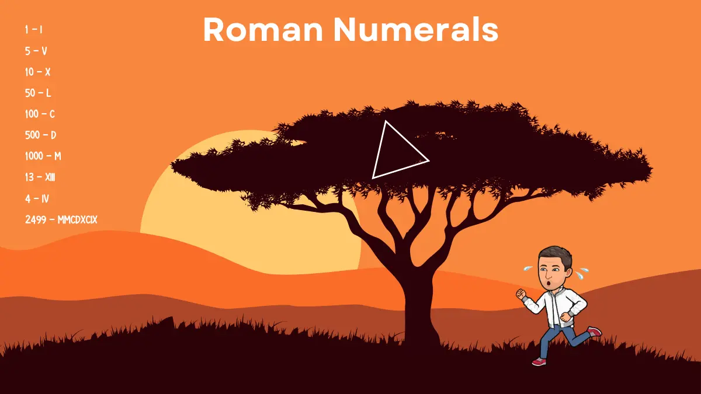

# Roman Numerals
Implémentez un convertisseur de nombres romains.
Le système doit pouvoir prendre en charge des nombres décimaux allant jusqu'à `3999` et les convertir en leur équivalent romain.



```text
Exemples :
1 - I
5 - V
10 - X
50 - L
100 - C
500 - D
1000 - M
4 - IV
13 - XIII
2499 - MMCDXCIX
```

Démontrer les points suivants :
- `Fake it until you make it`
- `Triangulation`

Step-by-step disponible [ici](SOLUTION.md).
