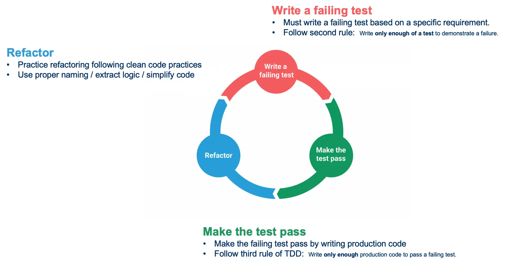
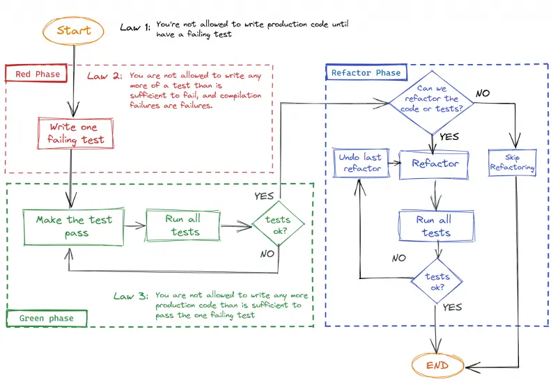
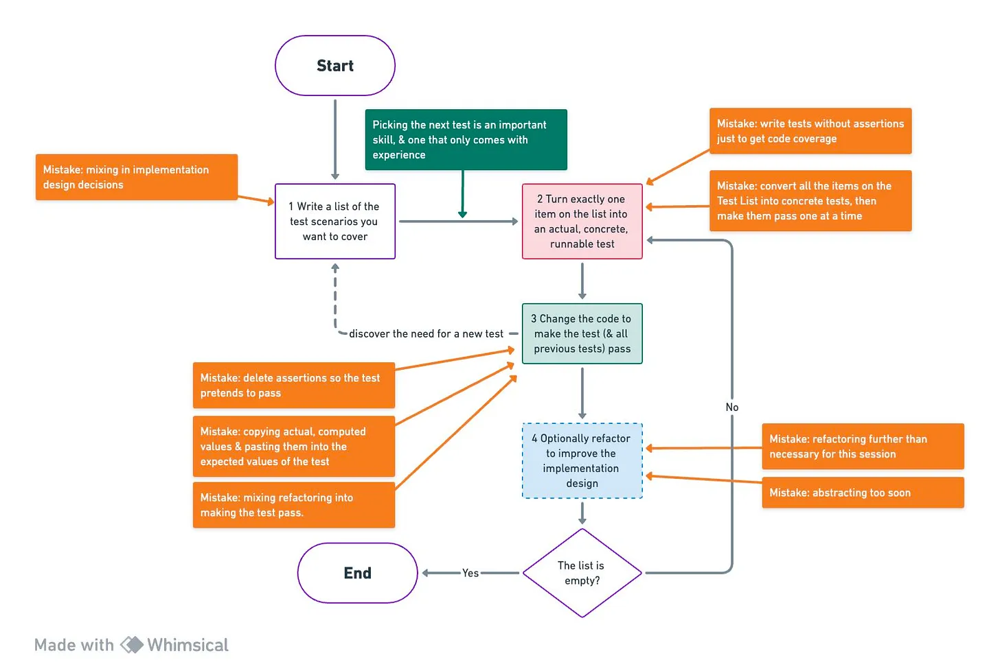
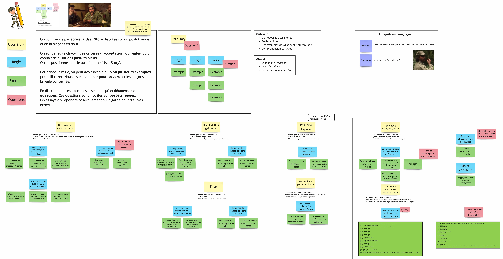
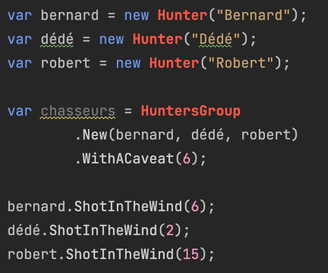
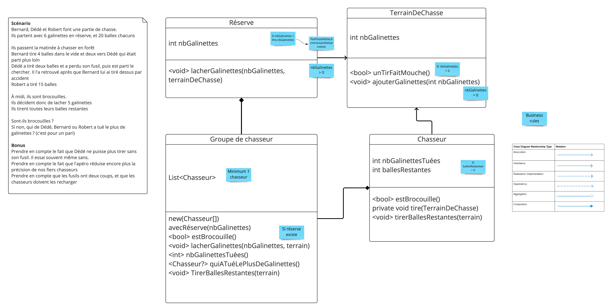
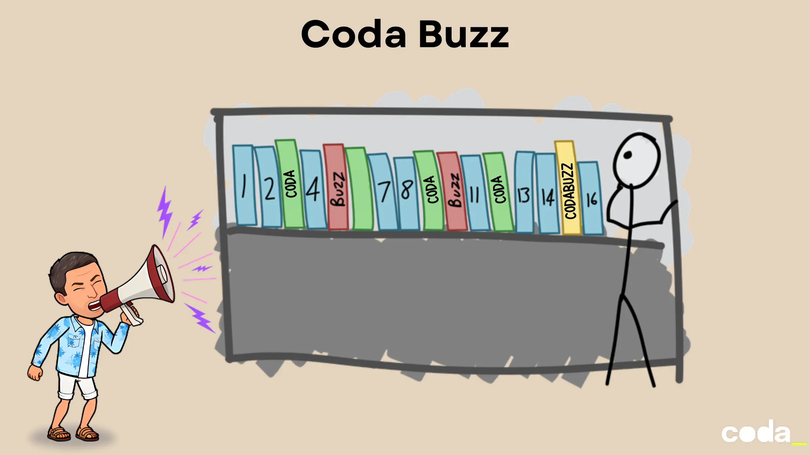
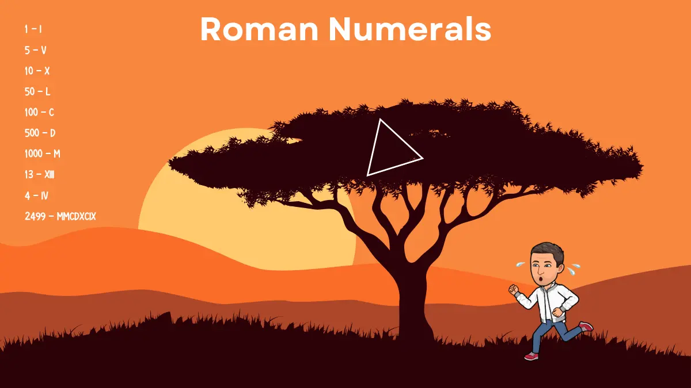
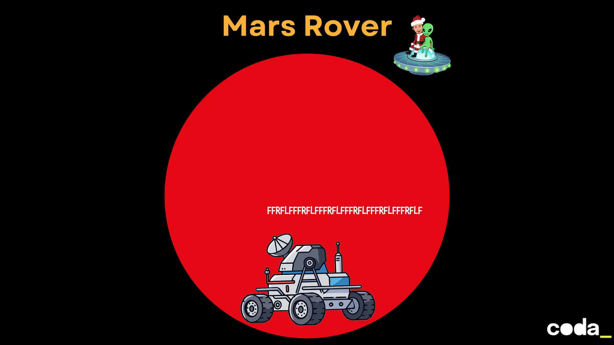

# TDD <mark>Inside-Out</mark>

Laisser les tests guider la conception, un petit pas à la fois.

---

<span class="kicker">Connexion · en binôme · 2'</span>

# Myth Busters TDD

Pour chaque affirmation : **vraie ou fausse** ? Préparez un argument.

| # | Affirmation                                                              |
|---|--------------------------------------------------------------------------|
| 1 | "TDD c'est écrire des tests *après* le code, pour valider que ça marche" |
| 2 | "TDD ralentit le développement : on passe deux fois plus de temps"       |
| 3 | "TDD ne convient qu'aux projets simples ou greenfield"                   |
| 4 | "Si on a 100 % de couverture, on fait du TDD"                            |
| 5 | "TDD améliore la conception du code, pas seulement sa qualité"           |
| 6 | "On ne peut pas faire du TDD sur du code legacy"                         |
| 7 | "TDD c'est écrire *tous* les tests avant de coder l'implémentation"      |

> Mise en commun : chaque binôme défend sa position, puis on démystifie ensemble.

---
class: dense
---

<span class="kicker">Myth Busters · correction</span>

# Démystifions

| # | Verdict | Explication                                                                                                                              |
|---|---------|------------------------------------------------------------------------------------------------------------------------------------------|
| 1 | ❌ Faux | C'est l'inverse : le test est écrit **avant** le code. Il ne valide pas a posteriori, il **guide la conception**.                         |
| 2 | ❌ Faux | Des études (Microsoft, IBM) montrent 40 à 90 % de bugs en moins, ce qui compense largement le surcoût initial.                           |
| 3 | ❌ Faux | Sur les projets complexes ou long terme, c'est là qu'il apporte le plus : le filet de tests permet de refactorer sans crainte.           |
| 4 | ❌ Faux | La couverture mesure les lignes exécutées, pas l'intention. TDD est une **pratique de développement**, pas une métrique.                  |
| 5 | ✅ Vrai | Écrire le test en premier force à penser l'API avant l'implémentation : code plus simple, plus découplé, plus testable.                   |
| 6 | ❌ Faux | Tests de caractérisation, Sprout Method/Class, Golden Master… Le TDD devient un outil de sécurisation progressive.                       |
| 7 | ❌ Faux | **Un test à la fois** : Red → Green → Refactor. Confusion fréquente avec d'autres approches test-first.                                  |

---

<span class="kicker">Concepts</span>

# Qu'est-ce que le Test-Driven Development ?

Une technique née d'un ensemble de convictions sur le code :

- La **simplicité** : l'art de maximiser la quantité de travail *non* effectué
- L'**évidence et la clarté** sont plus vertueuses que l'astuce
- Écrire du code **sans encombrement** est une composante clé du succès

Une méthodologie issue de l'Extreme Programming (XP), développée par `Kent Beck` sur le projet C3.

> "Test-Driven Development is a way of managing fear during programming." Kent Beck

---

<span class="kicker">Concepts</span>

# Le TDD ne porte pas sur les tests

<div class="cols">
<div>

### Concevoir et structurer le code

Les tests sont un moyen, notre **filet de sécurité**, pas l'objectif. Il s'agit de :

- Améliorer la **conception et la structure** du code
- Pouvoir **refactorer en toute sécurité**

### Confiance accrue

- Chaque nouveau test sollicite le système de façons nouvelles
- La suite de tests protège contre les régressions
- Un **retour rapide** permanent sur l'état du système

</div>
<div v-click>

### Un biais vers la simplicité

TDD force à construire la chose la plus simple qui fonctionne :

- Ne pas écrire plus de code que nécessaire (**YAGNI**)
- Résister à la complexité artificielle

Mais ce n'est pas une baguette magique : il ne réduit pas nécessairement le temps de développement, le nombre de lignes ou le nombre de défauts.

</div>
</div>

---

<span class="kicker">Concepts</span>

# Les briques du TDD

<div class="cols">
<div>

Une approche **scientifique** : écrire une hypothèse, lancer l'expérience, observer, essayer autre chose, recommencer.

| Phase           | Description                                                                                       |
|-----------------|---------------------------------------------------------------------------------------------------|
| 🔴&nbsp;**Red**     | Écrire un test qui échoue (les erreurs de compilation comptent) et vérifier l'échec               |
| 🟢&nbsp;**Green**   | Écrire **juste assez** de code pour passer au vert : hardcoder, dupliquer, copier-coller, vite     |
| 🔵&nbsp;**Refactor**| Supprimer les code smells (duplication, valeurs en dur...). Si un test casse : retour au vert d'abord |

</div>
<div>



</div>
</div>

---

<span class="kicker">Concepts</span>

# Les 3 règles d'Uncle Bob

<div class="cols">
<div>

1. N'écrire du code de production **que** pour faire passer un test unitaire en échec
2. N'écrire d'un test unitaire **que** ce qui suffit pour échouer (les erreurs de compilation sont des échecs)
3. N'écrire du code de production **que** ce qui est nécessaire pour faire passer le seul test en échec

</div>
<div>



</div>
</div>

---

<span class="kicker">Concepts</span>

# Baby Steps

Avancer par **incréments minuscules**, en restant le plus souvent possible au vert. Chaque pas doit être si petit qu'il est **impossible de se perdre**.

<div class="cols">
<div>

| Grosse étape                      | Baby step                                    |
|-----------------------------------|----------------------------------------------|
| On est rouge longtemps            | On revient au vert rapidement                |
| Plusieurs changements accumulés   | Un seul changement = cause d'échec évidente  |
| Refactoring risqué                | Refactoring sûr sur base stable              |
| Difficile d'annuler               | `git checkout` ou `Ctrl+Z` suffit            |

</div>
<div v-click>

- Commencer par le cas le plus simple (souvent trivial ou nul)
- Résister à l'envie de "tout faire en une fois"
- Test rouge trop complexe ? Le découper en un test plus petit
- Hardcoder en Green si nécessaire : la généralisation vient au Refactor ou au test suivant

> "Make it work, make it right, make it fast." Kent Beck

</div>
</div>

---

<span class="kicker">Concepts</span>

# Pair Programming et Canon TDD

<div class="cols">
<div>

### Ping-Pong

Changer de rôle à **chaque nouveau test en rouge** : l'un écrit le test rouge, l'autre écrit le code vert et refactore, puis les rôles s'inversent.

### Canon TDD : partir des exemples

On commence par une **liste de tests** (des exemples), puis on en prend un à la fois.

</div>
<div>



</div>
</div>

---

<span class="kicker">Concepts</span>

# Example Mapping

<div class="cols">
<div>

Une technique collaborative pour clarifier les critères d'acceptation d'une User Story **avant** de coder.

1. **Présenter** : un expert métier introduit la story avec des exemples concrets
2. **Construire** : l'équipe pose des questions, identifie règles et cas limites
3. **Formaliser** : les exemples peuvent s'écrire en Gherkin (Given / When / Then)

- Laisser un temps de réflexion individuelle avant la discussion
- Capturer l'**Ubiquitous Language** : notez et définissez chaque ambiguïté de vocabulaire
- S'arrêter quand le périmètre est clair, ou quand le temps est écoulé

> Le résultat n'est pas un document, c'est une **compréhension partagée**.

</div>
<div>



</div>
</div>

---

<span class="kicker">Concepts</span>

# Generate Code From Usage

<div class="cols">
<div>

Écrire d'abord l'appel (le test), **puis** laisser l'IDE générer la structure.

1. Écrire le test comme si le code existait déjà
2. L'IDE souligne les identifiants manquants en rouge
3. `Alt+Enter` / `⌥⏎` pour générer une classe, une méthode, une propriété, un type
4. Passer à l'erreur suivante et recommencer

- Garde le **flux de pensée** : on reste dans l'intention
- Garantit une **API orientée usage**
- Parfaitement **aligné avec TDD** : Red d'abord, génération ensuite

</div>
<div>



</div>
</div>

---

<span class="kicker">Pratique concrète · en binôme</span>

# Une partie de chasse du Bouchonnois

<div class="cols">
<div>


Implémentez le scénario et les classes **en générant le code depuis son usage**. Notez les raccourcis découverts.

</div>
<div>



</div>
</div>

<Exercise path="11.tdd/exercices/bouchonnois" />

---

<span class="kicker">Pratique concrète · code katas</span>

# CodaBuzz

<div class="cols cols--wide-left">
<div>

Pour un nombre de 1 à 100, retourner ce nombre, sauf :

- Multiples de 3 : `"Coda"`
- Multiples de 5 : `"Buzz"`
- Multiples de 3 **et** de 5 : `"CodaBuzz"`

> Avant de coder, construire un **Example Mapping**.

### Trop facile ?

Supprimez les `if`, paramétrez (`limit`, `fizz`, `buzz`), ajoutez `Whizz` (7) et `Bang` (11), utilisez une `Higher Order Function`...

</div>
<div>



</div>
</div>

<Exercise path="11.tdd/exercices/codabuzz" />

---

<span class="kicker">Pratique concrète · code katas</span>

# Roman Numerals

<div class="cols cols--wide-left">
<div>

Convertir des nombres décimaux jusqu'à `3999` en leur équivalent romain.

```text
1 - I        100 - C       4 - IV
5 - V        500 - D       13 - XIII
10 - X       1000 - M      2499 - MMCDXCIX
50 - L
```

Démontrer :

- `Fake it until you make it`
- `Triangulation`

</div>
<div>



</div>
</div>

<Exercise path="11.tdd/exercices/roman-numerals" />

---

<span class="kicker">Pratique concrète · code katas</span>

# Mars Rover

<div class="cols cols--wide-left">
<div>

Un rover se déplace sur un plateau rectangulaire **toroïdal** (dépasser un bord renvoie au bord opposé).

- Position `(x, y)` et orientation `N`, `S`, `E`, `W`
- Commandes : `F` avancer, `R` tourner à droite, `L` tourner à gauche

```text
Plateau  : 5 5
Position : 1 2 N
Commandes: FFRFLF
Résultat : 1 4 W
```

> Commencez par `F` seul, sur une grille sans bords, face au Nord. Un baby step à la fois.

</div>
<div>



</div>
</div>

<Exercise path="11.tdd/exercices/mars-rover" />

---

<span class="kicker">Concepts</span>

# TDD sur du code existant

Le code legacy est rarement testable tel quel : dépendances cachées, classes omniscientes, couplage fort. On **sécurise d'abord**, puis on refactore, puis on avance en TDD.

```text
1. Caractériser  →  comprendre et figer le comportement actuel
2. Sécuriser     →  rendre le code testable (sans changer le comportement)
3. Avancer       →  reprendre le cycle Red → Green → Refactor
```

| Technique                    | Quand l'utiliser                                                        |
|------------------------------|-------------------------------------------------------------------------|
| **Tests de caractérisation** | Avant toute modification : figer le comportement observé (même buggé)   |
| **Golden Master**            | Sorties volumineuses (HTML, CSV, JSON) : comparer avant / après         |
| **Sprout Method / Class**    | Ajouter une fonctionnalité sans toucher au code existant                |
| **Seam (couture)**           | Un point où injecter un comportement de test sans modifier le code      |

> Ne jamais modifier du code non couvert par des tests.

---

<span class="kicker">Conclusions</span>

# Ce qu'on retient

<div class="cols">
<div>

- Le TDD n'est pas une technique de test, c'est une **technique de design**
- Commencer par les **exemples** clarifie le comportement avant d'écrire une ligne
- L'**Example Mapping** structure cette réflexion collective
- Écrire l'usage d'abord maintient le flux et oriente l'API
- Un cycle court est un filet de sécurité permanent

</div>
<div v-click>

### Le test comme documentation vivante

```typescript
// ❌ Test opaque
it('test fizzBuzz', () => {
  expect(fizzBuzz(15)).toBe('FizzBuzz')
})

// ✅ Test documenté
it('retourne FizzBuzz pour les multiples de 3 et de 5', () => {
  const nombreMultipleDe3Et5 = 15
  const resultat = fizzBuzz(nombreMultipleDe3Et5)
  expect(resultat).toBe('FizzBuzz')
})
```

</div>
</div>

---

<span class="kicker">Conclusions · seul, puis en binôme</span>

# Et demain ?

- Qu'est-ce qui change dans votre façon de **commencer une feature** demain matin ?
- Dans quel contexte pourriez-vous appliquer l'`Example Mapping` ?
- Quel **raccourci IDE** allez-vous adopter cette semaine ?

### Ressources

- [Concepts derrière T.D.D](https://github.com/les-tontons-crafters/xtrem-tdd-money-kata/blob/main/docs/concepts.md) · [Canon T.D.D](https://tidyfirst.substack.com/p/canon-tdd)
- [Example Mapping](https://xtrem-tdd.netlify.app/flavours/practices/example-mapping/) · [Generate Code From Usage](https://xtrem-tdd.netlify.app/flavours/design/generate-code-from-usage/)
- [Test-Driven Development by Example](https://www.amazon.com/Test-Driven-Development-Kent-Beck/dp/0321146530), Kent Beck
- [Software Craft : TDD, Clean Code et autres pratiques essentielles](https://www.dunod.com/sciences-techniques/software-craft-tdd-clean-code-et-autres-pratiques-essentielles-0)
