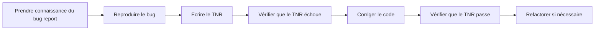

# Corriger <mark>un bug</mark>

Reproduire, verrouiller par un test, puis corriger.

---

<span class="kicker">Connexion · 1' seul, puis en binôme</span>

# Comment réagir ?

> **Ticket Jira, P1, en production depuis 2h**
> _"Le total du panier est incorrect pour certains clients. Plusieurs remboursements déjà demandés."_

**Qu'est-ce que vous faites en premier ?** Écrivez-le sur un post-it, sans vous concerter.

Puis en binôme :

- Avez-vous le même réflexe ?
- Qu'est-ce qui vous a poussé à choisir cette première action ?
- Qu'est-ce qui pourrait mal tourner si vous commencez par là ?

---
layout: statement
---

# Un bug, c'est un <mark>test manquant</mark>

Avant de toucher au code, on écrit le test qui aurait dû exister, et on le regarde échouer.

---

<span class="kicker">Concepts</span>

# Le réflexe face à un bug

Brûler des étapes, c'est risquer de corriger le mauvais problème, ou de le faire revenir.



### Pourquoi commencer par reproduire ?

| Sans reproduction                       | Avec reproduction                           |
|-----------------------------------------|---------------------------------------------|
| On devine la cause                      | On observe la cause                         |
| Le fix peut corriger le mauvais endroit | Le fix cible le vrai problème               |
| Pas de critère de succès                | Le TNR définit "corrigé" de façon objective |

---

<span class="kicker">Concepts</span>

# Le TNR : du TDD appliqué à un bug

<div class="cols">
<div>

Un **test de non-régression** :

1. **Échoue** avant la correction (il reproduit le bug)
2. **Passe** après la correction
3. **Continuera à passer** dans le futur (filet de sécurité)

Il se place au **niveau le plus bas** possible : un test unitaire plutôt qu'un test end-to-end.

> Un bug corrigé sans TNR est un bug en attente de réapparaître.

</div>
<div v-click>

| Phase           | Ce qu'on fait                                                                                   |
|-----------------|-------------------------------------------------------------------------------------------------|
| 🔴&nbsp;**Red**     | Traduire le bug report en **exemple** et écrire le test qui le reproduit                        |
| 🔴&nbsp;**Vérifier**| Le test échoue **pour la bonne raison** : l'assertion, pas une exception ou un problème de setup |
| 🟢&nbsp;**Green**   | La **plus petite correction** qui fait passer le test, sans rien embellir                       |
| 🔵&nbsp;**Refactor**| Nettoyer sur une base verte, le TNR reste dans la suite                                         |
| 🔍&nbsp;**Explorer**| Chercher les **bugs voisins** avec une test list                                                |

> Un test qui passe du premier coup ne reproduit pas le bug : revoyez l'exemple, pas le code.

</div>
</div>

---

<span class="kicker">Démonstration</span>

# Du bug report au test

<div class="cols">
<div>

> **Ticket #812**
> _"Je suis resté 30 minutes pile et la borne m'a demandé 2 €. Le panneau annonce 30 minutes gratuites."_

On extrait l'exemple, avec les **valeurs du ticket** :

```text
Given  un stationnement de 30 minutes
When   on calcule le montant
Then   le montant est de 0 €
```

</div>
<div v-click>

```java
@Test
void parking_for_exactly_30_minutes_is_free() {
    assertThat(ParkingFee.compute(Duration.ofMinutes(30)))
        .isZero();
}
```

```text
expected: 0
 but was: 2
```

La correction minimale :

```java
if (minutes < FREE_MINUTES)   // avant
if (minutes <= FREE_MINUTES)  // après
```

</div>
</div>

---

<span class="kicker">Concepts</span>

# Un bug n'arrive jamais seul

<div class="cols">
<div>

Un `<` au lieu d'un `<=` est un bug de **valeur limite**. Les autres limites méritent la même attention.

Pour chaque règle, on teste **juste avant**, **pile dessus** et **juste après** :

| Durée   | Règle testée       | Attendu |
|---------|--------------------|---------|
| 30 min  | gratuité           | 0 €     |
| 31 min  | première heure     | 2 €     |
| 61 min  | heure entamée      | 4 €     |
| 7 h 01  | plafond journalier | 15 €    |
| 24 h 10 | deuxième journée   | 17 € ?  |
| 48 h    | deux journées      | 30 €    |

</div>
<div v-click>

### Ce que la test list révèle

- Chaque cas qui échoue devient un **nouveau cycle** Red → Green → Refactor
- Un cas ambigu (les 30 minutes gratuites s'appliquent-elles chaque jour ?) est une **question pour le métier**, pas une décision du développeur
- Le débrief compte autant que le fix : **pourquoi** ce test n'existait-il pas ?

> Corriger le symptôme ferme le ticket. Chercher les voisins évite les trois suivants.

</div>
</div>

---

<span class="kicker">Pratique concrète · en binôme</span>

# Le parking qui facture trop

<div class="cols">
<div>

### Règles de tarification

- Les **30 premières minutes** sont **gratuites**
- Au-delà, chaque **heure entamée** coûte **2 €**
- Plafond de **15 € par tranche de 24 heures**

> **Ticket #812** : 30 minutes pile, facturées 2 €.

</div>
<div v-click>

### Votre mission

1. 🔴 Reproduisez le ticket avec **un seul** test et voyez-le échouer
2. 🟢 Corrigez avec la plus petite modification possible, puis 🔵 refactorez
3. 🔍 Écrivez une test list sur les **valeurs limites** de chaque règle
4. Traitez chaque cas qui échoue avec un nouveau cycle Red → Green → Refactor
5. Notez les **questions pour le métier** au lieu de deviner

</div>
</div>

<Exercise path="13.fix-a-bug/exercices/parking" />

---

<span class="kicker">Pratique concrète · en binôme</span>

# Coda Social : 280 caractères, pas un de plus

<div class="cols">
<div>

> **Ticket #1337** : _"Mon message fait 280 caractères pile. Le compteur affiche 0 caractère restant, mais le bouton Publier reste grisé."_

### Règles métier

- Un message fait **au maximum 280 caractères**
- **Publier** est actif si le message n'est pas vide et ne dépasse pas la limite
- Le compteur passe en **orange** à **20 caractères restants ou moins**

</div>
<div v-click>

### Votre mission

1. 🔴 Reproduisez le ticket avec un **test E2E** Playwright, comme l'utilisatrice
2. 🔴 Trouvez la fonction responsable et **descendez** au test unitaire
3. 🟢 Corrigez avec la plus petite modification possible, puis 🔵 refactorez
4. 🔍 Test list sur les **valeurs limites** de chaque règle, en `it.each`
5. Gardez-vous le test E2E ? Argumentez

> Le test E2E dit **que** ça ne marche pas. Le test unitaire dit **où**.

</div>
</div>

<Exercise path="13.fix-a-bug/exercices/post-composer" />

---

<span class="kicker">Ressources</span>

# Pour aller plus loin

- [Test de non-régression](https://fr.wikipedia.org/wiki/Test_de_non-r%C3%A9gression), Wikipedia
- [Working Effectively with Legacy Code](https://www.amazon.com/Working-Effectively-Legacy-Michael-Feathers/dp/0131177052), Michael Feathers
- [The Pragmatic Programmer : Fix the Root Cause](https://pragprog.com/titles/tpp20/the-pragmatic-programmer-20th-anniversary-edition/)
