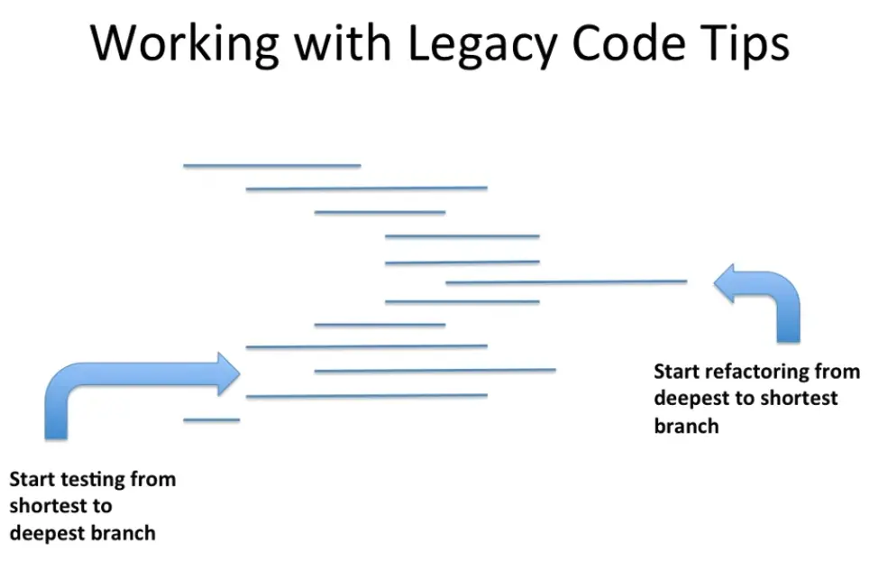
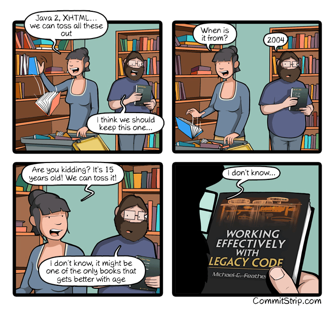
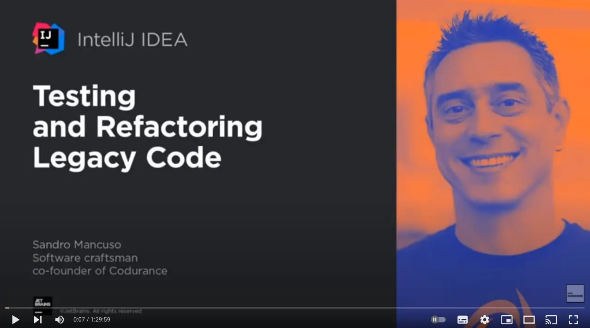

# Refactorer du <mark>code legacy</mark>

Sécuriser d'abord, refactorer ensuite.

---

<span class="kicker">Connexion · en binôme · 2'</span>

# C'est quoi, du code legacy ?

- Pour vous, c'est quoi du **code legacy** ?
- Avez-vous déjà eu **peur** de modifier du code ? Pourquoi ?
- Qu'est-ce qui vous **manquait** pour vous sentir en confiance ?

---
layout: center
---


---

<span class="kicker">Concepts</span>

# Deux définitions

<div class="cols">
<div>

### Michael Feathers

> *"Code legacy, c'est du code sans tests."*
> *Working Effectively with Legacy Code*

La dangerosité ne vient ni de l'âge ni de la complexité, mais de l'**absence de filet de sécurité**. Sans tests, chaque modification est un saut dans le vide.

</div>
<div v-click>

### Adam Tornhill

> *"Le code legacy, c'est du code que personne ne comprend plus, et que tout le monde a peur de toucher."*
> *Your Code as a Crime Scene*

Une dimension **sociale** : les fichiers les plus modifiés, par le plus de monde, sont souvent les plus fragiles. Ce sont les **hotspots**.

</div>
</div>

| Dimension             | Ce qui rend le code dangereux                           |
|-----------------------|---------------------------------------------------------|
| **Technique**         | Pas de tests, dépendances couplées, état global         |
| **Cognitive**         | Personne ne comprend l'intention d'origine              |
| **Organisationnelle** | Tout le monde le modifie, personne n'en est responsable |

---
layout: statement
---

# Vous ne pouvez pas modifier du code <mark>non couvert</mark> par des tests

Seule exception : pour *ajouter* des tests, les **refactorings automatisés** de l'IDE sont autorisés, sans changer le comportement.

---

<span class="kicker">Concepts · sécuriser du code legacy</span>

# Tests de caractérisation et Seams

<div class="cols">
<div>

### 1. Tests de caractérisation

Ils testent ce que le code *fait aujourd'hui*, pas ce qu'il *devrait* faire.

```text
1. Écrire un test qui appelle le code
2. Le laisser échouer pour observer le retour réel
3. Utiliser cette valeur comme valeur attendue
4. Le test détecte toute régression involontaire
```

</div>
<div v-click>

### 2. Les Seams (points de couture)

Le problème est presque toujours un **problème de dépendances** : base de données, serveur tiers, Singleton global, paramètre complexe à instancier.

> **Un Seam est un endroit où l'on peut modifier le comportement d'un programme sans changer le code source.**

```scala
// Production : dépendance dure sur un Singleton
protected def getLoggedUser = UserSession.getLoggedUser()

// Test : on sous-classe et on surcharge
class TripServiceForTest(loggedUser: User) extends TripService {
  override def getLoggedUser: User = loggedUser
}
```

</div>
</div>

---

<span class="kicker">Concepts · sécuriser du code legacy</span>

# Refactorings automatisés, couverture, mutation

<div class="cols" style="grid-template-columns: 1fr 1fr 1fr">
<div>

### 3. Refactorings automatisés

Sur du code non couvert, seuls les refactorings de l'IDE garantissent la préservation du comportement :

- **Extract Method** : isoler une dépendance (créer un Seam)
- **Change Signature** : injecter une dépendance
- **Rename** : clarifier l'intention

</div>
<div v-click>

### 4. La couverture comme pilote

- Les branches non couvertes indiquent les cas de test manquants
- On avance **de la branche la plus courte vers la plus profonde**

</div>
<div v-click>

### 5. Le mutation testing

L'outil injecte des mutations (`==` en `!=`, condition supprimée...) et vérifie que vos tests les détectent.

> Un test qui ne tue pas de mutant ne prouve rien.

</div>
</div>

---

<span class="kicker">Pratique concrète · en binôme</span>

# Trip Service Kata

<div class="cols cols--wide-left">
<div>

```scala
class TripServiceBackup {
  def getTripsByUser(user: User): List[Trip] = {
    var tripList: List[Trip] = List()
    val loggedInUser = UserSession getLoggedUser ()
    var isFriend = false
    if (loggedInUser != null) {
      breakable {
        for (friend <- user.friends()) {
          if (friend == loggedInUser) {
            isFriend = true
            break
          }
        }
      }
      if (isFriend) {
        tripList = TripDAO.findTripsByUser(user)
      }
      tripList
    } else {
      throw new UserNotLoggedInException
    }
  }
}
```

</div>
<div v-click>

Refactorez ce service pour respecter Clean Code / SOLID, **sans jamais modifier du code non couvert**.

- Commencez les **tests** de la branche la plus **courte** à la plus profonde
- Commencez le **refactoring** de la branche la plus **profonde** à la plus courte



</div>
</div>

<Exercise path="14.legacy-code/exercices/trip-service" />

---

<span class="kicker">Trip Service · étapes 1 et 2</span>

# Identifier les smells, écrire un test naïf

<div class="cols">
<div>

- Quels **code smells** voyez-vous ?
- Qu'est-ce qui rend ce code **difficile à tester** ?
- Quelles sont les **dépendances problématiques** ?

<div v-click>

- `UserSession.getLoggedUser()` : Singleton global
- `TripDAO.findTripsByUser(user)` : appel statique, dépendance dure
- Boucle `breakable` : **Feature Envy**, l'amitié appartient à `User`
- `var tripList`, `var isFriend` : état mutable inutile
- `null` check : contrat implicite, absent du type

</div>

</div>
<div v-click>

```scala
class TripServiceSpec extends AnyFlatSpec {
  it should "throw when user is not logged in" in {
    val tripService = new TripServiceBackup()
    // Que se passe-t-il quand on appelle
    // getTripsByUser ?
  }
}
```

> `UserSession.getLoggedUser()` est appelé, et en dehors d'un contexte HTTP, il explose.

</div>
</div>

---

<span class="kicker">Trip Service · étapes 3 et 4</span>

# Créer un Seam, puis sous-classer

<div class="cols">
<div>

**Extract Method** (refactoring automatique), puis `private` → `protected` :

```scala
protected def getLoggedUser: User =
  UserSession.getLoggedUser()

protected def findTripsByUser(user: User): List[Trip] =
  TripDAO.findTripsByUser(user)
```

</div>
<div v-click>

```scala
class TestableTripService(
  loggedUser: User,
  tripsForUser: List[Trip]
) extends TripServiceBackup {
  override protected def getLoggedUser: User = loggedUser
  override protected def findTripsByUser(user: User) =
    tripsForUser
}

it should "throw when no user is logged in" in {
  val tripService = new TestableTripService(null, List())
  assertThrows[UserNotLoggedInException] {
    tripService.getTripsByUser(anyUser)
  }
}
```

</div>
</div>

---

<span class="kicker">Trip Service · étapes 5 et 6</span>

# La couverture comme pilote, des builders pour lire

<div class="cols">
<div>

Lancez la couverture et couvrez les branches manquantes :

```text
Non connecté → UserNotLoggedInException
Connecté, pas ami → liste vide
Connecté, ami → les voyages
```

</div>
<div v-click>

Les setups deviennent vite illisibles...

```scala
val aUserWithTrips = new User()
aUserWithTrips.addTrip(toPortugal)
aUserWithTrips.addTrip(toSpringfield)
aUserWithTrips.addFriend(anotherUser)
aUserWithTrips.addFriend(loggedInUser)
```

... le **Test Data Builder** les rend expressifs :

```scala
UserBuilder.aUser()
  .friendsWith(loggedInUser)
  .withTrips(toPortugal, toSpringfield)
  .build()
```

</div>
</div>

---

<span class="kicker">Trip Service · étape 7</span>

# Feature Envy et Sprout Technique

<div class="cols">
<div>

La logique d'amitié appartient à `User`. Plutôt que de modifier du code legacy, on **pousse le nouveau comportement dans une nouvelle méthode testable**, en TDD.

```scala
"User" should "inform when users are not friends" in {
  val user = UserBuilder.aUser().build()
  val stranger = UserBuilder.aUser().build()
  user.isFriendWith(stranger) mustBe false
}

it should "inform when users are friends" in {
  val loggedUser = UserBuilder.aUser().build()
  val user = UserBuilder.aUser().friendsWith(loggedUser).build()
  user.isFriendWith(loggedUser) mustBe true
}
```

</div>
<div v-click>

`TripService` se simplifie :

```scala
if (user.isFriendWith(loggedInUser)) findTripsByUser(user)
else emptyTrips
```

> La Sprout Technique permet d'ajouter du comportement propre sans contaminer le code legacy existant. [Nicolas Carlo](https://understandlegacycode.com/blog/key-points-of-working-effectively-with-legacy-code/#identify-seams-to-break-your-code-dependencies)

</div>
</div>

---

<span class="kicker">Trip Service · étapes 8, 9 et bonus</span>

# Contrats explicites et injection

<div class="cols">
<div>

Remplacer le `throw` implicite par un type explicite :

```scala
def getTripsByUser(user: User): Try[List[Trip]] =
  checkUser(getLoggedUser) { loggedUser =>
    if (user.isFriendWith(loggedUser)) findTripsByUser(user)
    else emptyTrips
  }
```

Puis **Change Signature** : `loggedUser` en paramètre, `TripDAO` dans le constructeur.

```scala
class TripService(val tripDAO: TripDAO) {
  def getFriendTrips(user: User, loggedUser: User)
    : Try[List[Trip]] = ...
}
```

</div>
<div v-click>

### [Bonus] Mutation testing

Validez vos tests avec **Stryker** ou **PiTest**. Mutants à tuer :

- Supprimer la vérification `loggedInUser == null`
- Inverser la condition `isFriendWith`
- Retourner une liste vide au lieu de `findTripsByUser(user)`

> Si un mutant survit, votre test ne prouve pas ce qu'il prétend prouver.

</div>
</div>

---

<span class="kicker">Conclusions</span>

# Ce qu'on retient

<div class="cols cols--wide-left">
<div>

- Le code legacy, c'est avant tout du **code sans tests**, pas forcément du vieux code
- Les **tests de caractérisation** figent le comportement avant tout refactoring
- Les **Seams** rendent le code testable sans le modifier à la main
- Seuls les **refactorings automatisés** sont autorisés sur du code non couvert
- La **couverture** est un pilote, pas un objectif
- Le **mutation testing** vérifie que vos tests ont du sens

### Et vous ?

- Qu'avez-vous ressenti en découvrant le code ?
- Quelle partie a été la plus difficile à tester ?
- Y a-t-il des zones de votre projet qui ressemblent à ce kata ?

</div>
<div>



</div>
</div>

---
class: dense
---

<span class="kicker">Ressources</span>

# Pour aller plus loin

<div class="cols cols--wide-left">
<div>

- [Step-by-step guide](https://github.com/ythirion/scala-kata-logs/blob/main/TripServiceKata/solution/step-by-step.md)
- [Kata original](https://github.com/sandromancuso/trip-service-kata/), Sandro Mancuso
- [Testing Legacy with Hard-wired Dependencies](https://www.codurance.com/publications/2011/07/16/testing-legacy-hard-wired-dependencies), Sandro Mancuso
- [Understand Legacy Code](https://understandlegacycode.com/blog/key-points-of-working-effectively-with-legacy-code/#identify-seams-to-break-your-code-dependencies), Nicolas Carlo
- [Working Effectively with Legacy Code](https://www.oreilly.com/library/view/working-effectively-with/0131177052/), Michael Feathers
- [Your Code as a Crime Scene](https://pragprog.com/titles/atcrime2/your-code-as-a-crime-scene-second-edition/), Adam Tornhill

</div>
<div>

<a href="https://youtu.be/LSqbXorkyfQ" target="_blank"></a>

</div>
</div>
